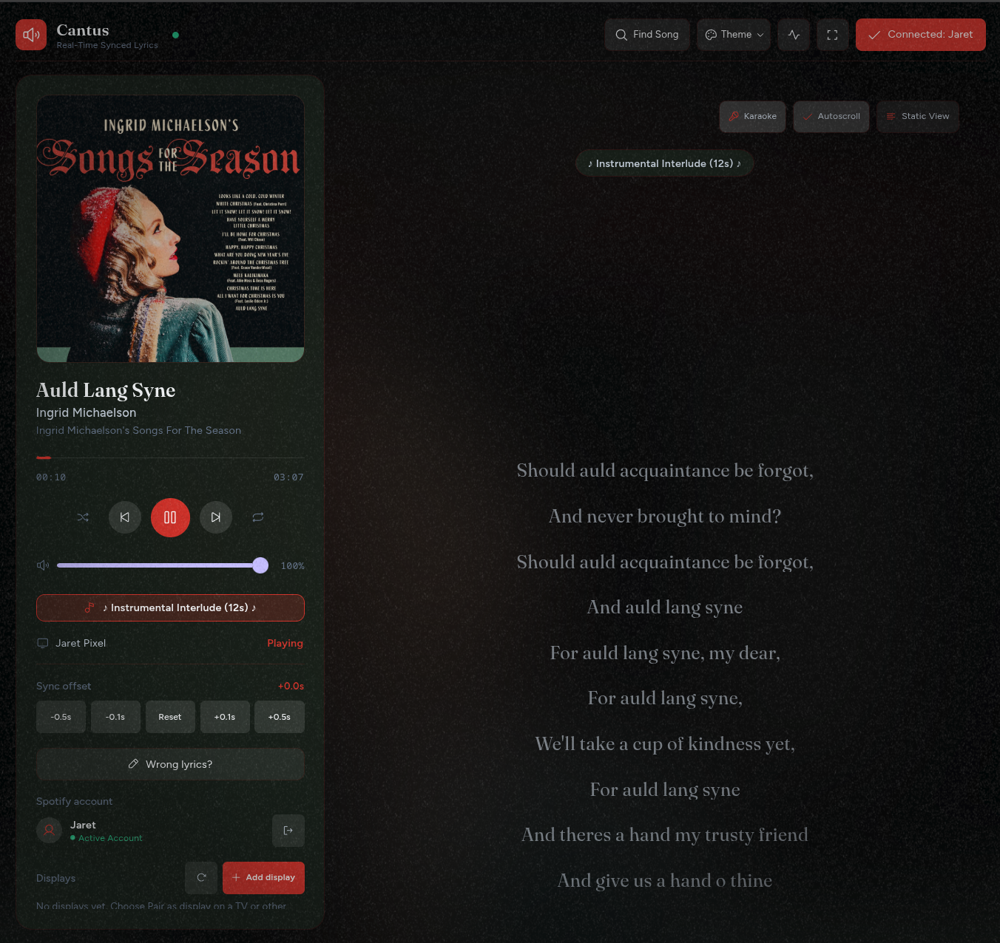
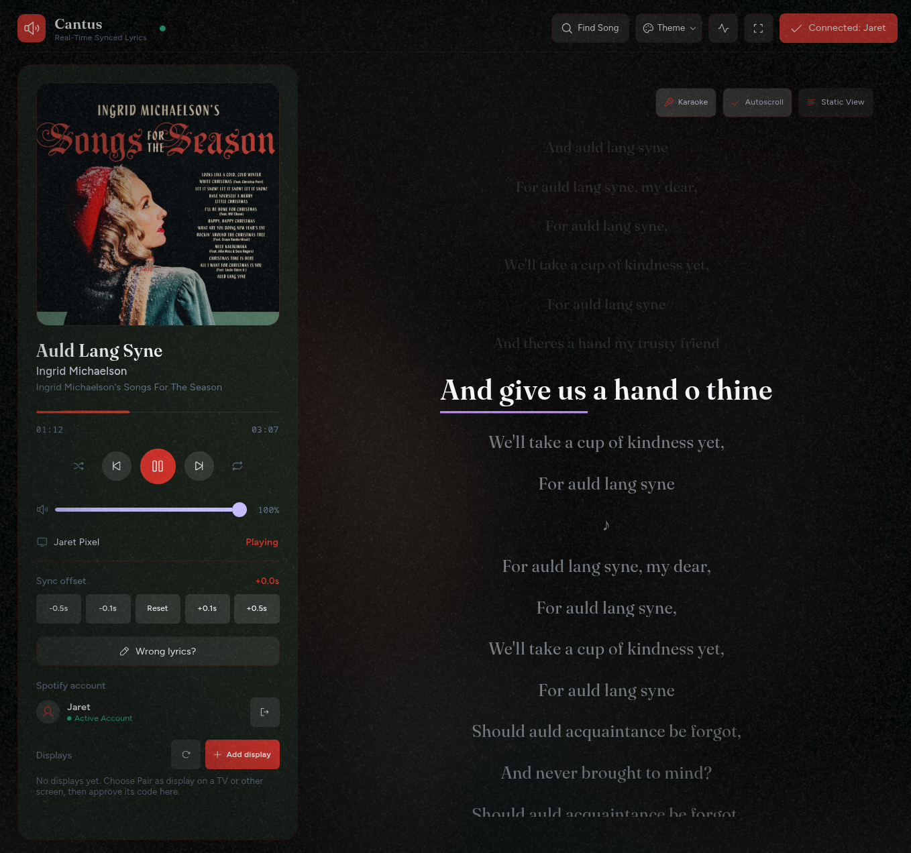
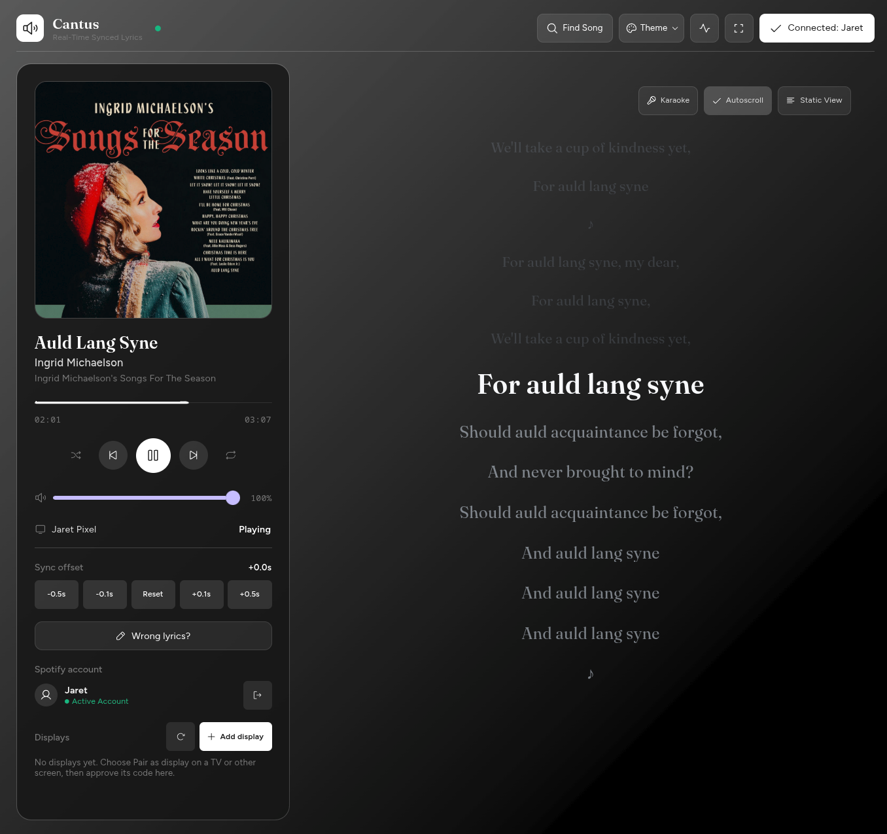
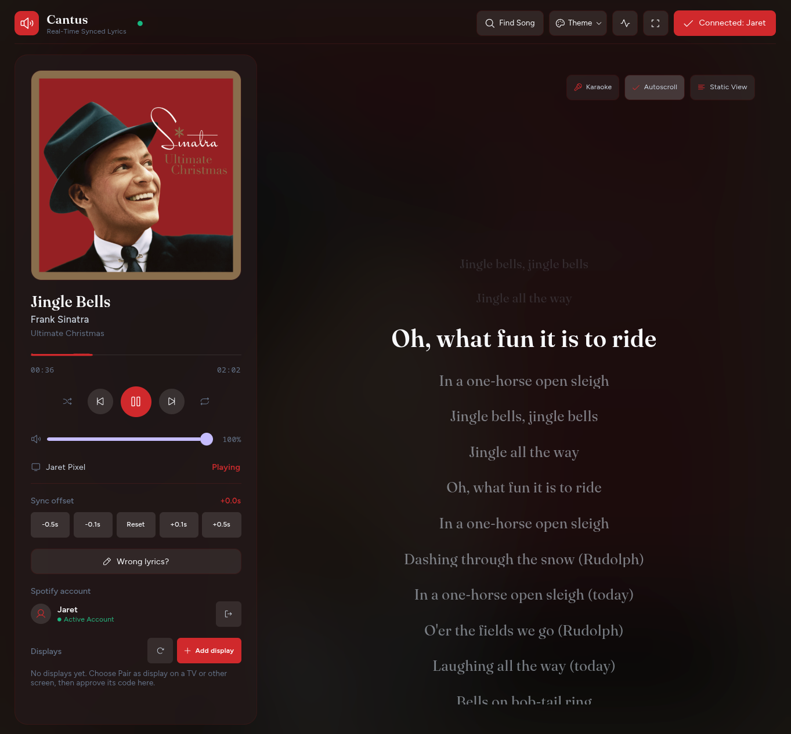
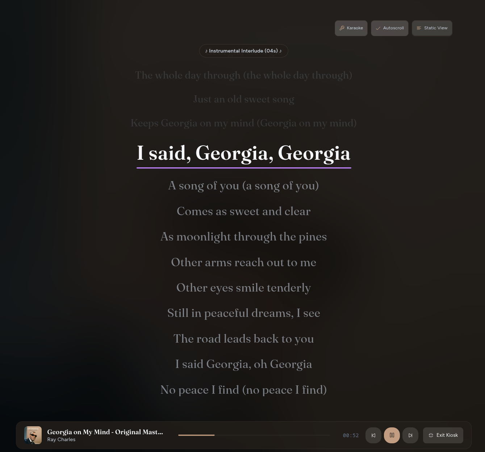

# Cantus

[](https://github.com/jav76/Cantus/actions/workflows/ci.yml)
[](https://cantus.docs.jav26122.net)
[](https://github.com/jav76/Cantus/releases)
[](https://github.com/jav76/Cantus/pkgs/container/cantus)
[](https://dotnet.microsoft.com/)
[](LICENSE)

Cantus is a self-hosted, real-time synchronized lyrics display platform. It follows your Spotify playback and shows synchronized lyrics across web browsers, desktop operating systems, and dedicated kiosk displays.

Full documentation is hosted at [cantus.docs.jav26122.net](https://cantus.docs.jav26122.net).



---

## Features

- **Clock Synchronization**: Four-timestamp NTP-style clock offset estimation and smooth position interpolation filter network jitter.
- **Adaptive Polling**: Dynamically adjusts Spotify polling cadence (4.0s baseline playing, 2.5s/1.2s track-end acceleration, graduated backoff when paused/idle, and 20s background tab throttling) and halts polling when zero viewers are connected to conserve API quota.
- **Multi-Tier Lyrics Resolution**: SQLite cache first, then LRCLIB, then the optional NetEase fallback, with negative caching for tracks no provider has. See [Lyrics Providers](#lyrics-providers).
- **Find a Song by Lyrics**: Type a line you half remember. Cantus fuzzy-searches the lyrics it already has, falls back to NetEase and LRCLIB lyric search within rate limits, and lets you play or queue the best guess on Spotify.
- **Playback Controls**: Play/pause, skip, seek, shuffle, repeat, and volume from any display (Spotify Premium required).
- **Cross-Platform Client**: Uno Platform application supporting WebAssembly (modern web browsers and smart TVs) alongside native Linux, Windows, and macOS desktop targets.
- **Dynamic Theming**: Extracts complementary palettes and ambient gradients from active album artwork in real time, alongside fixed themes.
- **Self-Hosted and Private**: Zero third-party telemetry. User tokens are encrypted at rest using ASP.NET Core Data Protection.

---

## Architecture

The solution follows Clean Architecture principles across five projects:

| Layer | Project | Description |
| :--- | :--- | :--- |
| **Core Domain** | `src/Cantus.Core` | Domain models (`PlaybackState`, `LyricLine`), LRC parser, and service contracts. |
| **Infrastructure** | `src/Cantus.Infrastructure` | Spotify PKCE authentication and player API, LRCLIB and NetEase lyrics providers, SQLite caching, and token encryption. |
| **Server Engine** | `src/Cantus.Server` | ASP.NET Core host, SignalR `PlaybackHub`, adaptive polling monitor, and REST APIs. |
| **Client Presentation** | `src/Cantus.Client` | Uno Platform application targeting WebAssembly and the Skia desktop runtime. |
| **Source Generators** | `src/Cantus.Generators` | Roslyn source generator for compile-time method tracing (`[TraceLog]`). |

---

## Prerequisites

### Containerized Deployment
- Docker Engine 24.0 or later
- Docker Compose v2.0 or later

### Local Development
- .NET 10 SDK (version 10.0.100 or later)
- WebAssembly workload, used to build the web client:
  ```bash
  dotnet workload install wasm-tools
  ```
- A Spotify Developer app (free) for its Client ID

---

## Quickstart with Docker

### 1. Create Compose Configuration

Create a `docker-compose.yml` file:

```yaml
services:
  cantus:
    image: ghcr.io/jav76/cantus:latest
    container_name: cantus
    restart: unless-stopped
    ports:
      - "5000:5000"
    environment:
      - Spotify__ClientId=your_spotify_client_id_here
      - CANTUS_HOST_URL=http://127.0.0.1:5000
      - ASPNETCORE_ENVIRONMENT=Production
    volumes:
      - cantus_data:/app/data

volumes:
  cantus_data:
    name: cantus_data
```

### 2. Start the Service

```bash
docker compose up -d
```

Access the web interface at `http://127.0.0.1:5000` (or your configured `CANTUS_HOST_URL`). Spotify rejects `http://localhost` redirect URIs, so use `127.0.0.1` for local access and HTTPS for any other address. See the [Self-Hosting Guide](https://cantus.docs.jav26122.net/operator-guide/self-hosting/) for remote and reverse-proxy setups.

Standalone server binaries for Linux, macOS, and Windows are also attached to each [release](https://github.com/jav76/Cantus/releases).

---

## Spotify Developer Setup

Cantus needs a registered Spotify Developer app to call the Spotify Web API.

1. Navigate to the [Spotify Developer Dashboard](https://developer.spotify.com/dashboard) and log in.
2. Select **Create App** and specify an application name and description.
3. In **Redirect URIs**, add the callback endpoints for your instance:
   - Local: `http://127.0.0.1:5000/api/auth/spotify/callback` (Spotify does not accept `localhost`)
   - Production: `https://cantus.yourdomain.com/api/auth/spotify/callback`
4. Select **Web API** under the requested APIs.
5. Save the configuration and copy the generated **Client ID** into `Spotify__ClientId`.

Cantus uses the OAuth 2.0 PKCE flow, so no Client Secret is needed. Spotify apps in development mode allow up to 5 users, and the app owner needs Spotify Premium. Details: [Spotify App Setup](https://cantus.docs.jav26122.net/operator-guide/spotify-setup/).

---

## Configuration Reference

Cantus is configured through environment variables or `appsettings.json`. The most common settings:

| Variable | Required | Default | Description |
| :--- | :---: | :---: | :--- |
| `Spotify__ClientId` | Yes | None | 32-character Client ID from your Spotify Developer Dashboard. (`SPOTIFY_CLIENT_ID` is not read.) |
| `CANTUS_HOST_URL` | Recommended | Unset | Public URL used to build the Spotify OAuth callback. When unset, Cantus uses the request's address. |
| `ASPNETCORE_ENVIRONMENT` | No | `Production` | ASP.NET Core environment profile (`Production` or `Development`). |
| `DATA_DIR` | No | `/app/data` if it exists | Parent directory of the Data Protection key ring (`keys/`). The database path is set by `ConnectionStrings__CantusDatabase`. |
| `ConnectionStrings__CantusDatabase` | No | `Data Source=/app/data/cantus.db` (container) | SQLite connection string. |
| `Lrclib__BaseUrl` | No | `https://lrclib.net` | Base endpoint for external LRCLIB lyrics lookups. |
| `Netease__Enabled` | No | `true` | Enables the NetEase lyrics fallback. Set `false` to use LRCLIB only. |
| `CANTUS_LOG_CONFIGURATION` | No | `none` | Log verbosity profile: `none`, `debug`, or `trace`. |
| `SongLookup__ExternalSearchEnabled` | No | `true` | Lets song lookups send lyric fragments to NetEase and LRCLIB. Set `false` to search only the local lyrics library. |
| `PlaybackPoller__ActivePollIntervalMs` | No | `4000` | Baseline Spotify polling cadence (ms) during active playback. |

See the [Configuration Reference](https://cantus.docs.jav26122.net/reference/configuration/) for every option.

### Persistent Data Layout

Mount `/app/data` to persistent storage to preserve user sessions and cached lyrics:
- `/app/data/cantus.db`: SQLite database storing user sessions, paired Displays, track offsets, lyrics overrides, and cached lyrics.
- `/app/data/keys/`: Cryptographic key ring used by ASP.NET Core Data Protection to encrypt tokens at rest. Back it up with the database.

---

## Lyrics Providers

Cantus checks its SQLite cache first, then asks the providers in order:

1. **LRCLIB** ([lrclib.net](https://lrclib.net)): the primary provider, always on.
2. **NetEase Cloud Music**: the fallback. It is asked when LRCLIB has no lyrics or only line-timed ones, and its word-timed lyrics win when it has them. It uses an unofficial API.

To use LRCLIB only, set `Netease__Enabled=false` (or `"Netease": { "Enabled": false }` in `appsettings.json`). See the [configuration reference](https://cantus.docs.jav26122.net/reference/configuration/) for all provider options.

---

## Building and Development

### Solution Build

```bash
git clone https://github.com/jav76/Cantus.git
cd Cantus
dotnet restore Cantus.slnx
dotnet build Cantus.slnx
```

### Running Test Suites

```bash
dotnet test Cantus.slnx
```

### Running the Server Locally

```bash
export Spotify__ClientId=your_spotify_client_id_here
ASPNETCORE_ENVIRONMENT=Development dotnet run --project src/Cantus.Server/Cantus.Server.csproj
```

Then open `http://127.0.0.1:5000`. Without `ASPNETCORE_ENVIRONMENT=Development`, the server runs as Production and stores its database at `/app/data/cantus.db`.

### Running the Desktop Client

```bash
dotnet run --project src/Cantus.Client/Cantus.Client/Cantus.Client.csproj -f net10.0-desktop
```

It connects to `http://127.0.0.1:5000`; add `-- --server-url <address>` to use another server.

### Publishing the WebAssembly Client

```bash
dotnet publish src/Cantus.Client/Cantus.Client/Cantus.Client.csproj -f net10.0-browserwasm -c Release -o ./wasm_dist
```

The site is in `./wasm_dist/wwwroot`. Copy its contents into `src/Cantus.Server/wwwroot` to serve it from a local server.

### Packaging Linux AppImage

```bash
dotnet publish src/Cantus.Client/Cantus.Client/Cantus.Client.csproj -f net10.0-desktop -r linux-x64 -c Release -p:PublishSingleFile=true --self-contained true -o ./publish
./packaging/linux/build-appimage.sh ./publish ./artifacts 1.0.0
```

---

## Usage

1. Open Cantus in a web browser or launch the desktop client.
2. Select **Connect Spotify** to complete the one-time PKCE sign-in.
3. Start playback on any Spotify device (phone, desktop, speaker, or web player).
4. Lyrics scroll automatically in synchronization with active playback.
5. If lyrics run early or late, use the **Sync offset** buttons (±0.1 s / ±0.5 s) for the current track, or <kbd>[</kbd> / <kbd>]</kbd> to change this device's latency compensation by 50 ms. Per-track offsets are stored in the database.
6. Select **Find Song** in the header to look up a song by a lyric line you remember, then play or queue it.

---

## Documentation

Guides, architecture deep dives, and API references are available at:

[https://cantus.docs.jav26122.net](https://cantus.docs.jav26122.net)

- [User Guide](https://cantus.docs.jav26122.net/user-guide/)
- [Operator Guide & Self-Hosting](https://cantus.docs.jav26122.net/operator-guide/self-hosting/)
- [Authentication & Sessions](https://cantus.docs.jav26122.net/architecture/authentication/)
- [NTP Clock Synchronization Architecture](https://cantus.docs.jav26122.net/architecture/ntp-clock-sync/)
- [Adaptive Polling Engine Architecture](https://cantus.docs.jav26122.net/architecture/adaptive-polling/)
- [SignalR PlaybackHub Protocol Reference](https://cantus.docs.jav26122.net/reference/signalr-api/)
- [Contributing Guide](https://cantus.docs.jav26122.net/contributing/) (or see [CONTRIBUTING.md](CONTRIBUTING.md))

---

## Screenshots

| Karaoke Word-Level Sync | Fixed Dark Theme |
| :---: | :---: |
|  |  |

| Dynamic Album-Art Theming | Full-Screen Kiosk Mode |
| :---: | :---: |
|  |  |

---

## Contributing

Community contributions are welcome! See the [Contributing Guide](CONTRIBUTING.md) and the [Development Documentation](https://cantus.docs.jav26122.net/contributing/) for setup, coding standards, and the pull request process.

---

## License

This project is licensed under the terms of the [MIT License](LICENSE).
