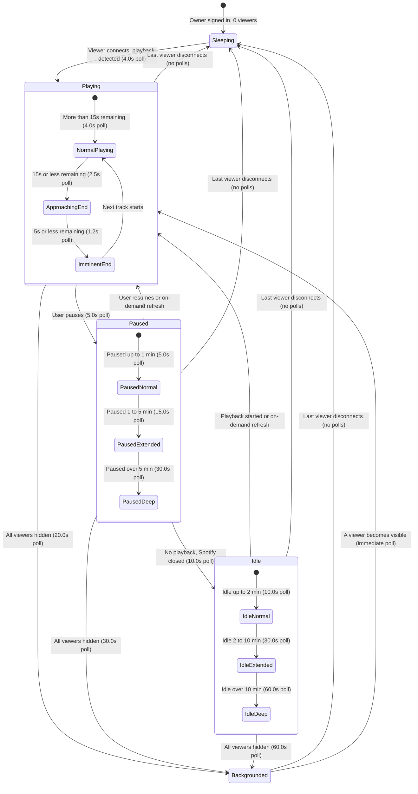

# Adaptive Polling Engine

Spotify does not provide an outgoing WebSocket webhook for user playback changes. To provide responsive real-time lyric tracking while strictly adhering to Spotify's API rate limits, Cantus employs an **Adaptive Polling Engine** (`ActiveUsersPlaybackMonitor`).

The engine dynamically schedules per-user polling intervals based on player activity, remaining track duration, browser tab visibility, and client interaction.

The cadence rules below live in `PollingCadencePolicy`, a pure type with no I/O or timers: given an owner's playback state, visibility and how long they have been paused or idle, or the remaining rate-limit cooldown, it returns the next delay. `ActiveUsersPlaybackMonitor` runs the loop, calls Spotify, tracks when each owner was last paused or idle, and keeps `_nextPollUtc` and `_rateLimitUntilUtc`. `PollingCadencePolicyTests` has one case per cadence in the table.

---

## State Machine Architecture

The background worker evaluates connected SignalR clients and playback snapshots on every tick, scheduling the next poll time independently for each active Spotify user:



---

## Polling Cadence Profiles

| State | Interval | Trigger Condition | Rationale & API Quota Impact |
| :--- | :---: | :--- | :--- |
| **Imminent Track End** | `1,200ms` | Playing & remaining track $\le$ 5,000ms | Catches the track boundary almost instantly so lyrics transition on beat (~0.83 req/s). |
| **Approaching Track End** | `2,500ms` | Playing & remaining track $\le$ 15,000ms | Prepares for track end and detects upcoming fade-outs (0.40 req/s). |
| **Active Playing (Baseline)**| `4,000ms` | Playing & remaining track $>$ 15,000ms | Steady-state tracking; client interpolation smoothly handles lyric scrolling between polls (0.25 req/s). |
| **Paused (Initial)** | `5,000ms` | Paused duration $\le$ 1 minute | Fast detection if the user pauses briefly to speak or answer a call (0.20 req/s). |
| **Paused (Extended)** | `15,000ms` | Paused duration 1 to 5 minutes | Intermediate backoff for short breaks (0.067 req/s). |
| **Paused (Deep)** | `30,000ms` | Paused duration $>$ 5 minutes | Deep conservation when playback is halted long-term (0.033 req/s). |
| **Idle (Initial)** | `10,000ms` | No active playback $\le$ 2 minutes | Detects when user opens Spotify and queues a track (0.10 req/s). |
| **Idle (Extended)** | `30,000ms` | No active playback 2 to 10 minutes | Intermediate backoff when Spotify is closed or idle (0.033 req/s). |
| **Idle (Deep)** | `60,000ms` | No active playback $>$ 10 minutes | Maximum power/quota savings while keeping viewer connections alive (0.017 req/s). |
| **Background Throttled** | `20,000ms` playing, `30,000ms` paused, `60,000ms` idle | Every connection viewing this owner reports hidden | Cuts polling while nobody is looking. Paused and idle use the larger of their deep interval and `BackgroundPollIntervalMs` (0.05 req/s or less). |
| **Sleeping** | `0ms` (Halted) | Zero connected viewers (Session or Display connections) | Complete suspension: **0 req/s** (zero quota consumption). |

---

## Dynamic End-of-Track Acceleration

A major challenge with polling-based Spotify synchronization is catching track transitions without wasting requests during long tracks.

Cantus solves this with **Horizon Acceleration**:
1. When a song has more than 15 seconds remaining, Cantus polls every `4,000ms` (`ActivePollIntervalMs`). The client's phase-locked loop interpolates the position at about 60 FPS between updates (see [NTP Clock Synchronization](ntp-clock-sync.md)).
2. When remaining duration is `15,000ms` or less (`ApproachingEndThresholdMs`), the interval tightens to `2,500ms` (`ApproachingEndPollIntervalMs`).
3. When remaining duration is `5,000ms` or less (`ImminentEndThresholdMs`), the interval tightens to `1,200ms` (`ImminentEndPollIntervalMs`).
4. On the first poll that sees a new track, the server resolves its lyrics and track offset and broadcasts them, and the cadence returns to `4,000ms`.

These tiers apply only while a viewer is visible. Every interval is configurable in the `PlaybackPoller` configuration section (`PlaybackPollerOptions`).

The poller loop waits between 500 ms and 10 seconds between passes, and polls each owner only once that owner's scheduled time has passed. After an unexpected error polling one owner, that owner is retried after `PausedPollIntervalMs` (5 seconds).

---

## Client Visibility Tracking

In the WebAssembly client, `MainPage` checks `WasmInterop.IsDocumentVisible()` (Page Visibility API) every 2 seconds. Desktop heads always report visible.

- When the tab becomes hidden, the client invokes `ReportClientVisibility(false)` on `PlaybackHub`.
- When every connection viewing an owner is hidden, that owner's next poll is scheduled at `BackgroundPollIntervalMs` (`20,000ms` by default), or at the deep paused or idle interval if that is larger.
- When the tab becomes visible again (or is clicked while marked hidden), the client sends `ReportClientVisibility(true)` and `RefreshPlayback()`. The server requests an immediate poll instead of waiting for the scheduled interval.

---

## On-Demand Playback Refresh

Rather than waiting for the next polling cycle when resuming playback:
1. When the tab becomes visible again, the client invokes `RefreshPlayback()` on the SignalR hub.
2. The server calls `IPlaybackSessionRegistry.RequestUserActivity(userId)`, and the poller resets `_nextPollUtc[userId]` so that owner is due immediately.
3. The poller cancels its internal delay via `_wakeCts.Cancel()`, so the loop wakes and polls Spotify right away.

A successful transport command (`SendPlayerCommand`: pause, resume, next, previous) also requests an immediate poll, then two follow-up polls 400 ms and a further 1,100 ms later, since Spotify can return the old state right after a command.

A Display connection goes through `RequestDisplayActivity(userId)` instead, which forwards at most one refresh per owner every 5 seconds (`DISPLAY_ACTIVITY_MIN_INTERVAL_MS`). A view-only screen on shared hardware cannot drive the owner's Spotify quota toward a server-wide 429. Owner Session refreshes are not throttled.

---

## Rate Limit Backoff (HTTP 429) & Error Handling

The back-off is shared: `SpotifyRateLimitGate` (a singleton) holds one pause for every Spotify caller, namely the poller, transport commands from the hub (pause, seek, volume, ...), song lookup track search, and play or queue.

If Spotify responds with `APITooManyRequestsException` (HTTP 429) to any of them:
1. The caller reports `RetryAfter` from the exception to the gate (defaulting to 60 seconds if it is not set). A shorter report never ends an active pause early.
2. The poller skips its Spotify calls for every owner until the pause expires. Song lookup search, play and queue check the gate first and answer `rateLimited` without calling Spotify. Hub transport commands are still sent; a rejected one reports `Failed`.
3. Sends runtime diagnostics to each polled owner's viewers via `ReceiveDiagnostics`, repeated on each loop pass (at most every 10 seconds) while the cooldown lasts:
   ```json
   {
     "pollerStatus": "Rate Limited (00:45)",
     "activePollIntervalMs": 10000
   }
   ```
4. The client shows the status text (for example `Rate Limited (00:45)`) in the header bar and the diagnostics HUD.
5. Polling resumes automatically once the retry window elapses.

The same handling applies when the 429 arrives during a token refresh.

A 429 on a transport command therefore pauses the poller too, where before it only failed that command.

---

## Zero-Viewer Sleep Optimization

When you close the browser tab or turn off your kiosk display:
1. The client disconnects or changes its subscription in SignalR.
2. `PlaybackSessionRegistry` removes the connection. The poller only polls owners with at least one subscribed connection (`GetActiveUserIdsWithConnectedClients`).
3. An owner with no connections drops out of that set, and the poller discards their schedule and backoff state. With no connections at all, the loop just checks once a second for a new one.
4. When a viewer connects or subscribes again, the poller wakes immediately via `OnClientsConnected` (first connection on the server) or `OnSessionsChanged` (a subscription changed).

A connection holding a Display token counts as a viewer of its owner, the same as a signed-in tab. An unattended paired Display keeps polling alive on its own, so its lyrics keep moving with no owner device open.

---

## Token Renewal Coordination

The adaptive poller supervises Spotify access token expiration:
- Spotify access tokens expire after the token response's `ExpiresIn` (60 minutes).
- `SpotifyAuthService.GetSessionForUserAsync` refreshes a token that expires within 2 minutes (`TOKEN_REFRESH_WINDOW_MINUTES`) before the poll uses it.
- If a playback call still returns `401 Unauthorized`, the poller calls `SpotifyAuthService.RefreshTokenAsync`, which exchanges the encrypted refresh token stored in SQLite for a new access token, and retries the call once.
- A 429 during refresh starts the rate-limit cooldown above. Any other refresh failure is logged as an error and the owner is retried on the next scheduled poll, without dropping client connections.

