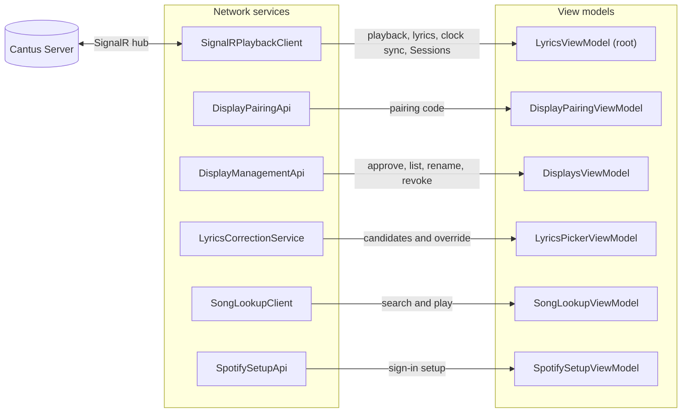
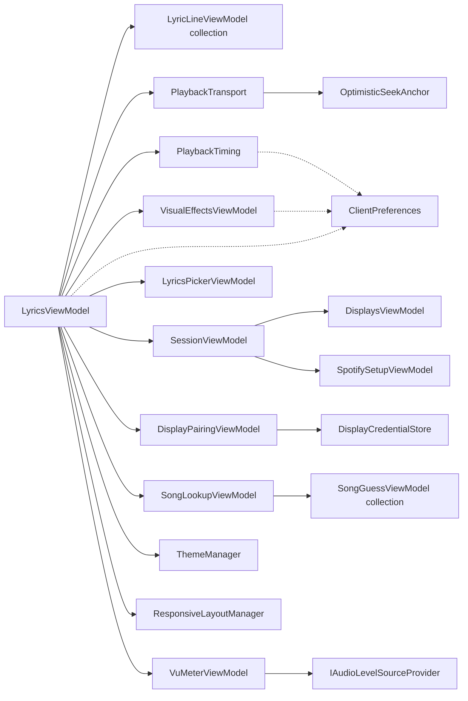
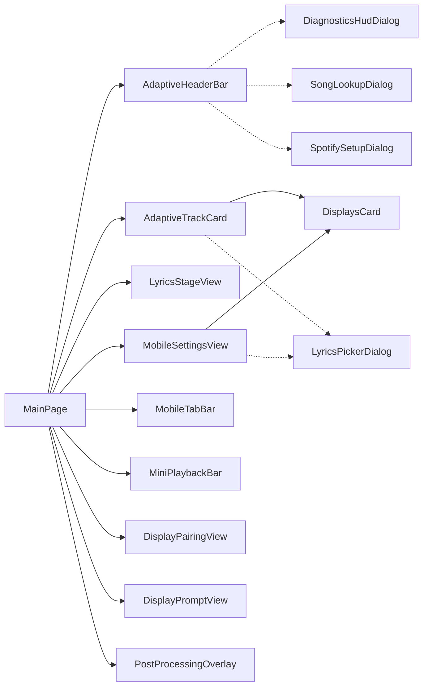

# Client & Uno Platform Architecture

The Cantus client is built with **Uno Platform**, so one C# and XAML codebase runs on Linux, Windows and macOS (Skia desktop) and in web browsers (WebAssembly).

---

## Client MVVM Pattern

The client keeps network code, view models and views apart. Three small diagrams show it: how data arrives, how the view models are composed, and how the views nest. The view table under [`LyricsViewModel`](#2-lyricsviewmodel) lists which composed part each view binds to.

### Data flow

Each network service feeds one view model. `SignalRPlaybackClient` holds the hub connection, and the other five call the REST API. All of them serialize through the `CantusJsonContext` source generator.



### View model composition

`LyricsViewModel` is the root. It creates every other part, and views reach them through it. Dotted lines are shared helpers.



### View tree

`MainPage` hosts the views and picks which ones show for the current layout. Dotted lines are dialogs opened on demand.



---

## Core Client Components

### 1. `SignalRPlaybackClient`
- Manages the WebSocket lifecycle: SignalR automatic reconnect (retries after 0, 1, 2, 5 and 10 seconds), plus a 5-second reconnect timer (`ReconnectInterval`) that starts a new connection whenever the hub is fully disconnected. It also dispatches incoming payload events.
- Uses `CantusJsonContext` (`JsonSerializerContext`) for source-generated JSON, so serialization works in the trimmed WebAssembly build without reflection.
- Runs the 4-timestamp NTP clock synchronization loop and passes each sample to `ClockOffsetEstimator`, which filters the samples and holds the resulting `RttMs` and `ClockOffsetMs` (see [NTP Clock Synchronization](ntp-clock-sync.md)).
- Exposes `ReportVisibilityAsync(bool isVisible)` to signal document visibility state to the server and `RefreshPlaybackAsync()` for on-demand poll wakeups.

### 2. `LyricsViewModel`
- The root view model. Owns the lyric line collection, the display clock tick, song metadata, lyrics display modes (static, auto-scroll, karaoke), instrumental breaks, and the theme toast.
- Composes its parts and exposes each once: `Transport` (`PlaybackTransport`), `Timing` (`PlaybackTiming`), `Session` (`SessionViewModel`), `Effects` (`VisualEffectsViewModel`), `VuMeter` (`VuMeterViewModel`), `Pairing` (`DisplayPairingViewModel`), `LyricsPicker` (`LyricsPickerViewModel`), `Lookup` (`SongLookupViewModel`), `Theme` (`ThemeManager`), and `Layout` (`ResponsiveLayoutManager`). It does not forward their members; views bind to them directly.
- Keeps only state it computes itself: the ambient artwork backdrop (`AmbientBackgroundSource`, `AmbientBackgroundVisibility`, `AmbientScrimOpacity`) and the theme toast, whose placement (`ThemeToastPageVisibility`, `ThemeToastStageVisibility`) depends on the layout breakpoint.
- Owns the client lifecycle entry points `MainPage` calls: `InitializeAsync`, `ReportVisibilityAsync`, and `RefreshPlaybackAsync`.
- Drives the 60 FPS animation tick loop (`OnTick`), evaluating which line should be marked active based on the synchronized clock.
- Manages scroll interaction state: `IsUserScrollingPaused`, `IsAutoScrollEnabled`, `ResumeAutoScroll()`, and the `AutoScrollResumed` event.
- Seeks playback to a tapped synced line (`SeekToLineAsync`). It checks that seeking is possible, ends any manual-scroll pause, and hands the line timestamp to `PlaybackTransport`. When the transport applies or reverts the seek, it re-anchors the display clock and re-centers on the line.
- Each tick asks `PlaybackTiming` for the clock target and the render position, and asks `PlaybackTransport` to hold the position at an unconfirmed seek.
- Routes client events to the view model that owns them (track offsets to `PlaybackTiming`, Sessions and revokes to `SessionViewModel`, connection state, Session lists, `ReceiveDisplayPaired` and `ReceiveDisplayRevoked` to `DisplayPairingViewModel`, `ReceiveDisplaysChanged` to `Session.Displays`, track changes to `LyricsPickerViewModel`). Lyrics the picker applies go through the same path as `ReceiveLyrics`. When the Session ends it clears the track card, lyrics, and theme; logout and a Display losing its token also clear the transport's playback state.
- `ReceiveDisplaysChanged` refreshes `Session.Displays` on the UI thread. Opening the mobile **Sync & Info** tab (`Layout.IsMobileSettingsActive` turning on) also refreshes it, because a Display's REST calls can move its last-seen time without that event.
- Tap-to-seek (`CanSeekToLines`) is off on a paired Display.

#### View Binding
- Every view binds through a `ViewModel` property set to the root. Views that need a composed part also expose it as a `Transport`, `Timing`, `Session`, `Pairing`, `LyricsPicker`, `Theme`, `Layout`, or `Effects` dependency property, filled from `ViewModel` when it is set, so `{x:Bind}` paths stay one level deep (`Transport.PlayPauseIcon`, `Timing.OffsetText`, `Session.ConnectButtonText`, `Theme.TextPrimaryBrush`, `Layout.CurrentBreakpoint`). `MainPage` exposes `Pairing`, `Displays` (`Session.Displays`), `Theme`, `Layout` and `Effects` as plain properties. `DisplaysCard` and `DisplayPromptView` take `Displays` from `ViewModel.Session.Displays`, and so does `MobileSettingsView`. `DiagnosticsHudDialog` takes the root in its constructor and sets `Transport`, `Timing`, `Session`, `Theme`, and `Layout` as plain properties.
- Button handlers call the composed part directly (`Transport.TogglePlayPauseAsync`, `Timing.NudgeOffsetAsync`, `Session.LogoutAsync`, `Layout.ToggleKioskMode`, `Layout.CycleMobileView`). `MainPage` sends the latency keyboard shortcuts to `ViewModel.Timing` and the kiosk and mobile tab shortcuts to `ViewModel.Layout`.
- The Connect Spotify buttons call `SpotifySignIn.StartAsync`. It loads `Session.SpotifySetup`, shows `SpotifySetupDialog` when the user has to bring their own Spotify app, and takes the sign-in path from `SpotifySetupViewModel.PrepareLoginPath()`. Desktop opens it against `Session.ServerBaseUrl` in the system browser; WebAssembly navigates the page (`WasmInterop.NavigateTo`).

| View | `ViewModel` | `Transport` | `Timing` | `Session` | `Pairing` | `Displays` | `LyricsPicker` | `Theme` | `Layout` |
| :--- | :---: | :---: | :---: | :---: | :---: | :---: | :---: | :---: | :---: |
| `MainPage` | Yes | | | | Yes | Yes | | Yes | Yes |
| `AdaptiveHeaderBar` | Yes | | | Yes | Yes | | | Yes | Yes |
| `AdaptiveTrackCard` | Yes | Yes | Yes | Yes | Yes | | Yes | Yes | Yes |
| `LyricsStageView` | Yes | | | | | | | Yes | Yes |
| `MobileSettingsView` | Yes | | Yes | Yes | Yes | Yes | Yes | Yes | |
| `MobileTabBar` | Yes | | | | | | | Yes | Yes |
| `MiniPlaybackBar` | Yes | Yes | | | Yes | | | Yes | Yes |
| `DisplayPairingView` | Yes | | | | Yes | | | Yes | Yes |
| `DisplaysCard` | Yes | | | | | Yes | | Yes | |
| `DisplayPromptView` | Yes | | | | | Yes | | Yes | |
| `DiagnosticsHudDialog` | Yes | Yes | Yes | Yes | | | | Yes | Yes |
| `LyricsPickerDialog` | | | | | | | Yes | Yes | |
| `SongLookupDialog` | | | | | | | | Yes | |

`LyricsPickerDialog` takes the picker in its constructor and exposes it as the plain `Picker` property, with `Theme` set to `ThemeManager.Instance`. `SongLookupDialog` takes the root in its constructor but keeps no `ViewModel` property: it binds `Lookup` and `Theme` as plain properties.

### 3. `LyricsStageView` & Auto-Scroll Controller
- Implements intelligent auto-scroll with manual override detection:
    - **Programmatic Scroll Filtering**: Uses a 450ms debounce flag (`_isProgrammaticScroll`) to distinguish internal centering adjustments from user-driven mouse wheel, touch, or drag events.
    - **Manual Pause & Auto-Resume**: When manual scrolling is detected, pauses auto-scrolling and starts a 3-second `DispatcherTimer` (`_autoResumeTimer`). When the timer expires or the user clicks the floating resume button, it calls `ResumeAutoScroll()` and smooth-scrolls back to the active line.
    - **Tap-to-Seek**: Tapping or clicking a synced line calls `SeekToLineAsync` and re-centers on it. Drags never count as taps (the gesture recognizer drops them, and a list that moved more than 10px under the press is treated as a scroll); a press on a line does not pause auto-scroll by itself, but the platform cancelling it for a pan does. Lines show a hover tint and hand cursor for mouse/pen and a pressed tint for touch, only while seeking is possible (never for static lyrics).
    - **Dynamic Viewport Padding**: Computes top and bottom padding at runtime based on container height so that both the first and final lines of any track can be aligned to the vertical center.

### 4. `WasmInterop` Browser Hooks
- C# wrappers over `window.CantusInterop` (defined in `WasmScripts/index.html`) for Uno WebAssembly. On desktop heads they return defaults.
    - `IsDocumentVisible` returns `!document.hidden`. `MainPage` polls it every 2 seconds and, on a change, calls `LyricsViewModel.ReportVisibilityAsync` (and `RefreshPlaybackAsync` when visible again), which lets the server slow polling for hidden tabs.
    - Reads the page's query string (`GetLocationSearch`) and drops one parameter from the address without a reload (`RemoveQueryParameter`), for the `?pair=` approval link and the `?connect=spotify` sign-in link.
    - Sign-in helpers: `GetCurrentOrigin` and `NavigateTo` start the Spotify sign-in, and `GetAuthQueryParameter` and `CleanAuthQuery` read and clear its result.

### 5. `LyricLineViewModel`
- Represents an individual lyric line with observable properties for:
    - `IsActive`: Whether this line is currently being sung.
    - `IsPast`: Whether this line has already finished.
    - `LineBrush`, `FontSize`, `FontFamily`, and `Opacity`: Visual styling dynamically driven by theme and active state. The active line uses Fraunces SemiBold and every other line Fraunces Regular (`CantusTypography.GetLyricLineSource`); the weight comes from the font file, so the line never sets `FontWeight`.
- Drives the karaoke underline of the active line (`UpdateLineProgress`, `LineProgressFraction`), which has two modes:
    - **Word timing** (`HasWordTiming`): the line carries `Syllables` from the lyrics payload. A `SyllableFillTimeline` fills each syllable's visible characters over its real start and duration, and holds still between syllables, so rests and held notes show as they are sung. A word's trailing space is not sung time: the fill crosses it when the next syllable starts. Character positions are found in the displayed line `Text` (enhanced LRC sends trimmed words and keeps the spaces only there), falling back to the joined syllable texts when a syllable is not in it. Width is approximated by character count (exact for CJK lines, where each character is its own syllable). The underline also shows on the final line, since its last syllable gives a real end.
    - **Elapsed time** (no syllables, or none with visible text): the underline fills over `DurationMs`, the gap to the next line capped by `LyricsViewModel.ComputeLineFillDurationMs` when it is break-length. The final line has no duration and shows no underline.
- The underline's colour is the shared `KaraokeProgressBrush`, mutated in place from `LyricsViewModel.OnPaletteChanged`. Under the Dynamic theme it takes the artwork palette's secondary accent; every other theme keeps the fixed violet default.
- `LyricsViewModel` maps syllables off the wire. A syllable without a duration (enhanced LRC word tags carry only starts) runs until the next syllable starts, and the last one until the line's fill end. When there is no fill end (the final line) or it is not after the last syllable's start, the last syllable gets a short text-length estimate so it still fills instead of snapping full.

### 6. `ThemeManager` & `ResponsiveLayoutManager`
- `ThemeManager` holds the theme mode (`CurrentMode`, `CycleNextTheme`) and the active `ColorPalette`, and exposes it as brushes. It starts on `IClientPreferences.Theme` (Dynamic when nothing is saved) without raising a change, so launch shows no theme toast, and the `CurrentMode` setter saves every real change. `ThemeManager.Instance` builds its own `ClientPreferences` over `LocalSettingsStore` because `App.OnLaunched` needs it before `MainPage` exists. In `Dynamic` mode it asks `AlbumArtColorService` for artwork swatches and builds the palette with `ColorExtractionHelper` (see [Dynamic Theming](../user-guide/theming.md)). It raises a property change for every brush and for `ActivePrimaryAccentColor`, `ActiveOnPrimaryAccentColor` and `ActiveBackgroundColor` when the palette changes, so views bind to it directly.
- Brushes keep their identity: a palette change only sets `.Color` on each `SolidColorBrush`, so anything holding a brush follows the theme live.
- **Mode list.** `ThemeManager.AvailableModes` is the one ordered list of modes (Dynamic, Midnight Violet, Emerald Synth, Cyberpunk Sunset, Nordic Slate, OLED Monochrome, Solarized Dark), and `AvailableModeNames` holds their `GetDisplayName()` text index for index. `CycleNextTheme` (the <kbd>T</kbd> key) walks this list and wraps. `CurrentModeIndex` is the current mode's position, raised with `CurrentMode`; the Sync & Info `ComboBox` binds `SelectedIndex` to it two-way and ignores the `-1` of a cleared selection.
- **Theme menus.** The Large and Medium header Theme buttons open a `MenuFlyout`, and the Small overflow menu has a **Theme** `MenuFlyoutSubItem`. `ThemeMenuItems.Populate` fills all three from `AvailableModes`: one `RadioMenuFlyoutItem` per mode, a separator, then one `ToggleMenuFlyoutItem` per `VisualEffectsViewModel.AvailableEffects` entry (Film grain, Vignette, Scanlines, Blur album background (Dynamic theme), Seek bar VU meter), tagged with its `VisualEffect`, then a **VU meter levels** `MenuFlyoutSubItem`. `Sync` fills that submenu from `VuMeterViewModel.AvailableSources` the first time (a disabled `ModeSummary` line, then one radio item per source) and hides it when the meter is off or the platform has no live source. Each menu has its own radio `GroupName` (group names are app-wide). `AdaptiveHeaderBar` re-checks the items with `ThemeMenuItems.Sync` when a menu opens, when `CurrentMode` changes and on any `Effects` property change, so the three menus stay in step with each other and the mobile checkboxes. The theme toast comes from the `CurrentMode` setter, so every picker shows it.
- `OnPrimaryAccentBrush` is the text and icon colour for accent backgrounds (accent buttons, checkbox marks, the selected mobile tab). For the preset themes it is near-black when the accent's relative luminance is above 0.5 (OLED Monochrome's white accent), white otherwise. In `Dynamic` mode it picks near-black or white by the higher WCAG contrast ratio (`GetContrastRatio`), which switches to near-black at a luminance of about 0.18. `MenuSurfaceBrush` is the opaque card colour used for menus and dropdowns.
- **App resources.** `App.xaml` sets `RequestedTheme="Dark"` (every palette is dark) and declares placeholder `Cantus*Brush` resources (`CantusTextPrimaryBrush`, `CantusTextSecondaryBrush`, `CantusTextMutedBrush`, `CantusBackgroundBrush`, `CantusSurfaceCardBrush`, `CantusMenuSurfaceBrush`, `CantusCardBorderBrush`, `CantusPrimaryAccentBrush`, `CantusOnPrimaryAccentBrush`). `App.OnLaunched` calls `ThemeManager.ApplyToResources` before `MainPage` exists, which replaces them with the live brushes.
    - The same call maps the Uno.Material 6.1.1 lightweight-styling keys (`ThemeManager.ResourceBrushKeys`) for the Outlined TextBox, ComboBox (including its `ComboBoxBackground*` state keys, mapped to `SurfaceCard`) and its items, CheckBox, ProgressRing and Slider (value fill and thumb in `PrimaryAccent`, track in `CardBorder`, so the volume slider matches the seek bar), plus `OnSurfaceBrush`, `OnSurfaceVariantBrush` and `SurfaceBrush`, which the MenuFlyout presenter and item templates read directly. So these controls follow the palette in every visual state.
    - Button keys are not mapped. Instead `App.xaml` has an implicit `Button` style (based on `MaterialBaseButtonStyle`, so the 40px minimum size and fonts stay) with its own template. It keeps each button's own `Background` in every state, where the Material template swapped in its own primary colour on hover, press and focus. Hover and press show a faint `CantusTextPrimaryBrush` layer (8% and 16%), keyboard focus a 2px `CantusPrimaryAccentBrush` ring, and Disabled dims the button. `Padding` is the whole inner gap: Material's extra 8px `ButtonContentMargin` is dropped so narrow rows such as the sync offset buttons keep their labels.
    - On the WASM head, Uno's DOM renderer does not pass a TextBox's `Foreground` to the native `<input>`, which kept the browser's black text. `WasmScripts/index.html` sets `input, textarea { color: inherit; }` so typed text takes the themed colour of its parent.
    - Inside a `DataTemplate`, where `x:Bind Theme` is out of reach, use `{StaticResource CantusTextPrimaryBrush}` and the other `Cantus*` keys. They resolve to the live brushes, so they follow theme changes too.
- `ResponsiveLayoutManager` classifies viewports into `Small`, `Medium`, `Large`, and `FullscreenTv` breakpoints (`LayoutBreakpoint`). It owns kiosk mode (`IsKioskMode`, `ToggleKioskMode`) and the mobile tab (`MobileView`, `CycleMobileView`), and raises a property change for every size that depends on them.
    - **Sidebar.** `ShowSidebar` is true for Large and Medium, and `SidePanelWidth` is 290 for Medium in both orientations. Medium portrait used to get a 0px sidebar, which hid the track card and its controls.
    - **Width rules inside a breakpoint.** These are raised on every width change, not only on a breakpoint change: `ShowFullHeaderLabels` (width >= `FULL_HEADER_LABELS_MIN_WIDTH`, 1200: Large header Find Song and Theme labels and the brand subtitle), `IsNarrowPhone` (Small and under 380: mobile tab bar stacks icon over label, the now-playing strip drops its timestamp column), `IsKioskBarCompact` (under 700: kiosk bar hides the timestamp and the Exit Kiosk label), `IsKioskBarStacked` (under 480: kiosk bar hides the album art, tightens its padding and moves the seek bar to its own row, set from `MiniPlaybackBar` code-behind) and `ContentPadding` (kiosk padding drops to 12 on phone widths). `HeaderAccountNameMaxWidth` (160) caps the Large header account name, and `DiagnosticsHudMinWidth` is 420, or 0 on Small.
    - `ShouldShowStageModeLabels(stageWidth)` is a static rule (420px) that `LyricsStageView` applies to its own top bar width from `SizeChanged`, through its `ModeLabelVisibility` property.
    - `MIN_WINDOW_WIDTH` x `MIN_WINDOW_HEIGHT` (360 x 560) is set on the desktop window's `OverlappedPresenter` (`PreferredMinimumWidth`/`Height`) in `App.OnLaunched`. The WASM head has no minimum, so phones narrower than 360px still work.
- **Header status.** Every header layout shows one status dot next to the brand (`GetStatusColor` over `HeaderStatus.GetStatusTone`: green when `Connected`, amber when `Reconnecting`, red otherwise) whose tooltip and accessible name list the connection status, RTT and poller status (`HeaderStatus.GetTooltip`). RTT, clock skew and poller cadence live in the Diagnostics HUD. The Large and Medium layouts also show one alert chip in the middle column, only while `HeaderStatus.GetAlertText` returns text: the connection status when it is not `Connected` (including the initial `Connecting...`), otherwise the poller status when it starts with `Rate Limited`. The chip dot is amber for a rate limit and keeps the status colour otherwise (`HeaderStatus.GetAlertTone`). The chip sits in a star column and trims its text, so it never pushes the action buttons out.
    - Only the dot colour is an `x:Bind`. The tooltips, accessible names and the whole chip are set in code-behind (`ApplyStatusTooltip`, `ApplyAlertChips`) from `LyricsViewModel.PropertyChanged`, subscribed while the header is loaded. The chip starts `Collapsed`. The WinUI XAML compiler on the Windows head failed (CS1061 on `UpdateFallback_M_*`) when a function binding with `FallbackValue` shared parameter paths with function bindings without one, so keep `FallbackValue` off function bindings over `ViewModel.*` here.
- **Surfaces.** Few boxes, so the page reads as a player rather than a dashboard:
    - **Header:** no card. A `CardBorderBrush` bottom border is its only edge, and `GetHeaderPadding` keeps only the gap above it, so the brand lines up with the sidebar and the buttons with the page's right edge.
    - **Lyrics stage:** no card, border or corner radius. `LyricsStageView` keeps only its padding (`GetStagePadding`), so the lyrics sit on the page backdrop. Only the floating pills (instrumental countdown, theme toast) keep a `SurfaceCardBrush` fill.
    - **Sidebar:** `AdaptiveTrackCard` is the one card. Inside it, the device row, sync offset, paired display, Spotify account and Displays list are plain sections with a `CantusSectionLabelStyle` heading and no box of their own. One `CantusHairlineStyle` divider (1px, `CantusCardBorderBrush`) splits the player from the settings below it. `DisplaysCard` rows are plain rows too.
    - **Mobile Sync & Info:** `MobileSettingsView` is one card with a hairline before every section but the first. Sync offset comes first for an owner and Device latency for a Display, so Device latency's hairline follows `Pairing.OwnerControlsVisibility`.
    - The mobile now-playing strip and the kiosk bar stay single cards with nothing boxed inside.
- **Scrollbar gutter.** The track card's `ScrollViewer` extends 12px into the card's right padding (`Margin="0,0,-12,0"`) and its content takes a matching right margin, so the overlay scrollbar draws in the padding instead of over buttons and sliders.
- **Overflow handling.** The track card's album art has `MaxWidth` = `AlbumArtSize` and stretches, so it never widens the card's `ScrollViewer` content past the viewport (Large art was 2px wider than the card). Its height is kept square in `SizeChanged` through `SquareArtSizing.GetNextHeight`, which only grows the art when the vertical scrollbar is already shown or the taller art still fits. This stops a resize loop where a scrollbar that takes layout space keeps appearing and disappearing. Rows with long text (device name, kiosk title, Diagnostics HUD values, pairing status) use a `Grid` star column with `CharacterEllipsis` or wrapping instead of a horizontal `StackPanel`, which measures its children at infinite width.
- **Visual effects.** `VisualEffectsViewModel` (`LyricsViewModel.Effects`) owns five per-device booleans: `IsFilmGrainEnabled`, `IsVignetteEnabled`, `IsScanlinesEnabled`, `IsBackgroundBlurEnabled` and `IsVuMeterEnabled`. It reads them from `IClientPreferences` once, and each setter writes through and notifies only on a real change. `ApplyDeviceRole(isDisplay)` turns film grain off on a paired Display while `HasFilmGrainChoice` is false, without saving; `LyricsViewModel` calls it after building `Pairing` and on every `IsDisplay` change, so un-pairing restores the owner default. `IsEnabled(VisualEffect)` and `SetEnabled` serve the menus. `FilmGrainVisibility`, `VignetteVisibility` and `ScanlinesVisibility` drive the overlay layers, and `AnyOverlayEffectVisibility` collapses the whole overlay when none is on.
- **Seek bar VU meter.** `VuMeterViewModel` (`LyricsViewModel.VuMeter`) turns audio into 48 log-spaced bands (40 Hz to 16 kHz):
    - **Clock:** `AdvancePlayback` calls `Update(now, isPlaying)` on every 16 ms tick. New levels are made at most every 33 ms (`FRAME_INTERVAL_MS`), smoothed with a fast attack and slow release, and announced with `LevelsUpdated` (an event, not a bound property, so no binding runs per frame). Paused playback lets the bars fall to rest, and once they are flat no more events fire. `SetPointerOver(true)` (seek bar `PointerEntered`) skips updates so the bars hold still; `PointerExited`, `PointerCanceled` or the bar becoming unclickable (`IsHitTestVisible`) resumes them.
    - **Live or static:** while the selected `IAudioLevelSource` delivers data (within `STALL_MS`) and heard sound within `SILENCE_FALLBACK_MS`, the bars show its bands (`Mode` = `Live`). Otherwise (`Mode` = `Static`, including source `None`) the levels fall to rest, every bar turns transparent and the seek bar looks as it does with the meter off. There is no simulated pattern: the meter only shows real audio. `StatusText` and `ModeSummary` say which is the case.
    - **Analysis:** `SpectrumAnalyzer` keeps a ring buffer of mono PCM pushed from capture threads and, on the UI thread, runs a Hann-windowed 2048-point radix-2 FFT and maps -70..-12 dB onto 0..1 (`MapBins` takes the loudest bin per band).
    - **Sources** (`Services/Audio`, from `PlatformAudioLevelSourceProvider`, passed in by `MainPage`): `MonitorCaptureLevelSource` runs `parec --device=@DEFAULT_MONITOR@` (or `pw-record` with `stream.capture.sink=true`) as raw mono float on stdout, Linux only. `WasapiLoopbackLevelSource` uses NAudio's `WasapiLoopbackCapture` on Windows (desktop and WinUI heads). `BrowserAudioLevelSource` calls `window.CantusAudio` in `index.html` through `[JSImport]`: `getUserMedia` or `getDisplayMedia` into an `AnalyserNode`, read with `getByteFrequencyData` into a `MemoryView` span each frame. Each browser capture has a session id, so a superseded start can never stop or feed a newer one. Shared audio returns `NeedsUserAction` unless started from a click.
    - **Drawing:** `VuMeterBars` is a `Canvas` of 3px `Rectangle`s on a 5px pitch behind each `ProgressBar`, 36px tall on the track card and 28px on the kiosk bar, centred on the progress line. Only bars inside the played part are visible, and the whole spectrum is spread across that part, so every band shows wherever playback is. A bar's opacity comes from `GetBarOpacity` (transparent up to `INVISIBLE_LEVEL`, opaque from `OPAQUE_LEVEL`), so quiet bands leave the seek bar clear, and its `ScaleTransform.ScaleY` from `GetBarHeight` (square root, lifting mid levels). Each is set only when it moves by 0.01 or more, and a transparent bar's height is not touched. A `RectangleGeometry` clip trims the bar cut by the played edge.
    - **Cost:** with a track playing, desktop Skia client CPU was about 11.7% of one core with the meter on against 8.6% off; WASM Release (interpreter) held 60 fps (p95 frame 17 ms) and added about 18 ms of main-thread work per second.
- **Post-processing overlay.** `PostProcessingOverlay` is the last child of the `MainPage` root `Grid`, so it covers every layout, theme and kiosk mode, and it is `IsHitTestVisible="False"`. It takes `Effects` as a dependency property and binds each layer's `Visibility` to it. Layers, bottom to top:
    - **Scanlines:** a `StackPanel` of 1px black `Rectangle`s, one every 4px, at 22% opacity. Lines stretch to the width on their own; `ScanlineLayout.GetLineCount` sets the count, and the list changes only when a resize changes the count. No assets.
    - **Vignette:** a `RadialGradientBrush` that stays clear to 60% of the radius and darkens towards the edges.
    - **Film grain:** three 256px noise tiles (`Assets/PostProcessing/grain_N.png`, about 23 KB each, made by `scripts/generate_grain_tiles.py`). PNGs under `Assets` are plain content, so Uno.Resizetizer does not touch them. Each tile has its own grid layer of `Image` elements one tile larger than the window (`FilmGrainLayout.GetTileCount`).
    - **Per frame (42 ms, about 24 fps):** the overlay shows the next layer and shifts the grid by a random whole-pixel offset (`FilmGrainLayout.GetJitterOffset`). That is one transform and two opacity changes, which is cheap on the WASM DOM renderer (CSS) and on desktop Skia. Nothing is re-rasterised.
    - **Lifetime:** the tiles load the first time film grain is shown, and grids are rebuilt only when the window crosses a tile boundary. The frame timer runs only while the overlay is loaded and the grain layer is visible. The tunables are `UPPER_SNAKE` constants in `PostProcessingOverlay.xaml.cs`.
- **Background blur (Dynamic theme).** The blur runs in managed code, so the WASM DOM renderer and desktop Skia show the same image:
    - **Pixels:** when `AlbumArtColorService` decodes artwork for swatches (StbImageSharp), it also keeps an 80px-long-side thumbnail (`ArtworkBlur.Downscale`, alpha-weighted area average). `GetBlurredArtworkPngAsync` blurs that thumbnail with three box-blur passes of radius 4 (`ArtworkBlur.BoxBlur`, close to a Gaussian, on premultiplied alpha so transparent pixels do not tint the art) and encodes it with `PngEncoder` (RGBA, one zlib `IDAT`, CRC-32). It downloads only when no thumbnail is cached. Swatches and thumbnails are cached for 16 URLs and blurred PNGs for 8 (`BoundedUrlCache`, oldest out first).
    - **Display:** `AmbientBackdrop<ImageSource>` picks what `MainPage` shows from `ThemeManager.AmbientArtworkUrl` and `Effects.IsBackgroundBlurEnabled`. The sharp `BitmapImage` shows at once, and a blurred one, loaded with `BitmapImage.SetSourceAsync` from the PNG stream, replaces it when ready. The `ImageBrush` (`UniformToFill`) upscales it smoothly.
    - **Staleness:** a blur result is used only if its artwork URL is still current and blur is still on. A new track or turning blur off cancels the pending blur and shows the sharp art straight away. A failed or empty blur keeps the sharp art and logs at Debug or Warning.
    - **Scrim:** `AmbientScrimOpacity` is `AMBIENT_SCRIM_OPACITY` (0.88) over sharp art and `BLURRED_AMBIENT_SCRIM_OPACITY` (0.86) over blurred art, since the blur already removes busy detail. The lyrics stage has no card, so the scrim alone has to keep lyrics readable on a bright cover. The values are at least the old darkness behind the lyrics: over a white cover, the 0.62 / 0.55 scrim plus the stage card's fill (80% alpha, HSL lightness 0.09) was as dark as a plain black scrim of 0.871 / 0.857 in every channel, for any background hue. `LyricsViewModelTests` checks this, so lowering the scrim fails a test.

### Fonts
- **Families.** Fraunces is the display face: lyric lines, the track title (track card, mobile strip, kiosk bar), the brand, page and empty-state headlines, and dialog titles (`CantusDialogTitleTemplate`, set as each `ContentDialog`'s `TitleTemplate`). Figtree is everything else. Noto Sans Mono stays for timestamps and the pairing code.
- **One file per weight.** `Assets/Fonts` holds static instances: Figtree Regular, Medium and SemiBold, Fraunces Regular and SemiBold (optical size 72, `SOFT` 0, `WONK` 1). `App.xaml` exposes them as `CantusTextFontFamily`, `CantusTextMediumFontFamily`, `CantusTextSemiBoldFontFamily`, `CantusDisplayFontFamily` and `CantusDisplaySemiBoldFontFamily`. Pick a weight with the family and leave `FontWeight` at `Normal`:
    - The WASM DOM renderer registers each `ms-appx` font file as its own CSS font face with the default weight of 400, so a `FontWeight` of 600 or more gets a synthetic bold. A variable font is clamped to 400 the same way, which is why the variable sources are not shipped.
    - Skia ignores `FontWeight` on a single font file unless a `<file>.manifest` maps weights to files. `Figtree-Regular.ttf.manifest` does this for Figtree, so a stray `FontWeight` on default text still picks a real file on desktop.
- **App-wide default.** `UnoDefaultFont` is `None` (no Open Sans package), and `App`'s static constructor sets `FeatureConfiguration.Font.DefaultTextFontFamily` to Figtree Regular before any `TextBlock` exists. `MainPage` sets the same family for the Windows head. Material's implicit `TextBlock` style is Body Medium, so `App.xaml` points the `Body*FontFamily` keys at Figtree Regular with `Normal` weight, and `MaterialTheme.FontOverrideDictionary` points `MaterialRegularFontFamily`, `MaterialLightFontFamily` and `MaterialMediumFontFamily` at Figtree, so Material controls never load Roboto. The implicit `Button` style uses Figtree Medium.
- **Section labels.** Headings above a group of settings or details use `CantusSectionLabelStyle` (Figtree Medium, 13px, muted, sentence case such as "Sync offset" or "Spotify account").
- **Subsetting.** `scripts/generate_font_instances.py` builds the files from a pinned google/fonts commit with fontTools (instancer, then subset to Latin, Latin-1, Latin Extended-A and common punctuation). It renames the Fraunces instances from `Fraunces 72pt` to plain `Fraunces`, because the Windows head matches the `#Fraunces` fragment against a family name that keeps `72pt`. Other scripts, CJK included, fall back to system fonts on both renderers. The five files total about 188 KB (about 110 KB gzipped), and the browser only fetches the ones a page uses. They replace the variable Open Sans (530 KB) and Material's Roboto Regular and Medium (about 335 KB) the WASM head used to fetch. The OFL licences sit next to them (`OFL-Figtree.txt`, `OFL-Fraunces.txt`).

### Icons
- **Set.** Every icon is from [Phosphor](https://phosphoricons.com) (regular weight, MIT). Built-in control parts (ComboBox chevrons, CheckBox marks, menu arrows) still come from the templates' own symbol font.
- **Kinds.** `CantusIconKind` names each icon by what it means in Cantus (`Play`, `Search`, `Palette`, `SpotifyConnect`, `ResumeAutoScroll`, ...), and several kinds can share one Phosphor icon. Each member's doc comment names its Phosphor icon and where it is used.
- **Generated paths.** `scripts/generate_icons.py` downloads the SVGs from a pinned phosphor-icons/core commit (SHA-256 checked) and writes `Icons/CantusIcons.g.cs`: the enum plus `CantusIconPaths`, one space-separated path per icon in Phosphor's 256 x 256 box. To add or swap an icon, edit `ICONS` and `PHOSPHOR_SHA256` in the script and run it. `Icons/LICENSE-Phosphor.txt` sits next to it and ships with the app as content.
- **Drawing.** `Views/CantusIcon` is a `PathIcon` with `Kind` and `Size` (default 16):

    ```xml
    <views:CantusIcon Kind="Search" Size="16" />
    <views:CantusIcon Kind="{x:Bind Transport.PlayPauseIcon, Mode=OneWay}" Size="20" />
    ```

    - It sets `Width` and `Height` to `Size` and `Data` to the path scaled to that size (`CantusIconGeometry.GetPathMarkup`, cached per kind and size). The geometry is scaled rather than transformed because `PathIcon` draws `Data` at its native size on both renderers. The markup starts with `F1` because Phosphor relies on SVG's nonzero fill, while XAML path markup defaults to even-odd.
    - It fills with the inherited `Foreground`, so icons follow the button, menu item or theme brush around them, including `OnPrimaryAccentBrush` on accent buttons.
    - Being an `IconElement`, it also works in `MenuFlyoutItem.Icon` (use `Size="16"` there).
    - View models expose a `CantusIconKind` (`Transport.PlayPauseIcon`, `Transport.RepeatIcon`, `Session.ConnectButtonIcon`, `ModeToggleIcon`, `AutoScrollToggleIcon`) and raise a change with the state it follows, so bound icons swap with it.
- **Sizing.** Phosphor keeps 24 units of padding on each side of the 256 box, so the drawn shape is about 80% of `Size`. Icons next to 11-13px labels use `Size` 13-15, header and transport buttons 16-17. Icon-only buttons keep Material's 40px minimum.

### 7. `ClientPreferences` & `ISettingsStore`
- Per-device preferences are read and written only through an injected `IClientPreferences`: the theme by `ThemeManager`, auto-scroll and karaoke mode by `LyricsViewModel`, the visual effects by `VisualEffectsViewModel`, the VU meter source by `VuMeterViewModel`, device latency compensation by `PlaybackTiming`. Each reads its values once at construction and writes on every change.
- `ClientPreferences` owns the storage keys (`cantus_theme`, `cantus_autoscroll`, `cantus_karaoke`, `cantus_fx_film_grain`, `cantus_fx_vignette`, `cantus_fx_scanlines`, `cantus_fx_background_blur`, `cantus_fx_vu_meter`, `cantus_vu_meter_source`, `cantus_latency_ms`), the defaults (theme Dynamic, auto-scroll and karaoke on, film grain, background blur and the VU meter on, the VU meter source picked by the platform, vignette and scanlines off, `200ms`), parsing of string-typed values, and clamping latency to `0-1000ms`. The theme is stored by enum name, and a missing or unknown name reads as Dynamic.
- A key is written only when the user changes that setting, so a device that never chose one follows the current default, and a saved choice outlives later default changes. `HasFilmGrainChoice` exposes this for the Display rule.
- `DisplayCredentialStore` keeps the Display token, id and name (`cantus_display_token`, `cantus_display_id`, `cantus_display_name`) through the same `ISettingsStore`, so a paired Display reconnects after a restart. `ISettingsStore` cannot remove keys, so clearing blanks them.
- Raw storage sits behind `ISettingsStore`. `LocalSettingsStore` wraps `ApplicationData.Current.LocalSettings` and swallows storage failures; unit tests use an in-memory store. Uno backs `LocalSettings` with the browser's `localStorage` on WASM (scoped to the page origin) and with `Settings/Local.dat` under the user's app data folder on desktop (`~/.local/share/Cantus.Client` on Linux).

### 8. `PlaybackTransport`
- Owns transport state and commands: `IsPlaying`, `IsShuffled`, `RepeatMode`, `VolumePercent`, their icons (`PlayPauseIcon`, `RepeatIcon`) and brushes, and the transport status line (rejected commands show a message for 8 seconds).
- Debounces volume changes: slider ticks only record the value, and the one the slider rests on for `300ms` is sent.
- Owns the effective playback state. `ApplyServerState` takes each poll, reconciles it with any unconfirmed seek, and returns the state the display clock follows.
- Line seeks (`SeekToLineAsync`) target the line timestamp minus the per-track offset, without latency compensation (a seek flushes in-flight audio, so adding it would clip the line). The jump is optimistic and raises `SeekApplied` before Spotify answers. `HoldAtSeekFloor` keeps the tapped line active until the latency-compensated estimate catches up. Polls still reporting the pre-seek position are ignored until one confirms the seek (or 4 seconds pass). A rejected seek restores the last poll, raises `SeekReverted`, and reports through the transport status line.
- The seek anchor itself (pending seek, display floor, seek generation, poll reconciliation) lives in an internal `OptimisticSeekAnchor` owned by the transport. Callers go through `PlaybackTransport` members; `LyricsViewModel` only calls the static `OptimisticSeekAnchor.ProjectProgressMs` position estimate.

### 9. `PlaybackTiming`
- Implements the render-position formula from [Timing & Calibration](../user-guide/timing-and-calibration.md): `playback position - device latency compensation + per-track offset`.
- `ComputeClockTargetMs` subtracts the latency compensation (never below `0`) from the projected Spotify position. The display clock interpolates toward this target, so a latency change slews in smoothly. `ComputeRenderPositionMs` adds the per-track offset to the interpolated position and clamps it to the track.
- Owns device latency compensation (`LatencyCompensationMs`, `CalibrationText`, `AdjustLatencyCompensation`): clamped to `0-1000ms` and persisted through `IClientPreferences`. `LATENCY_STEP_MS` is the `50ms` step.
- Owns the per-track offset (`TrackOffsetMs`, `OffsetText`). `NudgeOffsetAsync` and `ResetOffsetAsync` update it and save it for the current track; nudges clamp to `-30s..+30s`. `SetSyncOffsetAsync` only saves. `ApplyTrackOffset` takes the server's saved offset and ignores offsets for any track but the current one.
- Reads the current track ID through a delegate, so it has no dependency on `PlaybackTransport`.

### 10. `SessionViewModel`
- Owns sign-in state: the authorized Sessions list (`Sessions`, `CurrentUserSession`, `AuthorizedSessionsCount`), the active user (`ActiveUserName`, `ActiveUserId`), and the derived `IsAuthorized`, connect button text and icon (`ConnectButtonIcon`), and session visibilities.
- `ApplySessions` takes the server's Session list: the first Session becomes active and its playback is subscribed to. `ApplyAuthSession` replaces the list with a newly signed-in Session and subscribes to it. `ApplySessionRevoked` signs out when the revoked user is the active one (or none is named). `ApplyActiveUser` and `ApplyDiagnostics` take the active user and Session count from playback polls and diagnostics.
- `SubscribeToUserAsync` and `LogoutAsync` call the client. An empty Session list or a revoke raises `SessionEnded`; logout raises `LoggedOut`. `LyricsViewModel` handles both to clear playback state.
- `SpotifyLoginPath` is the server-relative sign-in path (`/api/auth/spotify/login`), with `?client_id=` added when the client has an id. `BuildSpotifyLoginPath(ownClientId)` also adds `spotify_client_id=` for a user's own Spotify app. `ServerBaseUrl` is the server origin the desktop heads open it against.
- `OwnerActionsVisibility` shows owner-only actions such as Find Song. It is keyed on `CurrentUserSession`, not `IsAuthorized`, because a paired Display is authorized but normally never receives the Session list. Views also check `Pairing.OwnerControlsVisibility` for a Display paired after a sign-in.
- Composes `SpotifySetup` (`SpotifySetupViewModel`, with `SpotifySetupApi` and `OwnSpotifyAppStore`), the own-Spotify-app sign-in setup.
- Composes `Displays` (`DisplaysViewModel`), the owner's Display management. A Session list or a completed sign-in turns it on and loads the list; signing out, a revoke or an empty Session list turns it off and empties the list.

### 11. `DisplayPairingViewModel` & `DisplayPairingView`
- This client's side of becoming a [Display](../reference/rest-api.md#display-endpoints). The owner side (approving, renaming, revoking) belongs to `DisplaysViewModel`, composed by `SessionViewModel`.
- States (`DisplayPairingState`): `Unpaired` (pairing screen closed), `RequestingCode` (waiting for the hub connection or the code), `ShowingCode`, `CodeExpired` (renewing), `RequestFailed` (retrying), and `Paired`.
- `StartPairingAsync` opens the pairing screen. Once the hub connection is up it sends the connection id to `POST /api/displays/pairings` through `IDisplayPairingApi`. A code belongs to its connection, so every new `Connected` state requests a new one and any other state drops the shown code.
- The shown code carries a QR (`QrCodeMatrix`, encoded with QRCoder and drawn as vector rectangles by `DisplayPairingView`) of the approval link `<ServerBaseUrl>/?pair=<CODE>` (`PAIR_QUERY_PARAMETER`), which opens the owner's approval prompt (see `DisplaysViewModel`). `CodeText` splits the code into two groups so it reads easily from a distance.
- The server's `expiresAtUtc` is turned into a lifetime once, using the NTP clock offset, and clamped to `30s..1h`, so a wrong device clock cannot expire a code early or keep it forever. A one-second countdown (`ExpiresInText`) renews the code when it runs out. Failed requests show why (`StatusMessage`) and retry after 10 seconds, or 60 seconds when rate limited.
- `CancelPairing` closes the screen and reconnects the hub, because the server drops a connection's pending code only when that connection closes.
- `ApplyDisplayPaired` accepts any token sent to this connection while it is not already a Display, even for an earlier code or just after Cancel: the server sends it only to the connection that requested the code and has already created the Display, so dropping it would leave an orphan. It saves the token through `DisplayCredentialStore`, sets `Paired`, and reconnects with `ReconnectWithDisplayTokenAsync`. At startup a stored token sets `ISignalRPlaybackClient.DisplayToken` before the first connection.
- `SignalRPlaybackClient.SelectConnectionCredential` picks what the access token factory sends: the Session token, else the Display token, else nothing (an anonymous connection that registers for the sign-in handoff). `ReconnectWithDisplayTokenAsync` with a token also discards any held Session token and its `session.txt`: pairing is offered only after the server returned no Sessions, so that Session is stale and would otherwise hide the Display token.
- `ApplyDisplayRevoked` discards the token, raises `DisplayEnded`, reconnects without a credential and reopens the pairing screen with `REVOKED_MESSAGE`. A rejected token shows up as an empty `ReceiveSessions`, which the server never sends to an accepted Display. The server sends the same empty list when checking a credential fails, so the token is kept and retried (after 15 seconds, then 30), and discarded with `REJECTED_MESSAGE` only after `MAX_TOKEN_REJECTIONS` (3) empty lists in a row. `ApplyDiagnostics` ends the run: an accepted Display gets diagnostics with a non-zero authorized count. A non-empty Session list means an owner Session on the device won, so the Display token is dropped quietly.
- `OwnerControlsVisibility` collapses every owner-only control on a Display: transport buttons and volume, the seek bars (not hit-testable), sync offset steppers, and account actions (Connect, Log Out). Device latency is a per-device preference that never reaches the server, so its controls and the <kbd>[</kbd> <kbd>]</kbd> shortcuts stay. `DisplayInfoVisibility` shows the Display's name instead. `PairingScreenVisibility` and `MainContentVisibility` swap the pairing screen and the main layout.

### 12. `DisplaysViewModel`, `DisplaysCard` & `DisplayPromptView`
- The owner's side of a [Display](../reference/rest-api.md#display-endpoints), over `IDisplayManagementApi` (`DisplayManagementApi`): `POST /api/displays/pairings/approve`, `GET /api/displays`, `PATCH` and `DELETE /api/displays/{displayId}`. Requests carry the Session token as `Authorization: Bearer` when the client holds one; the web app otherwise relies on the browser sending the Session cookie. Each answer maps to a `DisplayManagementStatus` (`400` `InvalidName`, `401` `NotSignedIn`, `403` `Forbidden`, `404` `NotFound`, `429` `RateLimited`, anything else or no answer `Failed`).
- `Displays` holds a `DisplayItemViewModel` per Display (name and `LastSeenText`, such as "Last seen 5 min ago", measured against the server clock through the NTP offset). While signed in, a one-minute `TimeProvider` timer re-describes `LastSeenText` on the UI thread (`RefreshLastSeen`), so it ages between fetches. `RefreshAsync` replaces the list with the server's, keeping rows for Displays still listed. Only the latest of overlapping refreshes is applied, and none is applied after sign-out. A failed refresh keeps the rows and shows `ListError`.
- One prompt (`PromptMode`: `Approve`, `Rename`, `Revoke`) serves all three owner actions. `DisplayPromptView` covers the page, so it works the same in every layout, including the mobile one. `ConfirmPromptAsync` sends the action, and `CanConfirm` gates it: an approval needs a code of letters and digits (case, spaces and hyphens are dropped, as the server does) and a trimmed name of 1 to 64 characters.
- The list is fetched again after every successful action and on [`ReceiveDisplaysChanged`](../reference/signalr-api.md#receivedisplayschanged), which the server sends the owner's Session connections when a Display is paired, renamed, revoked or connects, so changes made on another device show at once. A rename or remove of a Display that is already gone (`404`) drops its row. Errors stay in the open prompt (`PromptError`) with the typed values kept, so the owner can correct them and retry.
- `OpenApprovalFromLink` reads the approval link's `pair` query parameter (`ParsePairCode`). At startup `MainPage` passes it the page's query string (`WasmInterop.GetLocationSearch`, web app only) and, when it held a code, removes `pair` from the address (`WasmInterop.RemoveQueryParameter`) so a reload does not ask again. A paired Display ignores the link. Opening the prompt while signed out shows `SIGN_IN_HINT` and a **Connect Spotify** button; approving then answers `401` with `NOT_SIGNED_IN_MESSAGE`. Because the Spotify sign-in leaves the page and returns without the link, a code opened from a link while signed out, or typed in before **Connect Spotify** (`KeepCodeThroughSignIn`), is kept in per-device settings (`PendingPairCodeStore`). Signing in reopens the prompt with it. Cancelling the prompt forgets it, and a code older than the 5-minute pairing lifetime is dropped.
- `DisplaysCard` shows the list with **Add display**, refresh, rename and remove buttons. It sits under the Spotify account section in `AdaptiveTrackCard` (wider layouts) and in `MobileSettingsView`, only for a signed-in owner and never on a Display. `MainPage` ignores keyboard shortcuts while the prompt is open and for keys typed into a text box. <kbd>Escape</kbd> closes the prompt wherever focus is, and <kbd>Enter</kbd> in its code or name field confirms it.

### 13. `LyricsPickerViewModel`
- The "Wrong lyrics?" picker for the owner's current track. Composed by the root from `SessionViewModel`, `DisplayPairingViewModel`, the current track (read through a delegate from `PlaybackTransport`), and an `ILyricsCorrectionService`.
- `IsAvailable` / `ActionVisibility`: shown only while the Session list has a Session, a track is playing, and this client is not a paired Display (`DisplayPairingViewModel.IsDisplay`). A Display normally never receives the Session list, but one paired after a sign-in can still hold it, so the picker checks both. Becoming a Display closes an open picker, and `OpenAsync` does nothing on a Display. The track card button and the mobile settings section also collapse with `Pairing.OwnerControlsVisibility`, like the other owner-only controls (`GetLyricsPickerVisibility`).
- `OpenAsync` loads `GET /api/lyrics/{trackId}/candidates` into `Candidates` (`LyricsCandidateItem`: provider, title, artist, duration, synced, plain or instrumental, preview, and whether it is the active override). `IsLoading`, `StatusText` (empty list, load errors) and `UnavailableText` (providers that could not be reached) describe the list. `ActiveOverrideText` and `ClearOverrideVisibility` come from the response's `activeOverride`.
- Choices: `UseCandidateAsync`, `RefetchAsync`, `MarkNoLyricsAsync`, and `ClearOverrideAsync` post to `POST /api/lyrics/{trackId}/override`, which answers with the same `LyricsPayload` as `ReceiveLyrics`, per-syllable timing included, so the karaoke fill keeps following each word after a choice. `CanChoose` blocks a second choice while one is in flight. A successful choice closes the picker and raises `LyricsChanged` with the lyrics now in effect; the server also broadcasts them through `ReceiveLyrics`. The root applies them only while they match the track on screen, since the HTTP answer can arrive after the next track's lyrics. A failed choice keeps the picker open and explains why in `StatusText`.
- `NotifyTrackChanged` (called by the root on each poll) closes the picker when the track changes, and answers that arrive after the picker closed or the track changed are dropped.
- `LyricsCorrectionService` makes the REST calls against `ServerBaseUrl`, sends the Session token as a bearer token when the client holds one, and maps `400`, `401`, `403`, `404` and `502` to `LyricsCorrectionStatus`. Its payloads are in `CantusJsonContext`.
- `LyricsPickerDialog` is the `ContentDialog` the track card (desktop and tablet) and the mobile settings tab open. It hides itself when the picker closes.

### 14. `SongLookupViewModel`, `SongGuessViewModel` & `SongLookupDialog`
- `SongLookupClient` posts to `/api/lookup/search` and `/api/lookup/play` with payloads registered in `CantusJsonContext`. It reads `ServerBaseUrl` and the Session token per request, sends `Authorization: Bearer` only when a token exists, and otherwise relies on the same-origin `cantus_session_id` cookie (WASM after a reload).
- `SongLookupViewModel` runs a two-phase search: `scope: "local"` first, so library guesses show at once; when the server answers `onlineRecommended`, a second call with `scope: "auto"` runs while those guesses stay visible. "Not it? Search online" sends `scope: "online"`. A generation counter and a `CancellationTokenSource` drop stale responses; closing the dialog cancels the search in flight. There is no search-as-you-type.
- States (`SongLookupState`): `Idle`, `SearchingLibrary`, `SearchingOnline`, `Results`, `Empty`, `Error`, `RateLimited`. A `403` shows "needs a signed-in account"; an inbound `429` shows "try again in a minute".
- `SongGuessViewModel` holds one guess: title, artist and album (`ArtistAlbumText`, "Artist / Album" or just the artist), matched lines, the match text ("86% match, in your library", "found online (NetEase)"), and its own Play and Queue status.
- `SongLookupDialog` is a `ContentDialog` opened from the header (a Find Song button on Large and Medium layouts, an overflow menu item on Small), visible only while both `Session.OwnerActionsVisibility` and `Pairing.OwnerControlsVisibility` are visible (`GetSongLookupVisibility`), so a client paired as a Display after a sign-in never shows it. It has no `DefaultButton`: Enter in the fragment box (`MaxLength` 200) is handled in `KeyDown` and searches instead of closing the dialog. `MainPage` skips its keyboard shortcuts while a text box has focus, so typing `K`, `T` or `M` does not trigger the kiosk, theme or mobile tab shortcuts.

---

## Target Runtime Matrix

| Platform Target | Target Framework | UI Backend | Packaging (release workflow) |
| :--- | :--- | :--- | :--- |
| **WebAssembly (WASM)** | `net10.0-browserwasm` | Uno WebAssembly | Served by the server from `wwwroot` (Docker image and server binaries). |
| **Linux Desktop / Raspberry Pi** | `net10.0-desktop` (`linux-x64`, `linux-arm64`) | Skia (X11, or Linux framebuffer) | `.tar.gz` and AppImage (`packaging/linux`) for `linux-x64`. `linux-arm64` is build-from-source. |
| **Windows Desktop** | `net10.0-desktop` (`win-x64`) | Skia (Win32) | `.zip` and Inno Setup installer (`packaging/windows`). |
| **macOS Desktop** | `net10.0-desktop` (`osx-x64`, `osx-arm64`) | Skia (macOS) | `.tar.gz`. |

The client project also has a `net10.0-windows10.0.26100` (WinUI) target when built on Windows, but releases ship the Skia desktop build.
