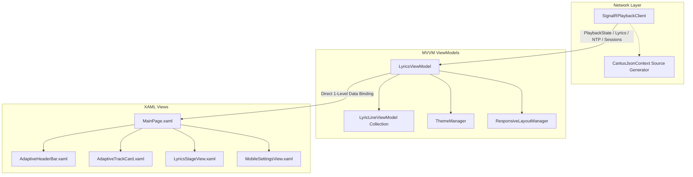

# Client & Uno Platform Architecture

The Cantus client is built with **Uno Platform**, enabling a unified C# and XAML codebase to run natively across Linux (Skia/X11), Windows (WinUI 3), and modern web browsers via WebAssembly.

---

## Client MVVM Pattern

The client architecture cleanly isolates presentation logic from real-time network communications:

---

## Core Client Components

### 1. `SignalRPlaybackClient`
- Manages the WebSocket lifecycle: automatic reconnect with exponential backoff, clock synchronization, and dispatching incoming payload events.
- Utilizes `CantusJsonContext` (`JsonSerializerContext`) for AOT / trimmed WebAssembly source-generated JSON deserialization, ensuring zero reflection overhead and maximum runtime reliability.
- Runs the 4-timestamp NTP clock synchronization loop.
- Exposes `ReportVisibilityAsync(bool isVisible)` to signal document visibility state to the server and `RefreshPlaybackAsync()` for on-demand poll wakeups.

### 2. `LyricsViewModel`
- Coordinates overall state: active playback progress, song metadata, lyrics line collection, authorized Spotify sessions, and instrumental breaks.
- Provides flattened 1-level direct visual properties (`BackgroundBrush`, `SurfaceCardBrush`, `NoSessionsVisibility`, `HasSessionsVisibility`, `CurrentBreakpoint`) ensuring thread-safe, compile-time verified XAML `{x:Bind}` execution across all platforms.
- Drives the 60 FPS animation tick loop (`OnTick`), evaluating which line should be marked active based on the synchronized clock.
- Manages scroll interaction state: `IsUserScrollingPaused`, `IsAutoScrollEnabled`, `ResumeAutoScroll()`, and the `AutoScrollResumed` event.
- Seeks playback to a tapped synced line (`SeekToLineAsync`). The target is the line timestamp minus the per-track offset, without latency compensation (a seek flushes in-flight audio, so adding it would clip the line). The jump is optimistic: a display floor keeps the tapped line active until the latency-compensated estimate catches up, and polls still reporting the pre-seek position are ignored until one confirms the seek (or 4 seconds pass). A rejected seek reverts and reports through the transport status line.

### 3. `LyricsStageView` & Auto-Scroll Controller
- Implements intelligent auto-scroll with manual override detection:
  - **Programmatic Scroll Filtering**: Uses a 450ms debounce flag (`_isProgrammaticScroll`) to distinguish internal centering adjustments from user-driven mouse wheel, touch, or drag events.
  - **Manual Pause & Auto-Resume**: When manual scrolling is detected, pauses auto-scrolling and starts a 3-second `DispatcherTimer` (`_autoResumeTimer`). When the timer expires or the user clicks the floating resume button, it calls `ResumeAutoScroll()` and smooth-scrolls back to the active line.
  - **Tap-to-Seek**: Tapping or clicking a synced line calls `SeekToLineAsync` and re-centers on it. Drags never count as taps (the gesture recognizer drops them, and a list that moved more than 10px under the press is treated as a scroll); a press on a line does not pause auto-scroll by itself, but the platform cancelling it for a pan does. Lines show a hover tint and hand cursor for mouse/pen and a pressed tint for touch, only while seeking is possible (never for static lyrics).
  - **Dynamic Viewport Padding**: Computes top and bottom padding at runtime based on container height so that both the first and final lines of any track can be aligned to the vertical center.

### 4. `WasmInterop` Browser Hooks
- Embedded JavaScript bridge for Uno WebAssembly:
  - Hooks into browser `document.addEventListener("visibilitychange")` to track tab focus/minimization.
  - Relays visibility state into C# via `SignalRPlaybackClient.ReportVisibilityAsync`, enabling server-side background poll rate reduction.

### 5. `LyricLineViewModel`
- Represents an individual lyric line with observable properties for:
  - `IsActive`: Whether this line is currently being sung.
  - `IsPast`: Whether this line has already finished.
  - `LineBrush`, `FontSize`, `FontWeight`, and `Opacity`: Visual styling dynamically driven by theme and active state.

### 6. `ThemeManager` & `ResponsiveLayoutManager`
- `ThemeManager` extracts dynamic palettes from album artwork bytes and provides WCAG-compliant high-contrast theme brushes.
- `ResponsiveLayoutManager` dynamically classifies viewports into `Compact`, `Medium`, `Expanded`, `LargeDesktop`, and `FullscreenTv` breakpoints.

---

## Target Runtime Matrix

| Platform Target | Runtime Engine | UI Backend | Packaging |
| :--- | :--- | :--- | :--- |
| **WebAssembly (WASM)** | .NET 10 WebAssembly | Uno DOM/HTML Engine | Embedded in Docker container (`wwwroot`). |
| **Linux Desktop / Raspberry Pi** | .NET 10 CoreCLR | Skia / X11 / Wayland | Standalone native binary / Flatpak. |
| **Windows Desktop** | .NET 10 CoreCLR | WinUI 3 / Windows App SDK | MSIX / Standalone `.exe`. |
