# Client & Uno Platform Architecture

The Cantus client is built with **Uno Platform**, enabling a unified C# and XAML codebase to run natively across Linux (Skia/X11), Windows (WinUI 3), and modern web browsers via WebAssembly.

---

## Client MVVM Pattern

The client architecture cleanly isolates presentation logic from real-time network communications:

```mermaid
flowchart TD
    subgraph Network Layer
        SignalR[SignalRPlaybackClient]
        Context[CantusJsonContext Source Generator]
        PairingApi[DisplayPairingApi]
        DisplaysApi[DisplayManagementApi]
        SignalR -.-> Context
        PairingApi -.-> Context
        DisplaysApi -.-> Context
    end

    subgraph MVVM ViewModels
        LVM[LyricsViewModel]
        LLVM[LyricLineViewModel Collection]
        Theme[ThemeManager]
        Layout[ResponsiveLayoutManager]
        Prefs[LyricsPreferences]
        Transport[PlaybackTransport]
        Anchor[OptimisticSeekAnchor]
        Timing[PlaybackTiming]
        Session[SessionViewModel]
        Displays[DisplaysViewModel]
        Pairing[DisplayPairingViewModel]
        Credentials[DisplayCredentialStore]
        LVM --> LLVM
        LVM --> Theme
        LVM --> Layout
        LVM --> Prefs
        LVM --> Transport
        LVM --> Timing
        LVM --> Session
        LVM --> Pairing
        Session --> Displays
        Pairing --> Credentials
        Transport --> Anchor
        Timing --> Prefs
    end

    subgraph XAML Views
        MainView[MainPage.xaml]
        Header[AdaptiveHeaderBar.xaml]
        TrackCard[AdaptiveTrackCard.xaml]
        LyricsStage[LyricsStageView.xaml]
        MobileSettings[MobileSettingsView.xaml]
        MiniBar[MiniPlaybackBar.xaml]
        Hud[DiagnosticsHudDialog.xaml]
        PairingView[DisplayPairingView.xaml]
        PromptView[DisplayPromptView.xaml]
        DisplaysCard[DisplaysCard.xaml]
        MainView --> Header
        MainView --> TrackCard
        MainView --> LyricsStage
        MainView --> MobileSettings
        MainView --> MiniBar
        MainView --> PairingView
        MainView --> PromptView
        TrackCard --> DisplaysCard
        MobileSettings --> DisplaysCard
        Header --> Hud
    end

    SignalR -->|PlaybackState / Lyrics / NTP / Sessions| LVM
    LVM -->|lyrics, track, toast| MainView
    Theme -->|brushes and colors| MainView
    Layout -->|breakpoint, sizes, mobile tab| MainView
    Transport -->|controls and status| TrackCard
    Transport --> MiniBar
    Timing -->|offset and latency| TrackCard
    Timing --> MobileSettings
    Session -->|sign-in state| Header
    Session --> TrackCard
    Session --> MobileSettings
    PairingApi -->|pairing code| Pairing
    Pairing -->|code, QR, owner-only visibility| PairingView
    Pairing --> TrackCard
    Pairing --> MobileSettings
    DisplaysApi -->|approve, list, rename, revoke| Displays
    Displays -->|Displays list| DisplaysCard
    Displays -->|approval, rename and remove prompt| PromptView
```

---

## Core Client Components

### 1. `SignalRPlaybackClient`
- Manages the WebSocket lifecycle: automatic reconnect with exponential backoff, clock synchronization, and dispatching incoming payload events.
- Utilizes `CantusJsonContext` (`JsonSerializerContext`) for AOT / trimmed WebAssembly source-generated JSON deserialization, ensuring zero reflection overhead and maximum runtime reliability.
- Runs the 4-timestamp NTP clock synchronization loop.
- Exposes `ReportVisibilityAsync(bool isVisible)` to signal document visibility state to the server and `RefreshPlaybackAsync()` for on-demand poll wakeups.

### 2. `LyricsViewModel`
- The root view model. Owns the lyric line collection, the display clock tick, song metadata, lyrics display modes (static, auto-scroll, karaoke), instrumental breaks, and the theme toast.
- Composes its parts and exposes each once: `Transport` (`PlaybackTransport`), `Timing` (`PlaybackTiming`), `Session` (`SessionViewModel`), `Pairing` (`DisplayPairingViewModel`), `Theme` (`ThemeManager`), and `Layout` (`ResponsiveLayoutManager`). It does not forward their members; views bind to them directly.
- Keeps only state it computes itself: the ambient artwork backdrop (`AmbientBackgroundSource`) and the theme toast, whose placement (`ThemeToastPageVisibility`, `ThemeToastStageVisibility`) depends on the layout breakpoint.
- Owns the client lifecycle entry points `MainPage` calls: `InitializeAsync`, `ReportVisibilityAsync`, and `RefreshPlaybackAsync`.
- Drives the 60 FPS animation tick loop (`OnTick`), evaluating which line should be marked active based on the synchronized clock.
- Manages scroll interaction state: `IsUserScrollingPaused`, `IsAutoScrollEnabled`, `ResumeAutoScroll()`, and the `AutoScrollResumed` event.
- Seeks playback to a tapped synced line (`SeekToLineAsync`). It checks that seeking is possible, ends any manual-scroll pause, and hands the line timestamp to `PlaybackTransport`. When the transport applies or reverts the seek, it re-anchors the display clock and re-centers on the line.
- Each tick asks `PlaybackTiming` for the clock target and the render position, and asks `PlaybackTransport` to hold the position at an unconfirmed seek.
- Routes client events to the view model that owns them (track offsets to `PlaybackTiming`, Sessions and revokes to `SessionViewModel`, connection state, Session lists, `ReceiveDisplayPaired` and `ReceiveDisplayRevoked` to `DisplayPairingViewModel`, `ReceiveDisplaysChanged` to `Session.Displays`). When the Session ends it clears the track card, lyrics, and theme; logout and a Display losing its token also clear the transport's playback state.
- `ReceiveDisplaysChanged` refreshes `Session.Displays` on the UI thread. Opening the mobile **Sync & Info** tab (`Layout.IsMobileSettingsActive` turning on) also refreshes it, because a Display's REST calls can move its last-seen time without that event.
- Tap-to-seek (`CanSeekToLines`) is off on a paired Display.

#### View Binding
- Every view binds through a `ViewModel` property set to the root. Views that need a composed part also expose it as a `Transport`, `Timing`, `Session`, `Pairing`, `Theme`, or `Layout` dependency property, filled from `ViewModel` when it is set, so `{x:Bind}` paths stay one level deep (`Transport.PlayPauseGlyph`, `Timing.OffsetText`, `Session.ConnectButtonText`, `Theme.TextPrimaryBrush`, `Layout.CurrentBreakpoint`). `MainPage` exposes `Pairing`, `Displays` (`Session.Displays`), `Theme` and `Layout` as plain properties. `DisplaysCard` and `DisplayPromptView` take `Displays` from `ViewModel.Session.Displays`, and so does `MobileSettingsView`. `DiagnosticsHudDialog` takes the root in its constructor and sets `Transport`, `Timing`, and `Session` as plain properties.
- Button handlers call the composed part directly (`Transport.TogglePlayPauseAsync`, `Timing.NudgeOffsetAsync`, `Session.LogoutAsync`, `Layout.ToggleKioskMode`, `Layout.CycleMobileView`). `MainPage` sends the latency keyboard shortcuts to `ViewModel.Timing` and the kiosk and mobile tab shortcuts to `ViewModel.Layout`.
- The Connect Spotify buttons build the sign-in link from `Session.SpotifyLoginPath`, which carries this client's id, and `Session.ServerBaseUrl` on desktop.

| View | `ViewModel` | `Transport` | `Timing` | `Session` | `Pairing` | `Displays` | `Theme` | `Layout` |
| :--- | :---: | :---: | :---: | :---: | :---: | :---: | :---: | :---: |
| `MainPage` | Yes | | | | Yes | Yes | Yes | Yes |
| `AdaptiveHeaderBar` | Yes | | | Yes | Yes | | Yes | Yes |
| `AdaptiveTrackCard` | Yes | Yes | Yes | Yes | Yes | | Yes | Yes |
| `LyricsStageView` | Yes | | | | | | Yes | Yes |
| `MobileSettingsView` | Yes | | Yes | Yes | Yes | Yes | Yes | |
| `MobileTabBar` | Yes | | | | | | Yes | Yes |
| `MiniPlaybackBar` | Yes | Yes | | | Yes | | Yes | |
| `DisplayPairingView` | Yes | | | | Yes | | Yes | Yes |
| `DisplaysCard` | Yes | | | | | Yes | Yes | |
| `DisplayPromptView` | Yes | | | | | Yes | Yes | |
| `DiagnosticsHudDialog` | Yes | Yes | Yes | Yes | | | | |

### 3. `LyricsStageView` & Auto-Scroll Controller
- Implements intelligent auto-scroll with manual override detection:
  - **Programmatic Scroll Filtering**: Uses a 450ms debounce flag (`_isProgrammaticScroll`) to distinguish internal centering adjustments from user-driven mouse wheel, touch, or drag events.
  - **Manual Pause & Auto-Resume**: When manual scrolling is detected, pauses auto-scrolling and starts a 3-second `DispatcherTimer` (`_autoResumeTimer`). When the timer expires or the user clicks the floating resume button, it calls `ResumeAutoScroll()` and smooth-scrolls back to the active line.
  - **Tap-to-Seek**: Tapping or clicking a synced line calls `SeekToLineAsync` and re-centers on it. Drags never count as taps (the gesture recognizer drops them, and a list that moved more than 10px under the press is treated as a scroll); a press on a line does not pause auto-scroll by itself, but the platform cancelling it for a pan does. Lines show a hover tint and hand cursor for mouse/pen and a pressed tint for touch, only while seeking is possible (never for static lyrics).
  - **Dynamic Viewport Padding**: Computes top and bottom padding at runtime based on container height so that both the first and final lines of any track can be aligned to the vertical center.

### 4. `WasmInterop` Browser Hooks
- Embedded JavaScript bridge for Uno WebAssembly:
  - Hooks into browser `document.addEventListener("visibilitychange")` to track tab focus/minimization.
  - Relays visibility state into C# via `SignalRPlaybackClient.ReportVisibilityAsync`, enabling server-side background poll rate reduction.
  - Reads the page's query string (`GetLocationSearch`) and drops one parameter from the address without a reload (`RemoveQueryParameter`), for the `?pair=` approval link.

### 5. `LyricLineViewModel`
- Represents an individual lyric line with observable properties for:
  - `IsActive`: Whether this line is currently being sung.
  - `IsPast`: Whether this line has already finished.
  - `LineBrush`, `FontSize`, `FontWeight`, and `Opacity`: Visual styling dynamically driven by theme and active state.

### 6. `ThemeManager` & `ResponsiveLayoutManager`
- `ThemeManager` extracts dynamic palettes from album artwork bytes and provides WCAG-compliant high-contrast theme brushes. It raises a property change for every brush and for `ActivePrimaryAccentColor` and `ActiveBackgroundColor` when the palette changes, so views bind to it directly.
- `ResponsiveLayoutManager` dynamically classifies viewports into `Compact`, `Medium`, `Expanded`, `LargeDesktop`, and `FullscreenTv` breakpoints. It owns kiosk mode (`IsKioskMode`, `ToggleKioskMode`) and the mobile tab (`MobileView`, `CycleMobileView`), and raises a property change for every size that depends on them.

### 7. `LyricsPreferences` & `ISettingsStore`
- Per-device preferences are read and written only through an injected `ILyricsPreferences`: auto-scroll and karaoke mode by `LyricsViewModel`, device latency compensation by `PlaybackTiming`. Each reads its values once at construction and writes on every change.
- `LyricsPreferences` owns the storage keys (`cantus_autoscroll`, `cantus_karaoke`, `cantus_latency_ms`), the defaults (on, on, `200ms`), parsing of string-typed values, and clamping latency to `0-1000ms`.
- `DisplayCredentialStore` keeps the Display token, id and name (`cantus_display_token`, `cantus_display_id`, `cantus_display_name`) through the same `ISettingsStore`, so a paired Display reconnects after a restart. `ISettingsStore` cannot remove keys, so clearing blanks them.
- Raw storage sits behind `ISettingsStore`. `LocalSettingsStore` wraps `ApplicationData.Current.LocalSettings` and swallows storage failures; unit tests use an in-memory store.

### 8. `PlaybackTransport`
- Owns transport state and commands: `IsPlaying`, `IsShuffled`, `RepeatMode`, `VolumePercent`, their glyphs and brushes, and the transport status line (rejected commands show a message for 8 seconds).
- Debounces volume changes: slider ticks only record the value, and the one the slider rests on for `300ms` is sent.
- Owns the effective playback state. `ApplyServerState` takes each poll, reconciles it with any unconfirmed seek, and returns the state the display clock follows.
- Line seeks (`SeekToLineAsync`) target the line timestamp minus the per-track offset, without latency compensation (a seek flushes in-flight audio, so adding it would clip the line). The jump is optimistic and raises `SeekApplied` before Spotify answers. `HoldAtSeekFloor` keeps the tapped line active until the latency-compensated estimate catches up. Polls still reporting the pre-seek position are ignored until one confirms the seek (or 4 seconds pass). A rejected seek restores the last poll, raises `SeekReverted`, and reports through the transport status line.
- The seek anchor itself (pending seek, display floor, seek generation, poll reconciliation) lives in an internal `OptimisticSeekAnchor` owned by the transport. Callers go through `PlaybackTransport` members; `LyricsViewModel` only shares its static `ProjectProgressMs` position estimate.

### 9. `PlaybackTiming`
- Implements the render-position formula from [Timing & Calibration](../user-guide/timing-and-calibration.md): `playback position - device latency compensation + per-track offset`.
- `ComputeClockTargetMs` subtracts the latency compensation (never below `0`) from the projected Spotify position. The display clock interpolates toward this target, so a latency change slews in smoothly. `ComputeRenderPositionMs` adds the per-track offset to the interpolated position and clamps it to the track.
- Owns device latency compensation (`LatencyCompensationMs`, `CalibrationText`, `AdjustLatencyCompensation`): clamped to `0-1000ms` and persisted through `ILyricsPreferences`. `LATENCY_STEP_MS` is the `50ms` step.
- Owns the per-track offset (`TrackOffsetMs`, `OffsetText`). `NudgeOffsetAsync` and `ResetOffsetAsync` update it and save it for the current track; nudges clamp to `-30s..+30s`. `SetSyncOffsetAsync` only saves. `ApplyTrackOffset` takes the server's saved offset and ignores offsets for any track but the current one.
- Reads the current track ID through a delegate, so it has no dependency on `PlaybackTransport`.

### 10. `SessionViewModel`
- Owns sign-in state: the authorized Sessions list (`Sessions`, `CurrentUserSession`, `AuthorizedSessionsCount`), the active user (`ActiveUserName`, `ActiveUserId`), and the derived `IsAuthorized`, connect button text and glyph, and session visibilities.
- `ApplySessions` takes the server's Session list: the first Session becomes active and its playback is subscribed to. `ApplyAuthSession` replaces the list with a newly signed-in Session and subscribes to it. `ApplySessionRevoked` signs out when the revoked user is the active one (or none is named). `ApplyActiveUser` and `ApplyDiagnostics` take the active user and Session count from playback polls and diagnostics.
- `SubscribeToUserAsync` and `LogoutAsync` call the client. An empty Session list or a revoke raises `SessionEnded`; logout raises `LoggedOut`. `LyricsViewModel` handles both to clear playback state.
- `SpotifyLoginPath` is the server-relative sign-in path (`/api/auth/spotify/login`), with `?client_id=` added when the client has an id. `ServerBaseUrl` is the server origin the desktop heads open it against.
- Composes `Displays` (`DisplaysViewModel`), the owner's Display management. A Session list or a completed sign-in turns it on and loads the list; signing out, a revoke or an empty Session list turns it off and empties the list.

### 11. `DisplayPairingViewModel` & `DisplayPairingView`
- This client's side of becoming a [Display](../reference/rest-api.md#display-endpoints). The owner side (approving, renaming, revoking) belongs to `DisplaysViewModel`, composed by `SessionViewModel`.
- States (`DisplayPairingState`): `Unpaired` (pairing screen closed), `RequestingCode` (waiting for the hub connection or the code), `ShowingCode`, `CodeExpired` (renewing), `RequestFailed` (retrying), and `Paired`.
- `StartPairingAsync` opens the pairing screen. Once the hub connection is up it sends the connection id to `POST /api/displays/pairings` through `IDisplayPairingApi`. A code belongs to its connection, so every new `Connected` state requests a new one and any other state drops the shown code.
- The shown code carries a QR (`QrCodeMatrix`, encoded with QRCoder and drawn as vector rectangles by `DisplayPairingView`) of the approval link `<ServerBaseUrl>/?pair=<CODE>` (`PAIR_QUERY_PARAMETER`), which opens the owner's approval prompt (see `DisplaysViewModel`). `CodeText` splits the code into two groups so it reads easily from a distance.
- The server's `expiresAtUtc` is turned into a lifetime once, using the NTP clock offset, and clamped to `30s..1h`, so a wrong device clock cannot expire a code early or keep it forever. A one-second countdown (`ExpiresInText`) renews the code when it runs out. Failed requests show why (`StatusMessage`) and retry after 10 seconds, or 60 seconds when rate limited.
- `CancelPairing` closes the screen and reconnects the hub, because the server drops a connection's pending code only when that connection closes.
- `ApplyDisplayPaired` accepts any token sent to this connection while it is not already a Display, even for an earlier code or just after Cancel: the server sends it only to the connection that requested the code and has already created the Display, so dropping it would leave an orphan. It saves the token through `DisplayCredentialStore`, sets `Paired`, and reconnects with `ReconnectWithDisplayTokenAsync`. At startup a stored token sets `ISignalRPlaybackClient.DisplayToken` before the first connection.
- `SignalRPlaybackClient.SelectConnectionCredential` picks what the access token factory sends: the Session token, else the Display token, else nothing (an anonymous connection that registers for the sign-in handoff). `ReconnectWithDisplayTokenAsync` with a token also discards any held Session token and its `session.txt`: pairing is offered only after the server returned no Sessions, so that Session is stale and would otherwise hide the Display token.
- `ApplyDisplayRevoked` discards the token, raises `DisplayEnded`, reconnects without a credential and reopens the pairing screen with `REVOKED_MESSAGE`. A rejected token shows up as an empty `ReceiveSessions`, which the server never sends to an accepted Display. The server sends the same empty list when checking a credential fails, so the token is kept and retried (after 15 seconds, then 30), and discarded with `REJECTED_MESSAGE` only after `MAX_TOKEN_REJECTIONS` (3) empty lists in a row. `ApplyDiagnostics` ends the run: an accepted Display gets diagnostics with a non-zero authorized count. A non-empty Session list means an owner Session on the device won, so the Display token is dropped quietly.
- `OwnerControlsVisibility` collapses every owner-only control on a Display: transport buttons and volume, the seek bars (not hit-testable), sync offset steppers, and account actions (Connect, Log Out). Device latency is a per-device preference that never reaches the server, so its controls and the <kbd>[</kbd> <kbd>]</kbd> shortcuts stay. `DisplayInfoVisibility` shows the Display's name instead. `PairingScreenVisibility` and `MainContentVisibility` swap the pairing screen and the main layout.

### 12. `DisplaysViewModel`, `DisplaysCard` & `DisplayPromptView`
- The owner's side of a [Display](../reference/rest-api.md#display-endpoints), over `IDisplayManagementApi` (`DisplayManagementApi`): `POST /api/displays/pairings/approve`, `GET /api/displays`, `PATCH` and `DELETE /api/displays/{displayId}`. Requests carry the Session token as `Authorization: Bearer` when the client holds one; the web app otherwise relies on the browser sending the Session cookie. Each answer maps to a `DisplayManagementStatus` (`400` `InvalidName`, `401` `NotSignedIn`, `403` `Forbidden`, `404` `NotFound`, `429` `RateLimited`, anything else or no answer `Failed`).
- `Displays` holds a `DisplayItemViewModel` per Display (name and `LastSeenText`, such as "Last seen 5 min ago", measured against the server clock through the NTP offset). While signed in, a one-minute `TimeProvider` timer re-describes `LastSeenText` on the UI thread (`RefreshLastSeen`), so it ages between fetches. `RefreshAsync` replaces the list with the server's, keeping rows for Displays still listed. Only the latest of overlapping refreshes is applied, and none is applied after sign-out. A failed refresh keeps the rows and shows `ListError`.
- One prompt (`PromptMode`: `Approve`, `Rename`, `Revoke`) serves all three owner actions. `DisplayPromptView` covers the page, so it works the same in every layout, including the mobile one. `ConfirmPromptAsync` sends the action, and `CanConfirm` gates it: an approval needs a code of letters and digits (case, spaces and hyphens are dropped, as the server does) and a trimmed name of 1 to 64 characters.
- The list is fetched again after every successful action and on [`ReceiveDisplaysChanged`](../reference/signalr-api.md#receivedisplayschanged), which the server sends the owner's Session connections when a Display is paired, renamed, revoked or connects, so changes made on another device show at once. A rename or remove of a Display that is already gone (`404`) drops its row. Errors stay in the open prompt (`PromptError`) with the typed values kept, so the owner can correct them and retry.
- `OpenApprovalFromLink` reads the approval link's `pair` query parameter (`ParsePairCode`). At startup `MainPage` passes it the page's query string (`WasmInterop.GetLocationSearch`, web app only) and, when it held a code, removes `pair` from the address (`WasmInterop.RemoveQueryParameter`) so a reload does not ask again. A paired Display ignores the link. Opening the prompt while signed out shows `SIGN_IN_HINT` and a **Connect Spotify** button; approving then answers `401` with `NOT_SIGNED_IN_MESSAGE`. Because the Spotify sign-in leaves the page and returns without the link, a code opened from a link while signed out, or typed in before **Connect Spotify** (`KeepCodeThroughSignIn`), is kept in per-device settings (`PendingPairCodeStore`). Signing in reopens the prompt with it. Cancelling the prompt forgets it, and a code older than the 5-minute pairing lifetime is dropped.
- `DisplaysCard` shows the list with **Add display**, refresh, rename and remove buttons. It sits under the Spotify account card in `AdaptiveTrackCard` (wider layouts) and in `MobileSettingsView`, only for a signed-in owner and never on a Display. `MainPage` ignores keyboard shortcuts while the prompt is open and for keys typed into a text box. <kbd>Escape</kbd> closes the prompt wherever focus is, and <kbd>Enter</kbd> in its code or name field confirms it.

---

## Target Runtime Matrix

| Platform Target | Runtime Engine | UI Backend | Packaging |
| :--- | :--- | :--- | :--- |
| **WebAssembly (WASM)** | .NET 10 WebAssembly | Uno DOM/HTML Engine | Embedded in Docker container (`wwwroot`). |
| **Linux Desktop / Raspberry Pi** | .NET 10 CoreCLR | Skia / X11 / Wayland | Standalone native binary / Flatpak. |
| **Windows Desktop** | .NET 10 CoreCLR | WinUI 3 / Windows App SDK | MSIX / Standalone `.exe`. |
