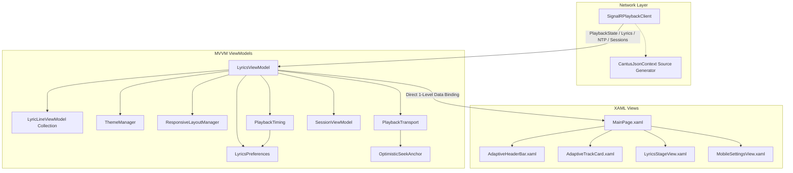

# Client & Uno Platform Architecture

The Cantus client is built with **Uno Platform**, enabling a unified C# and XAML codebase to run natively across Linux (Skia/X11), Windows (WinUI 3), and modern web browsers via WebAssembly.

---

## Client MVVM Pattern

The client architecture cleanly isolates presentation logic from real-time network communications:

---

## Core Client Components

### 1. `SignalRPlaybackClient`
- Manages the WebSocket lifecycle: automatic reconnect with exponential backoff, clock synchronization, and dispatching incoming payload events.
- Utilizes `CantusJsonContext` (`JsonSerializerContext`) for AOT / trimmed WebAssembly source-generated JSON deserialization, ensuring zero reflection overhead and maximum runtime reliability.
- Runs the 4-timestamp NTP clock synchronization loop.
- Exposes `ReportVisibilityAsync(bool isVisible)` to signal document visibility state to the server and `RefreshPlaybackAsync()` for on-demand poll wakeups.

### 2. `LyricsViewModel`
- Coordinates overall state: active playback progress, song metadata, lyrics line collection, and instrumental breaks.
- Provides flattened 1-level direct visual properties (`BackgroundBrush`, `SurfaceCardBrush`, `NoSessionsVisibility`, `HasSessionsVisibility`, `CurrentBreakpoint`) ensuring thread-safe, compile-time verified XAML `{x:Bind}` execution across all platforms.
- Drives the 60 FPS animation tick loop (`OnTick`), evaluating which line should be marked active based on the synchronized clock.
- Manages scroll interaction state: `IsUserScrollingPaused`, `IsAutoScrollEnabled`, `ResumeAutoScroll()`, and the `AutoScrollResumed` event.
- Seeks playback to a tapped synced line (`SeekToLineAsync`). It checks that seeking is possible, ends any manual-scroll pause, and hands the line timestamp to `PlaybackTransport`. When the transport applies or reverts the seek, it re-anchors the display clock and re-centers on the line.
- Transport controls (play/pause, skip, shuffle, repeat, volume, seek) are thin pass-throughs to `PlaybackTransport`, kept so existing `{x:Bind}` paths stay one level deep. The transport's property notifications are re-raised under the same names.
- Track offset and latency members (`OffsetText`, `NudgeOffsetAsync`, `ResetOffsetAsync`, `SetSyncOffsetAsync`, `LatencyCompensationMs`, `CalibrationText`, `AdjustLatencyCompensation`) are pass-throughs to `PlaybackTiming` in the same way. Each tick asks `PlaybackTiming` for the clock target and the render position.
- Session members (`Sessions`, `CurrentUserSession`, `ActiveUserName`, `ActiveUserId`, `AuthorizedSessionsCount`, `IsAuthorized`, `ConnectButtonText`, `ConnectButtonGlyph`, `NoSessionsVisibility`, `HasSessionsVisibility`, `SubscribeToUserAsync`, `SwitchUserSubscriptionAsync`, `LogoutAsync`) are pass-throughs to `SessionViewModel` in the same way. When the Session ends it clears the track card, lyrics, and theme; logout also clears the transport's playback state.

### 3. `LyricsStageView` & Auto-Scroll Controller
- Implements intelligent auto-scroll with manual override detection:
  - **Programmatic Scroll Filtering**: Uses a 450ms debounce flag (`_isProgrammaticScroll`) to distinguish internal centering adjustments from user-driven mouse wheel, touch, or drag events.
  - **Manual Pause & Auto-Resume**: When manual scrolling is detected, pauses auto-scrolling and starts a 3-second `DispatcherTimer` (`_autoResumeTimer`). When the timer expires or the user clicks the floating resume button, it calls `ResumeAutoScroll()` and smooth-scrolls back to the active line.
  - **Tap-to-Seek**: Tapping or clicking a synced line calls `SeekToLineAsync` and re-centers on it. Drags never count as taps (the gesture recognizer drops them, and a list that moved more than 10px under the press is treated as a scroll); a press on a line does not pause auto-scroll by itself, but the platform cancelling it for a pan does. Lines show a hover tint and hand cursor for mouse/pen and a pressed tint for touch, only while seeking is possible (never for static lyrics).
  - **Dynamic Viewport Padding**: Computes top and bottom padding at runtime based on container height so that both the first and final lines of any track can be aligned to the vertical center.

### 4. `WasmInterop` Browser Hooks
- Embedded JavaScript bridge for Uno WebAssembly:
  - Hooks into browser `document.addEventListener("visibilitychange")` to track tab focus/minimization.
  - Relays visibility state into C# via `SignalRPlaybackClient.ReportVisibilityAsync`, enabling server-side background poll rate reduction.

### 5. `LyricLineViewModel`
- Represents an individual lyric line with observable properties for:
  - `IsActive`: Whether this line is currently being sung.
  - `IsPast`: Whether this line has already finished.
  - `LineBrush`, `FontSize`, `FontWeight`, and `Opacity`: Visual styling dynamically driven by theme and active state.

### 6. `ThemeManager` & `ResponsiveLayoutManager`
- `ThemeManager` extracts dynamic palettes from album artwork bytes and provides WCAG-compliant high-contrast theme brushes.
- `ResponsiveLayoutManager` dynamically classifies viewports into `Compact`, `Medium`, `Expanded`, `LargeDesktop`, and `FullscreenTv` breakpoints.

### 7. `LyricsPreferences` & `ISettingsStore`
- Per-device preferences are read and written only through an injected `ILyricsPreferences`: auto-scroll and karaoke mode by `LyricsViewModel`, device latency compensation by `PlaybackTiming`. Each reads its values once at construction and writes on every change.
- `LyricsPreferences` owns the storage keys (`cantus_autoscroll`, `cantus_karaoke`, `cantus_latency_ms`), the defaults (on, on, `200ms`), parsing of string-typed values, and clamping latency to `0-1000ms`.
- Raw storage sits behind `ISettingsStore`. `LocalSettingsStore` wraps `ApplicationData.Current.LocalSettings` and swallows storage failures; unit tests use an in-memory store.

### 8. `PlaybackTransport`
- Owns transport state and commands: `IsPlaying`, `IsShuffled`, `RepeatMode`, `VolumePercent`, their glyphs and brushes, and the transport status line (rejected commands show a message for 8 seconds).
- Debounces volume changes: slider ticks only record the value, and the one the slider rests on for `300ms` is sent.
- Owns the effective playback state. `ApplyServerState` takes each poll, reconciles it with any unconfirmed seek, and returns the state the display clock follows.
- Line seeks (`SeekToLineAsync`) target the line timestamp minus the per-track offset, without latency compensation (a seek flushes in-flight audio, so adding it would clip the line). The jump is optimistic and raises `SeekApplied` before Spotify answers. `HoldAtSeekFloor` keeps the tapped line active until the latency-compensated estimate catches up. Polls still reporting the pre-seek position are ignored until one confirms the seek (or 4 seconds pass). A rejected seek restores the last poll, raises `SeekReverted`, and reports through the transport status line.
- The seek anchor itself (pending seek, display floor, seek generation, poll reconciliation) lives in an internal `OptimisticSeekAnchor` owned by the transport. Callers go through `PlaybackTransport` members; `LyricsViewModel` only shares its static `ProjectProgressMs` position estimate.

### 9. `PlaybackTiming`
- Implements the render-position formula from [Timing & Calibration](../user-guide/timing-and-calibration.md): `playback position - device latency compensation + per-track offset`.
- `ComputeClockTargetMs` subtracts the latency compensation (never below `0`) from the projected Spotify position. The display clock interpolates toward this target, so a latency change slews in smoothly. `ComputeRenderPositionMs` adds the per-track offset to the interpolated position and clamps it to the track.
- Owns device latency compensation (`LatencyCompensationMs`, `CalibrationText`, `AdjustLatencyCompensation`): clamped to `0-1000ms` and persisted through `ILyricsPreferences`. `LATENCY_STEP_MS` is the `50ms` step.
- Owns the per-track offset (`TrackOffsetMs`, `OffsetText`). `NudgeOffsetAsync` and `ResetOffsetAsync` update it and save it for the current track; nudges clamp to `-30s..+30s`. `SetSyncOffsetAsync` only saves. `ApplyTrackOffset` takes the server's saved offset and ignores offsets for any track but the current one.
- Reads the current track ID through a delegate, so it has no dependency on `PlaybackTransport`.

### 10. `SessionViewModel`
- Owns sign-in state: the authorized Sessions list (`Sessions`, `CurrentUserSession`, `AuthorizedSessionsCount`), the active user (`ActiveUserName`, `ActiveUserId`), and the derived `IsAuthorized`, connect button text and glyph, and session visibilities.
- `ApplySessions` takes the server's Session list: the first Session becomes active and its playback is subscribed to. `ApplyAuthSession` replaces the list with a newly signed-in Session and subscribes to it. `ApplySessionRevoked` signs out when the revoked user is the active one (or none is named). `ApplyActiveUser` and `ApplyDiagnostics` take the active user and Session count from playback polls and diagnostics.
- `SubscribeToUserAsync` and `LogoutAsync` call the client. An empty Session list or a revoke raises `SessionEnded`; logout raises `LoggedOut`. `LyricsViewModel` handles both to clear playback state.
- Display management attaches here.

---

## Target Runtime Matrix

| Platform Target | Runtime Engine | UI Backend | Packaging |
| :--- | :--- | :--- | :--- |
| **WebAssembly (WASM)** | .NET 10 WebAssembly | Uno DOM/HTML Engine | Embedded in Docker container (`wwwroot`). |
| **Linux Desktop / Raspberry Pi** | .NET 10 CoreCLR | Skia / X11 / Wayland | Standalone native binary / Flatpak. |
| **Windows Desktop** | .NET 10 CoreCLR | WinUI 3 / Windows App SDK | MSIX / Standalone `.exe`. |
