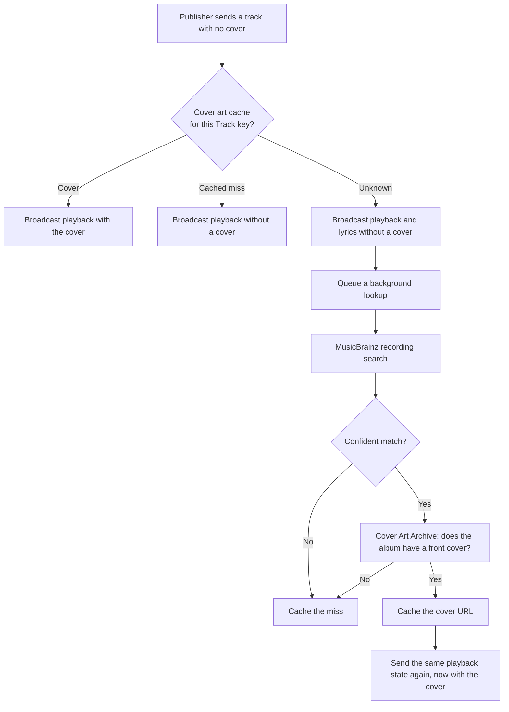

# Cover Art Lookup for Local Sessions

A Local Session's cover normally comes from the Local player, as an `http(s)` URL. Players that offer only a file on the computer, and every player on Windows, offer none. For those tracks the server looks the cover up in an open catalogue: **MusicBrainz** names the album, and the **Cover Art Archive** supplies the image URL.

Spotify playback is not affected. It always carries Spotify's own cover.

---

## Flow

The lookup never sits between a publish and its broadcast. The only work added to that path is one read of the local cache. The catalogue is asked afterwards, on a separate worker, and the cover arrives in a later `ReceivePlaybackState` for the same track. Position and timestamp in that message are unchanged, so viewers keep their place.

---

## Components

| Component | Project | Role |
| :--- | :--- | :--- |
| `LocalPlaybackIngest` | Server | Reads the cache once per track, remembers the answer for later updates of that track, and requests a background lookup after the broadcast. |
| `CoverArtBackfill` | Server | One worker for the whole server with a 32-track queue. Raises an event when a cover is found. |
| `PlaybackUpdateApplier.ApplyCoverArtAsync` | Server | Adds the cover to the Session's snapshot and broadcasts the playback state again. |
| `CachedCoverArtService` | Infrastructure | Cache first, then the catalogue. Decides what may be cached. |
| `MusicBrainzCoverArtCatalog` | Infrastructure | Searches, matches and probes. Classifies the result as found, no match, or unavailable. |
| `MusicBrainzReleaseMatcher` | Infrastructure | The matching rules below. |

A cover found in the background is handed back to the Session's own worker, the one that applies its publishes. So everything a Session broadcasts is still written by one worker in order, and a late cover cannot be overwritten by an update that was built before it arrived.

---

## Matching

One search request asks MusicBrainz for recordings whose title and artist share words with the track's and whose length is within 5 seconds. The album, when the player reports one, only raises the rank of recordings that appear on it.

A recording counts only when **all three** hold:

1. Its title equals or contains the track's title, or the reverse, after qualifiers such as "Remastered 2011" or "feat." are removed.
2. One of its credited artists matches one of the track's artists on whole words.
3. Its length is known and within 5 seconds of the track's.

Of that recording's releases, the cover may come from:

- a release whose title matches the track's album (exact matches first), of any kind, or
- an official studio album, EP or single, in that order of preference.

Compilations, live albums, soundtracks and bootlegs are used only when their title matches the album. Without that rule a well-known song would often show the cover of a compilation.

The best three albums are then checked against the Cover Art Archive with a `HEAD` request, and the first one that has a 500 px front cover wins. The server never downloads the image.

---

## Caching

Answers are stored per Track key in the `CachedCoverArt` table.

| Answer | Kept for | Setting |
| :--- | :--- | :--- |
| Cover found | 90 days | `CoverArt__CacheDays` |
| No confident match, or no cover in the archive | 30 days | `CoverArt__NegativeCacheDays` |
| Catalogue unreachable, busy or rate-limited | Not cached | |

An unreachable catalogue is never cached as a miss, for the same reason as with lyrics: it would hide a cover that exists for the whole negative-cache period.

---

## Rate Limits and Terms

- **MusicBrainz** allows one request per second from an address and requires a User-Agent that names the application and a contact. Cantus sends one request per track, spaces requests 1.1 seconds apart, and sends `CoverArt__UserAgent`.
- **MusicBrainz sheds load** with `503` and `Retry-After`, even for clients within the limit. `ProviderRateGate` pauses requests for that long, and the background worker tries a track again after 3 and then 10 seconds before giving up until the track next starts.
- **The Cover Art Archive** has no published rate limit. It also passes through `ProviderRateGate`, so a `429` or `503` with `Retry-After` pauses it.
- **A track that was skipped** before its turn in the queue is not looked up. When the queue is full, the oldest request is dropped.
- **The images are not licensed to Cantus.** The Cover Art Archive states that all images are copyrighted by their owners. Cantus stores and sends only the archive's URL. Each viewing device loads the image from the archive, which redirects to the Internet Archive.
- **Non-commercial use** of the MusicBrainz API is free. An operator who runs Cantus commercially needs to arrange that with MetaBrainz, or turn the lookup off.

---

## Turning It Off

`CoverArt__Enabled=false` stops every catalogue request. Tracks whose player offers no cover are then shown without one, as before. See [Configuration](../reference/configuration.md#cover-art-catalogue-coverart).
