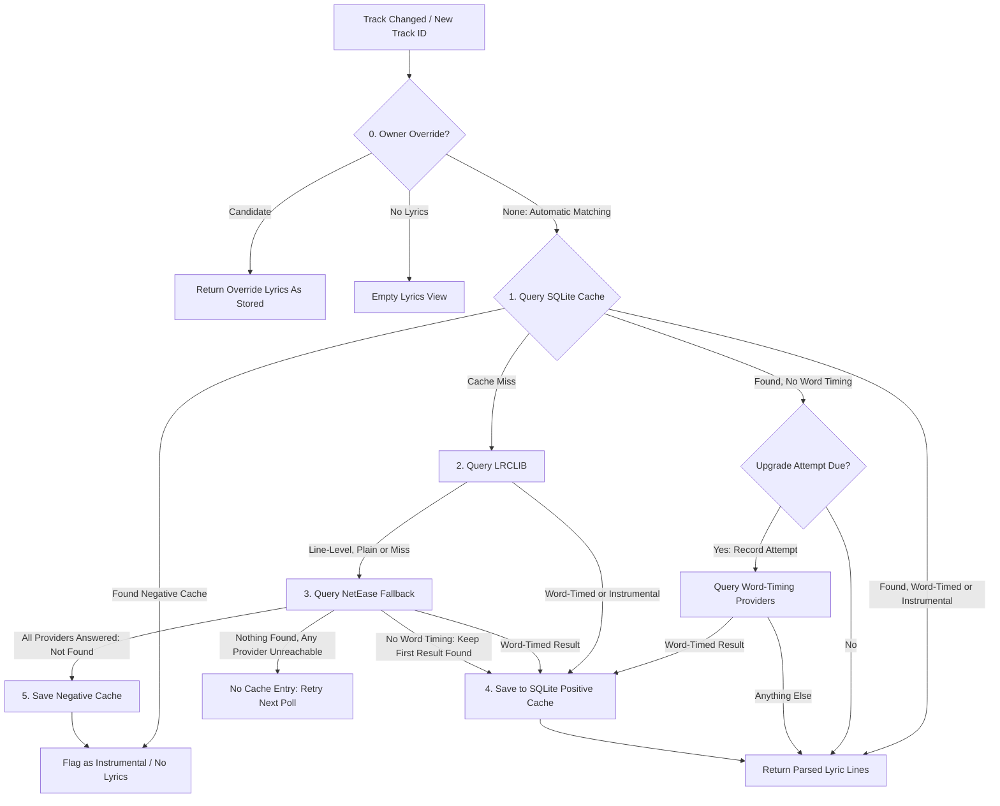

# Multi-Tier Lyrics Caching

Lyrics retrieval in Cantus is designed for instantaneous local response times and resilient fallback handling across large, diverse music catalogs.

---

## Retrieval Resolution Strategy

When a track starts playing, Cantus traverses a multi-tiered caching pipeline, then an ordered chain of lyric providers:



### Provider Fallback Chain

Lyric sources implement `ILyricsFetchProvider` and run in a configured order (`CachedLyricsService` walks the list):

1. **LRCLIB** (always first): community-driven, key-free synced and plain lyrics.
2. **NetEase Cloud Music** (optional fallback, `Netease:Enabled` in `appsettings.json`, on by default): unofficial web API with strong catalog coverage; synced lyrics only. It requests word-by-word lyrics in the same call (see [NetEase Word-by-Word Lyrics](#netease-word-by-word-lyrics-yrcparser)). A track NetEase marks as instrumental (`nolyric` or `pureMusic`) is reported as instrumental, like an LRCLIB instrumental result, so it stops the walk and is cached as instrumental instead of "not found". CJK credit lines (lyricist/composer metadata) are stripped before use, and payload-level error codes (rate limits, anti-scraping challenges) are treated as transient failures.

Every provider classifies its result as *found*, *authoritative miss*, or *transiently unavailable*. The negative cache is only written when **every** provider authoritatively missed. An unreachable provider (network error, 5xx, or NetEase payload error code) leaves the cache untouched so the next playback poll retries.

### Preference Order

For one track, sources rank as follows:

1. **Owner override** (see [Owner Overrides](#3-owner-overrides)). It always wins, whatever it holds: a chosen candidate is served as stored even when it is line-level and a provider has word timing, and a "no lyrics" override serves nothing. The caches and providers are not consulted while it is active.
2. **Automatic matching**, used only when there is no override. Provider results rank as follows:
   1. **Word-timed** (at least one line has syllables). The walk stops at the first one.
   2. **Instrumental**. The walk stops here too, since no word timing can follow.
   3. **Line-level synced or plain**: the first one found is kept, but the walk continues so a later provider can replace it with a word-timed result. If none does, the first result is saved, exactly as before word timing existed.

The same ranking applies on a cache miss and on an owner `refetch`. A line-level result is still saved when a later provider is unreachable; the upgrade policy below gives it another chance.

### Upgrading Line-Only Entries

A cached entry without word timing (synced or plain, not instrumental) can be upgraded on a later play without clearing the cache:

- Upgrades apply only to automatic matches. While a track has an owner override (a candidate or "no lyrics"), no attempt is made or recorded, so the budget is untouched. The override is read again after every wait on the providers (an upgrade attempt or a cache-miss fetch), so one the owner applies meanwhile is returned whatever the providers answered. Any lyrics that fetch found are still cached for when the override is cleared.
- Only providers that can return word timing (NetEase) are queried; LRCLIB is never re-fetched for an upgrade. With `Netease:Enabled=false` no provider qualifies, so no attempt is recorded and a cache hit stays read-only, exactly as before word timing existed.
- An attempt is due when fewer than `LyricsCache:WordTimingUpgradeMaxAttempts` (default `3`) attempts were made and `LyricsCache:WordTimingUpgradeIntervalDays` (default `7`) have passed since the entry was saved or last checked.
- The attempt is recorded (`WordTimingUpgradeAttempts`, `WordTimingCheckedAtUtc`) **before** the providers are queried, so a failing or slow provider never causes a refetch on every play. The write only succeeds if the attempt count is unchanged since it was read, so when two sessions play the same track at once only one of them runs the upgrade. If the write fails, the cached lyrics are returned and no upgrade runs.
- Only a word-timed result replaces the entry. A line-level result, a miss or a provider failure keeps the cached entry and never writes a negative entry.
- Saving fresh lyrics resets the budget. Entries cached before this feature start with no attempts. Their first attempt is due once `WordTimingUpgradeIntervalDays` have passed since they were fetched.
- An attempt runs inline with the cache hit, so that play waits for the word-timing providers once. Set `WordTimingUpgradeMaxAttempts` to `0` to turn upgrades off.

---

## Multi-Tier Cache Features

### 1. SQLite Local Positive Cache
- **Duration**: Persistent local storage (auto-renewing on access).
- **Storage**: Indexed by Spotify Track ID and Artist/Title. `RawSyncedLrc` holds the lines as LRC. Word-timed lyrics are also stored as JSON in `WordTimedLinesJson` (line and syllable start in milliseconds, syllable duration, and text exactly as sent, including a word's trailing space). LRC cannot hold syllable durations or millisecond times, so the JSON is read first and the LRC is only a fallback.
- **Latency**: `< 1ms` retrieval from local disk.

### 2. Negative Caching for Instrumental Tracks
- **Problem**: Many classical, jazz, EDM, and post-rock tracks have no lyrics. Without caching this absence, the server would query LRCLIB on every track transition.
- **Solution**: Cantus records a **Negative Cache** entry with a configurable 30-day TTL (configured via `LyricsCache:NegativeCacheDays` in `appsettings.json`; the setting is provider-agnostic and applies to the whole fallback chain). When the track plays again, Cantus immediately recognizes it as instrumental without network queries. A negative entry is only written when every provider in the chain authoritatively reported "not found". Transient provider failures are never cached.

### 3. Owner Overrides
- **Problem**: An automatic match can be wrong, and a track cached as "not found" stays that way for the whole negative-cache TTL.
- **Solution**: The owner can correct a track through `POST /api/lyrics/{trackId}/override` (see the [REST API reference](../reference/rest-api.md)): use a specific provider candidate, mark the track as having no lyrics, re-fetch, or clear the override. The client's "Wrong lyrics?" picker (see [Client & Uno Platform Architecture](client-uno.md#13-lyricspickerviewmodel)) lists candidates from `GET /api/lyrics/{trackId}/candidates`, whose `activeOverride` field names the override in effect.
- **Storage**: Overrides live in their own `LyricsOverrides` table, keyed by Spotify track ID and applied server-wide like track offsets. They have no TTL, and cache writes (`SaveLyricsAsync`, `MarkNotFoundAsync`) and cache expiry never touch them. `CachedLyricsService` checks the override before the negative and positive caches, so an override wins over both.
- **Candidate lyrics**: A chosen candidate is loaded by its provider id (`ILyricsFetchProvider.GetCandidateLyricsAsync`: LRCLIB `/api/get/{id}`, NetEase `/api/song/lyric?id=`, which includes word timing when NetEase has it) and stored with the track's own ID and metadata. A word-timed candidate keeps its syllables in `WordTimedLinesJson`, in the same format as the positive cache, so it is served with word timing after a restart.
- **Returning to automatic matching**: `clear` removes the override and serves the automatic match through `CachedLyricsService.GetLyricsAsync`, so the word-level preference and the upgrade policy apply again: a cached line-only match gets an upgrade attempt if one is due, and a cache miss walks the provider chain. `refetch` queries the provider chain again without reading the caches (`CachedLyricsService.RefreshFromProvidersAsync`), with the same word-level preference. Only a definitive answer replaces the cached match (including a "not found" entry) and removes the override. If a provider is unreachable, the override and cache are left as they were and the endpoint returns `502`.
- **Live update**: After each change, every Session currently on the track, and its Displays, gets the new lyrics through `ReceiveLyrics`, and its in-memory playback snapshot is updated so the poller and newly connecting clients see them too. The snapshot update only applies to snapshots still on that track, and the poller keeps the snapshot's current lyrics when the track has not changed, so a poll that overlaps an override does not revert it.

### 4. LRCLIB Integration & Fuzzy Matching
- **Primary Query**: Exact search by Track Name, Artist Name, Album Name, and Duration.
- **Fuzzy Fallback**: If exact matching fails (common for remastered titles, "feat." artist tags, or deluxe editions), Cantus strips noise keywords (e.g. `(Remastered 2021)`, `[Deluxe Edition]`) and queries LRCLIB's fuzzy search endpoint.

---

## LRC Parsing & Timestamp Normalization

Cantus implements a zero-allocation LRC parser (`LrcParser`) that translates standard LRC text formats into typed timestamp objects:

```text
[00:12.45]First line of synchronized lyrics
[00:15.80]Second line of synchronized lyrics
[00:22.10]Third line after a brief break
```

### Parser Features:
- Handles both 2-digit (`[mm:ss.xx]`) and 3-digit (`[mm:ss.xxx]`) millisecond precision.
- Normalizes out-of-order lyric lines.
- Computes start and end durations for each line to trigger smooth visual highlighting and transition states.

### NetEase Word-by-Word Lyrics (`YrcParser`)

`NeteaseLyricsProvider` requests `/api/song/lyric?id={songId}&lv=1&yv=1&tv=-1`. `yv=1` adds the word-timed `yrc` block to the same response as the line-level `lrc` block, so there is no extra request. When `yrc` has word-timed lyric lines, it is the whole line source (its timeline differs from `lrc` by about 100 ms per line, so the two are never merged). Credit lines are stripped on the joined token text, which also catches credits timed one character at a time. Without usable `yrc` the provider parses `lrc` as before.

`YrcParser` reads NetEase's word-timed `yrc` format. Each line has a `[startMs,durationMs]` header followed by `(startMs,durationMs,flag)text` tokens, all in absolute milliseconds:

```text
[27360,1290](27360,240,0)alpha (27600,90,0)bravo (27690,360,0)charlie
[40000,1270](40000,890,0)甲(40890,380,0)乙
```

- Each token becomes a `LyricSyllable` with its real start and duration. Token text is kept as sent, so a word's trailing space stays on it and split syllables of one word stay joined.
- The line text is the joined token text, trimmed. Credit lines are returned as ordinary lines; stripping them is up to the caller.
- A token's text runs until the next full `(start,duration,flag)` header, so parenthesised lyric text such as `(1, 2, 3, 4)` or `(2,000 miles)` stays in the syllable.
- A line with an unreadable token falls back to line-level timing (no syllables) and keeps its text. Only fragments made of digits and commas in parentheses are stripped from that text, so a broken header never removes lyric words. A line with no readable timing at all takes the previous line's timestamp. The parser never throws and never drops a non-blank line.
