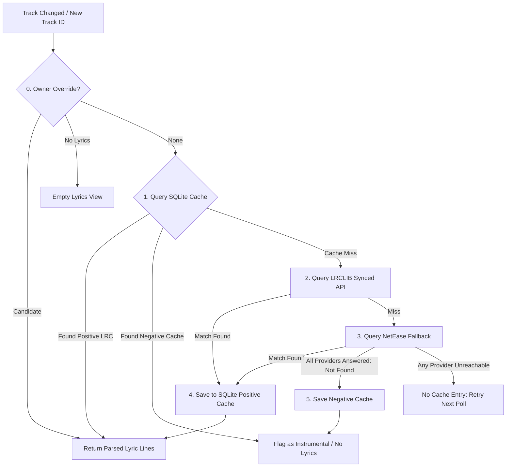

# Multi-Tier Lyrics Caching

Lyrics retrieval in Cantus is designed for instantaneous local response times and resilient fallback handling across large, diverse music catalogs.

---

## Retrieval Resolution Strategy

When a track starts playing, Cantus traverses a multi-tiered caching pipeline, then an ordered chain of lyric providers:



### Provider Fallback Chain

Lyric sources implement `ILyricsFetchProvider` and run in a configured order (`CachedLyricsService` walks the list):

1. **LRCLIB** (always first): community-driven, key-free synced and plain lyrics.
2. **NetEase Cloud Music** (optional fallback, `Netease:Enabled` in `appsettings.json`, on by default): unofficial web API with strong catalog coverage; synced lyrics only. CJK credit lines (lyricist/composer metadata) are stripped before parsing, and payload-level error codes (rate limits, anti-scraping challenges) are treated as transient failures.

Every provider classifies its result as *found*, *authoritative miss*, or *transiently unavailable*. The negative cache is only written when **every** provider authoritatively missed — an unreachable provider (network error, 5xx, or NetEase payload error code) leaves the cache untouched so the next playback poll retries.

---

## Multi-Tier Cache Features

### 1. SQLite Local Positive Cache
- **Duration**: Persistent local storage (auto-renewing on access).
- **Storage**: Raw LRC string and normalized JSON parsed line objects indexed by Spotify Track ID and Artist/Title hash.
- **Latency**: `< 1ms` retrieval from local disk.

### 2. Negative Caching for Instrumental Tracks
- **Problem**: Many classical, jazz, EDM, and post-rock tracks have no lyrics. Without caching this absence, the server would query LRCLIB on every track transition.
- **Solution**: Cantus records a **Negative Cache** entry with a configurable 30-day TTL (configured via `LyricsCache:NegativeCacheDays` in `appsettings.json`; the setting is provider-agnostic and applies to the whole fallback chain). When the track plays again, Cantus immediately recognizes it as instrumental without network queries. A negative entry is only written when every provider in the chain authoritatively reported "not found" — transient provider failures are never cached.

### 3. Owner Overrides
- **Problem**: An automatic match can be wrong, and a track cached as "not found" stays that way for the whole negative-cache TTL.
- **Solution**: The owner can correct a track through `POST /api/lyrics/{trackId}/override` (see the [REST API reference](../reference/rest-api.md)): use a specific provider candidate, mark the track as having no lyrics, re-fetch, or clear the override.
- **Storage**: Overrides live in their own `LyricsOverrides` table, keyed by Spotify track ID and applied server-wide like track offsets. They have no TTL, and cache writes (`SaveLyricsAsync`, `MarkNotFoundAsync`) and cache expiry never touch them. `CachedLyricsService` checks the override before the negative and positive caches, so an override wins over both.
- **Candidate lyrics**: A chosen candidate is loaded by its provider id (`ILyricsFetchProvider.GetCandidateLyricsAsync`: LRCLIB `/api/get/{id}`, NetEase `/api/song/lyric?id=`) and stored with the track's own ID and metadata.
- **Returning to automatic matching**: `clear` removes the override and serves the cached automatic match if there is one. `refetch` queries the provider chain again without reading the caches (`CachedLyricsService.RefreshFromProvidersAsync`). Only a definitive answer replaces the cached match (including a "not found" entry) and removes the override. If a provider is unreachable, the override and cache are left as they were and the endpoint returns `502`.
- **Live update**: After each change, every Session currently on the track, and its Displays, gets the new lyrics through `ReceiveLyrics`, and its in-memory playback snapshot is updated so the poller and newly connecting clients see them too. The snapshot update only applies to snapshots still on that track, and the poller keeps the snapshot's current lyrics when the track has not changed, so a poll that overlaps an override does not revert it.

### 4. LRCLIB Integration & Fuzzy Matching
- **Primary Query**: Exact search by Track Name, Artist Name, Album Name, and Duration.
- **Fuzzy Fallback**: If exact matching fails (common for remastered titles, "feat." artist tags, or deluxe editions), Cantus strips noise keywords (e.g. `(Remastered 2021)`, `[Deluxe Edition]`) and queries LRCLIB's fuzzy search endpoint.

---

## LRC Parsing & Timestamp Normalization

Cantus implements a zero-allocation LRC parser (`LrcParser`) that translates standard LRC text formats into typed timestamp objects:

```text
[00:12.45]First line of synchronized lyrics
[00:15.80]Second line of synchronized lyrics
[00:22.10]Third line after a brief break
```

### Parser Features:
- Handles both 2-digit (`[mm:ss.xx]`) and 3-digit (`[mm:ss.xxx]`) millisecond precision.
- Normalizes out-of-order lyric lines.
- Computes start and end durations for each line to trigger smooth visual highlighting and transition states.

### NetEase Word-by-Word Lyrics (`YrcParser`)

`YrcParser` reads NetEase's word-timed `yrc` format. Each line has a `[startMs,durationMs]` header followed by `(startMs,durationMs,flag)text` tokens, all in absolute milliseconds:

```text
[27360,1290](27360,240,0)alpha (27600,90,0)bravo (27690,360,0)charlie
[40000,1270](40000,890,0)甲(40890,380,0)乙
```

- Each token becomes a `LyricSyllable` with its real start and duration. Token text is kept as sent, so a word's trailing space stays on it and split syllables of one word stay joined.
- The line text is the joined token text, trimmed. Credit lines are returned as ordinary lines; stripping them is up to the caller.
- A line with an unreadable token falls back to line-level timing (no syllables) and keeps its text. A line with no readable timing at all takes the previous line's timestamp. The parser never throws and never drops a non-blank line.
