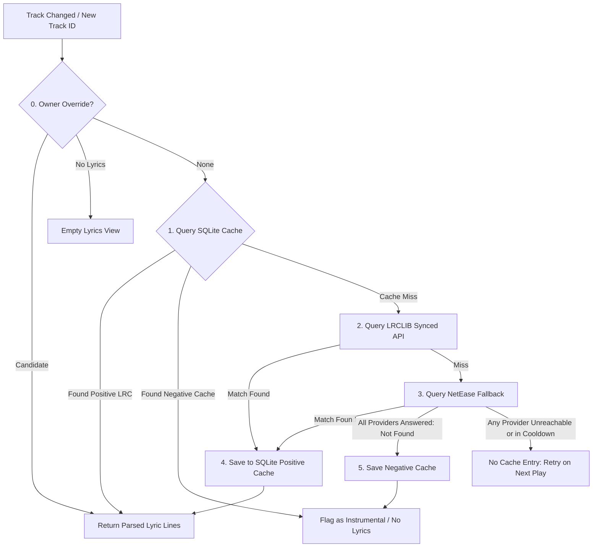
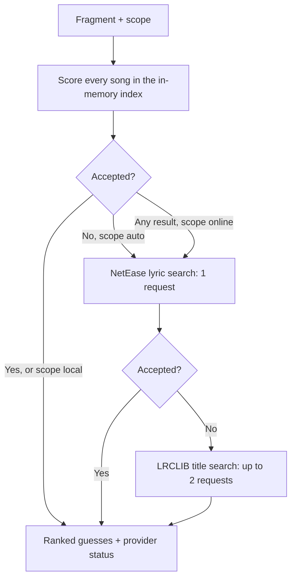

# Multi-Tier Lyrics Caching

Lyrics retrieval in Cantus is designed for instantaneous local response times and resilient fallback handling across large, diverse music catalogs.

---

## Retrieval Resolution Strategy

When a track starts playing, Cantus traverses a multi-tiered caching pipeline, then an ordered chain of lyric providers:



### Provider Fallback Chain

Lyric sources implement `ILyricsFetchProvider` and run in a configured order (`CachedLyricsService` walks the list):

1. **LRCLIB** (always first): community-driven, key-free synced and plain lyrics.
2. **NetEase Cloud Music** (optional fallback, `Netease:Enabled` in `appsettings.json`, on by default): unofficial web API with strong catalog coverage; synced lyrics only. CJK credit lines (lyricist/composer metadata) are stripped before parsing, and payload-level error codes (rate limits, anti-scraping challenges) are treated as transient failures.

Every provider classifies its result as *found*, *authoritative miss*, or *transiently unavailable*. The negative cache is only written when **every** provider authoritatively missed. An unreachable provider (network error, 5xx, or NetEase payload error code) leaves the cache untouched, so the track is fetched again the next time it starts. A provider paused by the [outbound rate gate](#5-outbound-provider-rate-gate) counts as unreachable.

---

## Multi-Tier Cache Features

### 1. SQLite Local Positive Cache
- **Duration**: Persistent local storage (auto-renewing on access).
- **Storage**: Raw LRC string and normalized JSON parsed line objects indexed by Spotify Track ID and Artist/Title hash.
- **Latency**: `< 1ms` retrieval from local disk.

### 2. Negative Caching for Instrumental Tracks
- **Problem**: Many classical, jazz, EDM, and post-rock tracks have no lyrics. Without caching this absence, the server would query LRCLIB on every track transition.
- **Solution**: Cantus records a **Negative Cache** entry with a configurable 30-day TTL (configured via `LyricsCache:NegativeCacheDays` in `appsettings.json`; the setting is provider-agnostic and applies to the whole fallback chain). When the track plays again, Cantus immediately recognizes it as instrumental without network queries. A negative entry is only written when every provider in the chain authoritatively reported "not found" — transient provider failures are never cached.

### 3. Owner Overrides
- **Problem**: An automatic match can be wrong, and a track cached as "not found" stays that way for the whole negative-cache TTL.
- **Solution**: The owner can correct a track through `POST /api/lyrics/{trackId}/override` (see the [REST API reference](../reference/rest-api.md)): use a specific provider candidate, mark the track as having no lyrics, re-fetch, or clear the override.
- **Storage**: Overrides live in their own `LyricsOverrides` table, keyed by Spotify track ID and applied server-wide like track offsets. They have no TTL, and cache writes (`SaveLyricsAsync`, `MarkNotFoundAsync`) and cache expiry never touch them. `CachedLyricsService` checks the override before the negative and positive caches, so an override wins over both.
- **Candidate lyrics**: A chosen candidate is loaded by its provider id (`ILyricsFetchProvider.GetCandidateLyricsAsync`: LRCLIB `/api/get/{id}`, NetEase `/api/song/lyric?id=`) and stored with the track's own ID and metadata.
- **Returning to automatic matching**: `clear` removes the override and serves the cached automatic match if there is one. `refetch` queries the provider chain again without reading the caches (`CachedLyricsService.RefreshFromProvidersAsync`). Only a definitive answer replaces the cached match (including a "not found" entry) and removes the override. If a provider is unreachable, the override and cache are left as they were and the endpoint returns `502`.
- **Live update**: After each change, every Session currently on the track, and its Displays, gets the new lyrics through `ReceiveLyrics`, and its in-memory playback snapshot is updated so the poller and newly connecting clients see them too. The snapshot update only applies to snapshots still on that track, and the poller keeps the snapshot's current lyrics when the track has not changed, so a poll that overlaps an override does not revert it.

### 4. LRCLIB Integration & Fuzzy Matching
- **Primary Query**: Exact search by Track Name, Artist Name, Album Name, and Duration.
- **Fuzzy Fallback**: If exact matching fails (common for remastered titles, "feat." artist tags, or deluxe editions), Cantus strips noise keywords (e.g. `(Remastered 2021)`, `[Deluxe Edition]`) and queries LRCLIB's fuzzy search endpoint.

### 5. Outbound Provider Rate Gate
Every LRCLIB and NetEase request, for now-playing lyrics and for song lookups alike, passes through `ProviderRateGate` (a `DelegatingHandler` on each provider's `HttpClient`):

- **Lookup budget**: lookup requests draw from a small per-provider budget per rolling minute (`SongLookup:LrclibRequestsPerMinute`, default 10; `SongLookup:NeteaseRequestsPerMinute`, default 6). Now-playing requests are never refused by a budget.
- **Cooldowns**: a `429`, or a `503` with `Retry-After`, on a now-playing request or on any LRCLIB request pauses all traffic to that provider. `Retry-After` is honoured, clamped to 1 to 300 seconds, with 60 seconds when it is missing. A throttle or payload rejection on a NetEase lookup request pauses lookups only, so its unofficial search endpoint cannot take down the now-playing fallback. A normal `404` never starts a cooldown.
- **Behaviour change for now-playing**: during a cooldown no request is sent, and the fetch reports the provider as unavailable (logged at Debug). As with any transient failure, nothing is negative-cached, and a track that starts during a cooldown shows no lyrics until the next track change.

---

## Song Lookup by Remembered Lyrics

`POST /api/lookup/search` (see the [REST API reference](../reference/rest-api.md#song-lookup-endpoints)) answers "what is the song that goes ...?". It reads the same lyrics the cache and overrides hold, but never writes the cache or the negative cache.



### Lookup Tiers
1. **Library**: the fragment is scored against every song in `LyricsSearchIndex`. If the best guess is accepted (or the scope is `local`), no provider is called.
2. **NetEase**: lyric search (`/api/search/get?type=1006`) returns songs with a lyric excerpt. Each excerpt is scored with the same scorer as the library. Up to 3 hits the scorer cannot confirm (for example Traditional against Simplified Chinese) are shown last as unverified and never affect the decision.
3. **LRCLIB**: only while the outcome is still not accepted. LRCLIB searches titles, not lyrics, so up to 2 short word windows from the fragment are tried as `track_name`, and each result's lyrics are scored against the whole fragment. It only finds songs whose title appears in the fragment. `SongLookup:LrclibTitleGuessEnabled` turns it off.

A lookup sends at most 3 provider requests within 10 seconds, and returns what it has on timeout. Each Spotify user may run `SongLookup:OnlineLookupsPerMinute` online lookups per minute. Provider answers are kept in memory for 10 minutes (empty answers for 2 minutes, 64 entries), keyed by provider and normalized fragment; unavailable or rate-limited answers are never kept, and a reused answer spends no budget.

### Scoring and Decision
- **Normalization**: section labels (`[Chorus]`, `Verse 2:`) are dropped, accents and full-width forms are folded, apostrophes are removed (`don't` matches `dont`), and each Han, kana or Hangul character is its own token. Lines are joined into one token stream, so a fragment that spans two lines still matches.
- **Score** (`0` to `1`): `0.60` word alignment (exact words, light stems, small typos and sound-alike words count as partial matches; skipped and extra words cost a little), `0.25` character trigram overlap, `0.15` overlap on rare words. A fragment of 6 or more words with one wrong word still scores at least `0.70`.
- **Grouping**: guesses with the same title core (without remaster, live or feat qualifiers) are one song when they also share the primary artist or have near-identical lyrics. Two different songs that only share a title stay separate.
- **Decision**: `accepted` when the best song scores at least `0.70` and leads the next song by at least `0.10`; `ambiguous` when it scores at least `0.50`; otherwise `none`. At most 5 guesses scoring at least `0.40` are returned. The margin matters: a score threshold alone accepts many fragments from songs that are not in the library.
- **Fragment limits**: 3 to 24 words or 4 to 48 CJK characters (longer input is cut), at most 200 characters.

### In-Memory Search Index
- **Corpus**: the effective lyrics of every track, read with two no-tracking queries. An override shadows the cached row; a "no lyrics" override, an instrumental or not-found entry, or an expired row hides the track. The corpus is **server-wide**: it holds tracks any Session on this server has played.
- **Built lazily** on the first lookup, then refreshed incrementally. `LyricsCorpusChangeInterceptor` (an EF Core `SaveChangesInterceptor`) records the track ids of every saved `CachedLyrics` and `LyricsOverrides` change and marks them dirty after a successful save; a failed save marks nothing. The next lookup re-reads only those tracks and swaps in a new snapshot.
- **Backstops**: a full rebuild after 6 hours or more than 1,000 dirty tracks; the snapshot is dropped after 20 minutes without lookups. A scan stops after 1.5 seconds, and a truncated scan never accepts a library guess. A warning is logged once above 20,000 songs.
- **Measured budget** (Release, synthetic corpus of 5,000 songs of 40 lines): build about 0.7 to 1.8 s, one-track refresh 2 to 4 ms, full scan about 100 to 200 ms, about 30 to 37 MB retained. That is about 0.02 to 0.04 ms per song, so the 1.5-second scan budget starts truncating somewhere between 37,000 and 70,000 songs.

### Spotify Play and Queue
Library guesses carry their Spotify track id. Online guesses are searched on Spotify only when the owner clicks Play or Queue, so a lookup spends no Spotify quota. All Spotify calls share one back-off with the playback poller (see [Adaptive Polling](adaptive-polling.md#rate-limit-backoff-http-429-error-handling)). After a play, the poller fetches and caches the track's lyrics under its real Spotify id, which is how the library grows.

---

## LRC Parsing & Timestamp Normalization

Cantus implements a zero-allocation LRC parser (`LrcParser`) that translates standard LRC text formats into typed timestamp objects:

```text
[00:12.45]First line of synchronized lyrics
[00:15.80]Second line of synchronized lyrics
[00:22.10]Third line after a brief break
```

### Parser Features:
- Handles both 2-digit (`[mm:ss.xx]`) and 3-digit (`[mm:ss.xxx]`) millisecond precision.
- Normalizes out-of-order lyric lines.
- Computes start and end durations for each line to trigger smooth visual highlighting and transition states.
