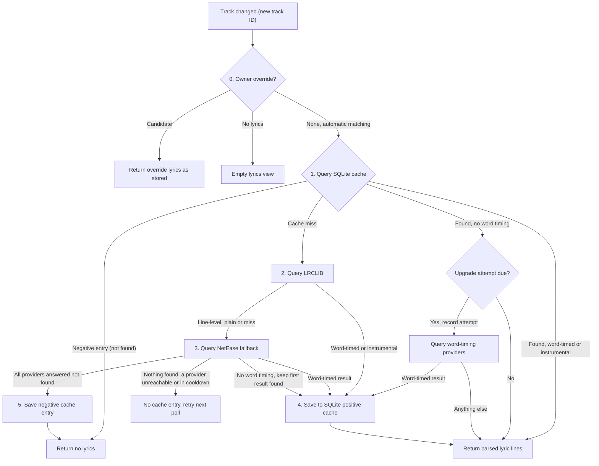

# Multi-Tier Lyrics Caching

Lyrics retrieval in Cantus is designed for instantaneous local response times and resilient fallback handling across large, diverse music catalogs.

---

## Retrieval Resolution Strategy

When a track starts playing, Cantus traverses a multi-tiered caching pipeline, then an ordered chain of lyric providers:



### Provider Fallback Chain

Lyric sources implement `ILyricsFetchProvider` and run in a configured order (`CachedLyricsService` walks the list):

1. **LRCLIB** (always first): community-driven, key-free synced and plain lyrics.
2. **NetEase Cloud Music** (optional fallback, `Netease:Enabled` in `appsettings.json`, on by default): unofficial web API with strong catalog coverage; synced lyrics only. It requests word-by-word lyrics in the same call (see [NetEase Word-by-Word Lyrics](#netease-word-by-word-lyrics-yrcparser)). A track NetEase marks as instrumental (`nolyric` or `pureMusic`) is reported as instrumental, like an LRCLIB instrumental result, so it stops the walk and is cached as instrumental instead of "not found". CJK credit lines (lyricist/composer metadata) are stripped before use, and payload-level error codes (rate limits, anti-scraping challenges) are treated as transient failures.

Every provider classifies its result as *found*, *authoritative miss*, or *transiently unavailable*. The negative cache is only written when **every** provider authoritatively missed. An unreachable provider (network error, 5xx, or NetEase payload error code) leaves the cache untouched so the next playback poll retries. A provider paused by the [outbound rate gate](#5-outbound-provider-rate-gate) counts as unreachable.

### Preference Order

For one track, sources rank as follows:

1. **Owner override** (see [Owner Overrides](#3-owner-overrides)). It always wins, whatever it holds: a chosen candidate is served as stored even when it is line-level and a provider has word timing, and a "no lyrics" override serves nothing. The caches and providers are not consulted while it is active.
2. **Automatic matching**, used only when there is no override. Provider results rank as follows:
    1. **Word-timed** (at least one line has syllables). The walk stops at the first one.
    2. **Instrumental**. The walk stops here too, since no word timing can follow.
    3. **Line-level synced or plain**: the first one found is kept, but the walk continues so a later provider can replace it with a word-timed result. If none does, the first result is saved, exactly as before word timing existed.

The same ranking applies on a cache miss and on an owner `refetch`. A line-level result is still saved when a later provider is unreachable; the upgrade policy below gives it another chance.

### Upgrading Line-Only Entries

A cached entry without word timing (synced or plain, not instrumental) can be upgraded on a later play without clearing the cache:

- Upgrades apply only to automatic matches. While a track has an owner override (a candidate or "no lyrics"), no attempt is made or recorded, so the budget is untouched. The override is read again after every wait on the providers (an upgrade attempt or a cache-miss fetch), so one the owner applies meanwhile is returned whatever the providers answered. Any lyrics that fetch found are still cached for when the override is cleared.
- Only providers that can return word timing (NetEase) are queried; LRCLIB is never re-fetched for an upgrade. With `Netease:Enabled=false` no provider qualifies, so no attempt is recorded and a cache hit stays read-only, exactly as before word timing existed.
- An attempt is due when fewer than `LyricsCache:WordTimingUpgradeMaxAttempts` (default `3`) attempts were made and `LyricsCache:WordTimingUpgradeIntervalDays` (default `7`) have passed since the entry was saved or last checked.
- The attempt is recorded (`WordTimingUpgradeAttempts`, `WordTimingCheckedAtUtc`) **before** the providers are queried, so a failing or slow provider never causes a refetch on every play. The write only succeeds if the attempt count is unchanged since it was read, so when two sessions play the same track at once only one of them runs the upgrade. If the write fails, the cached lyrics are returned and no upgrade runs.
- Only a word-timed result replaces the entry. A line-level result, a miss or a provider failure keeps the cached entry and never writes a negative entry.
- Saving fresh lyrics resets the budget. Entries cached before this feature start with no attempts. Their first attempt is due once `WordTimingUpgradeIntervalDays` have passed since they were fetched.
- An attempt runs inline with the cache hit, so that play waits for the word-timing providers once. Set `WordTimingUpgradeMaxAttempts` to `0` to turn upgrades off.

---

## Multi-Tier Cache Features

### 1. SQLite Local Positive Cache
- **Duration**: No TTL. Found lyrics (including instrumental results) stay cached until replaced by an upgrade, a `refetch` or a "not found" answer.
- **Storage**: `CachedLyrics` table, keyed by Spotify Track ID with an index on artist and title. `RawSyncedLrc` holds the lines as LRC. Word-timed lyrics are also stored as JSON in `WordTimedLinesJson` (line and syllable start in milliseconds, syllable duration, and text exactly as sent, including a word's trailing space). LRC cannot hold syllable durations or millisecond times, so the JSON is read first and the LRC is only a fallback.

### 2. Negative Caching for Tracks Without Lyrics
- **Problem**: Many tracks have no lyrics on any provider. Without caching this absence, the server would query every provider on every play.
- **Solution**: Cantus writes a **negative cache** entry (`IsNotFound` in the same `CachedLyrics` row) with a configurable 30-day TTL (`LyricsCache:NegativeCacheDays` in `appsettings.json`; it applies to the whole fallback chain). While the entry is unexpired, the track returns no lyrics without network queries. A negative entry is only written when every provider in the chain authoritatively reported "not found". Transient provider failures are never cached.
- **Instrumental tracks** are different: a provider that flags a track as instrumental produces a positive entry with `IsInstrumental` set, which has no TTL.
- **Instrumental by title**: when no provider has lyrics (a fresh "not found" answer or an unexpired negative entry), a track whose title marks it as a version without vocals is served as instrumental. Only a bracketed qualifier or a part after a spaced dash counts: `instrumental`, `inst`, `karaoke`, `off vocal`, `backing track`, `no vocals` or `without vocals`, as in `Song (Instrumental)` or `Song - Karaoke Version` (`InstrumentalTitle`). This guess is never cached, so provider lyrics still win once the negative entry expires.

### 3. Owner Overrides
- **Problem**: An automatic match can be wrong, and a track cached as "not found" stays that way for the whole negative-cache TTL.
- **Solution**: The owner can correct a track through `POST /api/lyrics/{trackId}/override` (see the [REST API reference](../reference/rest-api.md)): use a specific provider candidate, mark the track as having no lyrics (served as an instrumental track), re-fetch, or clear the override. The client's "Wrong lyrics?" picker (see [Client & Uno Platform Architecture](client-uno.md#13-lyricspickerviewmodel)) lists candidates from `GET /api/lyrics/{trackId}/candidates`, whose `activeOverride` field names the override in effect.
- **Storage**: Overrides live in their own `LyricsOverrides` table, keyed by Spotify track ID and applied server-wide like track offsets. They have no TTL, and cache writes (`SaveLyricsAsync`, `MarkNotFoundAsync`) and cache expiry never touch them. `CachedLyricsService` checks the override before the negative and positive caches, so an override wins over both.
- **Candidate lyrics**: A chosen candidate is loaded by its provider id (`ILyricsFetchProvider.GetCandidateLyricsAsync`: LRCLIB `/api/get/{id}`, NetEase `/api/song/lyric?id=`, which includes word timing when NetEase has it) and stored with the track's own ID and metadata. A word-timed candidate keeps its syllables in `WordTimedLinesJson`, in the same format as the positive cache, so it is served with word timing after a restart.
- **Returning to automatic matching**: `clear` removes the override and serves the automatic match through `CachedLyricsService.GetLyricsAsync`, so the word-level preference and the upgrade policy apply again: a cached line-only match gets an upgrade attempt if one is due, and a cache miss walks the provider chain. `refetch` queries the provider chain again without reading the caches (`CachedLyricsService.RefreshFromProvidersAsync`), with the same word-level preference. Only a definitive answer replaces the cached match (including a "not found" entry) and removes the override. If a provider is unreachable, the override and cache are left as they were and the endpoint returns `502`.
- **Live update**: After each change, every Session currently on the track, and its Displays, gets the new lyrics through `ReceiveLyrics`, and its in-memory playback snapshot is updated so the poller and newly connecting clients see them too. The snapshot update only applies to snapshots still on that track, and the poller keeps the snapshot's current lyrics when the track has not changed, so a poll that overlaps an override does not revert it.

### 4. LRCLIB Integration & Fuzzy Matching
- **Primary Query**: `/api/get` with track name, artist name, album name (when known) and duration in seconds (when known).
- **Search Fallback**: If the exact lookup returns 404, Cantus calls `/api/search?q={title} {artist}`. Results more than 5 seconds off the track's duration are dropped (when both durations are known). Of the rest it picks the synced result closest in duration, otherwise the closest instrumental or plain result. Titles are sent as Spotify reports them; no keywords are stripped.

### 5. Outbound Provider Rate Gate
Every LRCLIB and NetEase request, for now-playing lyrics and for song lookups alike, passes through `ProviderRateGateHandler` (a `DelegatingHandler` on each provider's `HttpClient`), backed by the singleton `ProviderRateGate`:

- **Lookup budget**: lookup requests draw from a small per-provider budget per rolling minute (`SongLookup:LrclibRequestsPerMinute`, default 10; `SongLookup:NeteaseRequestsPerMinute`, default 6). Now-playing requests are never refused by a budget.
- **Cooldowns**: a `429`, or a `503` with `Retry-After`, on a now-playing request or on any LRCLIB request pauses all traffic to that provider. `Retry-After` is honoured, clamped to 1 to 300 seconds, with 60 seconds when it is missing. A throttle or payload rejection on a NetEase lookup request pauses lookups only, so its unofficial search endpoint cannot take down the now-playing fallback. A normal `404` never starts a cooldown.
- **Behaviour change for now-playing**: during a cooldown no request is sent, and the fetch reports the provider as unavailable (logged at Debug). As with any transient failure, nothing is negative-cached, and a track that starts during a cooldown shows no lyrics until the next track change.

---

## Song Lookup by Remembered Lyrics

`POST /api/lookup/search` (see the [REST API reference](../reference/rest-api.md#song-lookup-endpoints)) answers "what is the song that goes ...?". It reads the same lyrics the cache and overrides hold, but never writes the cache or the negative cache.


### Lookup Tiers
1. **Library**: the fragment is scored against every song in `LyricsSearchIndex`. If the best guess is accepted (or the scope is `local`), no provider is called.
2. **NetEase**: lyric search (`/api/search/get?type=1006`) returns songs with a lyric excerpt. Each excerpt is scored with the same scorer as the library. Up to 3 hits the scorer cannot confirm (for example Traditional against Simplified Chinese) are shown last as unverified and never affect the decision.
3. **LRCLIB**: only while the outcome is still not accepted. LRCLIB searches titles, not lyrics, so up to 2 short word windows from the fragment are tried as `track_name`, and each result's lyrics are scored against the whole fragment. It only finds songs whose title appears in the fragment. `SongLookup:LrclibTitleGuessEnabled` turns it off.

A lookup sends at most 3 provider requests within 10 seconds, and returns what it has on timeout. Each Spotify user may run `SongLookup:OnlineLookupsPerMinute` online lookups per minute. Provider answers are kept in memory for 10 minutes (empty answers for 2 minutes, 64 entries), keyed by provider and normalized fragment; unavailable or rate-limited answers are never kept, and a reused answer spends no budget.

### Scoring and Decision
- **Normalization**: section labels (`[Chorus]`, `Verse 2:`) are dropped, accents and full-width forms are folded, apostrophes are removed (`don't` matches `dont`), and each Han, kana or Hangul character is its own token. Lines are joined into one token stream, so a fragment that spans two lines still matches.
- **Score** (`0` to `1`): `0.60` word alignment (exact words, light stems, small typos and sound-alike words count as partial matches; skipped and extra words cost a little), `0.25` character trigram overlap, `0.15` overlap on rare words. A fragment of 6 or more words with one wrong word still scores at least `0.70`.
- **Grouping**: guesses with the same title core (without remaster, live or feat qualifiers) are one song when they also share the primary artist or have near-identical lyrics. Two different songs that only share a title stay separate.
- **Decision**: `accepted` when the best song scores at least `0.70` and leads the next song by at least `0.10`; `ambiguous` when it scores at least `0.50`; otherwise `none`. At most 5 guesses scoring at least `0.40` are returned. The margin matters: a score threshold alone accepts many fragments from songs that are not in the library.
- **Fragment limits**: 3 to 24 words or 4 to 48 CJK characters (longer input is cut), at most 200 characters.

### In-Memory Search Index
- **Corpus**: the effective lyrics of every track, read with two no-tracking queries. An override shadows the cached row; a "no lyrics" override, an instrumental or not-found entry, or an expired row hides the track. The corpus is **server-wide**: it holds tracks any Session on this server has played.
- **Built lazily** on the first lookup, then refreshed incrementally. `LyricsCorpusChangeInterceptor` (an EF Core `SaveChangesInterceptor`) records the track ids of every saved `CachedLyrics` and `LyricsOverrides` change and marks them dirty after a successful save; a failed save marks nothing. The next lookup re-reads only those tracks and swaps in a new snapshot.
- **Backstops**: a full rebuild after 6 hours or more than 1,000 dirty tracks; the snapshot is dropped after 20 minutes without lookups. A scan stops after 1.5 seconds, and a truncated scan never accepts a library guess. A warning is logged once above 20,000 songs.
- **Measured budget** (Release, synthetic corpus of 5,000 songs of 40 lines): build about 0.7 to 1.8 s, one-track refresh 2 to 4 ms, full scan about 100 to 200 ms, about 30 to 37 MB retained. That is about 0.02 to 0.04 ms per song, so the 1.5-second scan budget starts truncating somewhere between 37,000 and 70,000 songs.

### Spotify Play and Queue
Library guesses carry their Spotify track id. Online guesses are searched on Spotify only when the owner clicks Play or Queue, so a lookup spends no Spotify quota. All Spotify calls share one back-off with the playback poller (see [Adaptive Polling](adaptive-polling.md#rate-limit-backoff-http-429-error-handling)). After a play, the poller fetches and caches the track's lyrics under its real Spotify id, which is how the library grows.

---

## LRC Parsing & Timestamp Normalization

`LrcParser` (span-based) turns LRC text into `LyricLine` records with a start timestamp:

```text
[00:12.45]First line of synchronized lyrics
[00:15.80]Second line of synchronized lyrics
[00:22.10]Third line after a brief break
```

### Parser Features:
- Reads `[mm:ss]`, `[mm:ss.x]`, `[mm:ss.xx]` and `[mm:ss.xxx]` timestamps; non-timestamp tags such as `[ar:...]` are skipped.
- A line with several timestamps (`[00:10.00][00:50.00]Chorus`) becomes one line per timestamp.
- Sorts lines by timestamp, so out-of-order files work.
- Enhanced LRC word tags (`<mm:ss.xx>word`) become syllables; each syllable's duration runs to the next syllable's start. Lines store only a start time.

### NetEase Word-by-Word Lyrics (`YrcParser`)

`NeteaseLyricsProvider` requests `/api/song/lyric?id={songId}&lv=1&yv=1&tv=-1`. `yv=1` adds the word-timed `yrc` block to the same response as the line-level `lrc` block, so there is no extra request. When `yrc` has word-timed lyric lines, it is the whole line source (its timeline differs from `lrc` by about 100 ms per line, so the two are never merged). Credit lines are stripped on the joined token text, which also catches credits timed one character at a time. Without usable `yrc` the provider parses `lrc` as before.

`YrcParser` reads NetEase's word-timed `yrc` format. Each line has a `[startMs,durationMs]` header followed by `(startMs,durationMs,flag)text` tokens, all in absolute milliseconds:

```text
[27360,1290](27360,240,0)alpha (27600,90,0)bravo (27690,360,0)charlie
[40000,1270](40000,890,0)甲(40890,380,0)乙
```

- Each token becomes a `LyricSyllable` with its real start and duration. Token text is kept as sent, so a word's trailing space stays on it and split syllables of one word stay joined.
- The line text is the joined token text, trimmed. Credit lines are returned as ordinary lines; stripping them is up to the caller.
- A token's text runs until the next full `(start,duration,flag)` header, so parenthesised lyric text such as `(1, 2, 3, 4)` or `(2,000 miles)` stays in the syllable.
- A line with an unreadable token falls back to line-level timing (no syllables) and keeps its text. Only fragments made of digits and commas in parentheses are stripped from that text, so a broken header never removes lyric words. A line with no readable timing at all takes the previous line's timestamp. The parser never throws and never drops a non-blank line.
