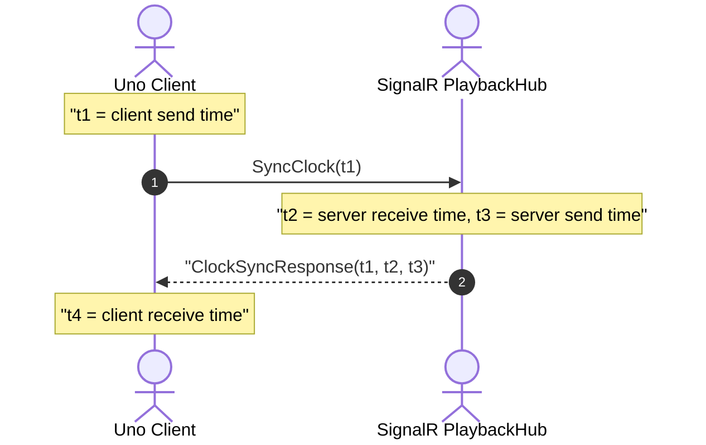
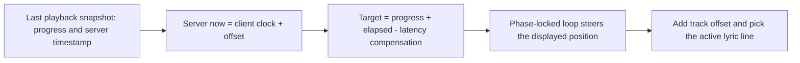

# NTP Clock Synchronization

Synchronized lyrics need timing within tens of milliseconds. Device clocks drift relative to the server, so Cantus runs an **NTP-style 4-timestamp clock sync** over SignalR.

---

## Why Clock Synchronization Matters

Each playback snapshot carries Spotify's progress plus the server timestamp it was taken at. The client projects the current position as `progress + (serverNow - timestamp)`, which only works if the client knows the server's clock.

Without clock synchronization:
- Client clock skew shifts every projected position (lyrics run early or late).
- Variable network round-trip latency adds jitter when playback updates arrive.

---

## The 4-Timestamp Synchronization Algorithm

Cantus uses the standard NTP round-trip model. Names match `SignalRPlaybackClient.SyncClockAsync`:

1. **Client send ($t_1$)**: the client reads its clock and calls `SyncClock(t1)` on the hub.
2. **Server receive ($t_2$)** and **server send ($t_3$)**: `PlaybackHub.SyncClock` reads the server clock twice and returns `ClockSyncResponse(t1, t2, t3)`.
3. **Client receive ($t_4$)**: the client reads its clock when the response arrives.

All timestamps are Unix milliseconds from `DateTimeOffset.UtcNow`, so precision is 1 ms.

---

## Offset and Jitter Filtering

From the four timestamps the client computes:

1. **Round-trip delay ($\delta$)**, clamped to at least 0:

    $$\delta = (t_4 - t_1) - (t_3 - t_2)$$

2. **Clock offset ($\theta$)**: how far the server clock is ahead of the client clock.

    $$\theta = \frac{(t_2 - t_1) + (t_3 - t_4)}{2}$$

The offset is computed in whole milliseconds and truncated toward zero.

`SignalRPlaybackClient.SyncClockAsync` hands the four timestamps to `ClockOffsetEstimator`, which owns this math and the sample filter below. The client's `RttMs` and `ClockOffsetMs` read the estimator's current values (both `0` before the first sample).

### Sample Filter (`ClockOffsetEstimator.AddSample`)

- The client keeps the 5 most recent samples (`MAX_NTP_SAMPLES`).
- The first sample is used as-is.
- With 3 or more samples, the single sample with the highest round-trip time is dropped (the first one on a tie).
- The rest are averaged, each weighted by `1 / max(1, RTT)` (lower latency counts more).
- The result is blended into the previous value with an exponential moving average (`alpha = 0.35`), so the offset moves gradually instead of jumping.

### Sync Schedule

- A sync runs when the hub connection starts, then every 5 seconds on a timer.
- A sync also runs after each automatic reconnect.

---

## Continuous Playback Interpolation

`LyricsViewModel` runs a 16 ms `DispatcherTimer` (about 60 FPS). Each tick:

- If the displayed position is more than 1,500 ms from the target, it snaps to the target.
- Otherwise it advances by the tick time, sped up or slowed down by up to 5% to close the gap without a visible jump.

This keeps lyrics scrolling smoothly between server polls, which arrive every 1.2 to 4 seconds during playback (see [Adaptive Polling](adaptive-polling.md)).
