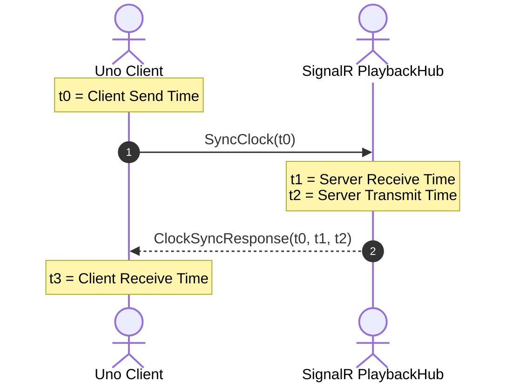
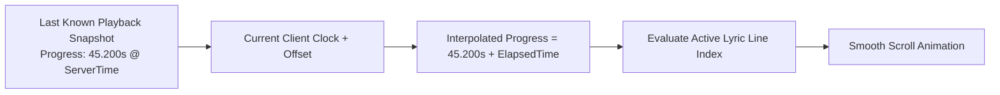

# NTP Clock Synchronization

Synchronized lyrics require timing precision within tens of milliseconds. Because browser and device system clocks can drift significantly relative to the server and audio source, Cantus implements an **NTP-style 4-timestamp clock synchronization protocol** over SignalR.

---

## Why Clock Synchronization Matters

When Spotify reports that a track is at progress `01:45.320` at timestamp $T$, the client must accurately render the exact millisecond position as time elapses.

Without clock synchronization:
- Client system clock drift creates noticeable desynchronization (lyrics advancing too fast or too slow).
- Variable network round-trip latency introduces jitter when playback updates arrive.

---

## The 4-Timestamp Synchronization Algorithm

Cantus uses the standard Network Time Protocol (NTP) round-trip model:

1. **Client Send ($t_0$)**: Client records its local Unix time in milliseconds ($t_0$) and sends `SyncClock(t0)` to the hub.
2. **Server Receive ($t_1$)**: Server captures timestamp ($t_1$) upon receiving the frame.
3. **Server Transmit ($t_2$)**: Server captures timestamp ($t_2$) as it transmits the response payload containing $(t_0, t_1, t_2)$.
4. **Client Receive ($t_3$)**: Client captures timestamp ($t_3$) when the response arrives.

---

## Offset and Jitter Filtering

From these four timestamps, Cantus calculates two core metrics:

1. **Round-Trip Delay ($\delta$)**:

    $$\delta = (t_3 - t_0) - (t_2 - t_1)$$

    Measures pure network transit time excluding server processing overhead.

2. **Clock Offset ($\theta$)**:

    $$\theta = \frac{(t_1 - t_0) + (t_2 - t_3)}{2}$$

    Represents how much the client clock leads or lags behind the server clock.

A negative round-trip delay (for example after a client clock step) is clamped to `0`. The offset is computed in whole milliseconds and truncated toward zero.

In code, `SignalRPlaybackClient.SyncClockAsync` takes the four timestamps (named `t1` to `t4` there, for $t_0$ to $t_3$ here) and hands them to `ClockOffsetEstimator`, which owns the math and the filter below. The client's `RttMs` and `ClockOffsetMs` read the estimator's current values (both `0` before the first sample).

### Jitter Filter

`ClockOffsetEstimator.AddSample` updates the estimate on every sample:

- The last 5 samples are kept (`MAX_NTP_SAMPLES`); older ones are dropped.
- The first sample is taken directly as the round-trip delay and offset.
- With 3 or more samples, the single sample with the highest round-trip delay (the first one on a tie) is discarded as a spike.
- The remaining samples are averaged, weighted by inverse round-trip delay ($1 / \max(1, \delta)$), so low-latency samples count more.
- The result is smoothed with an exponential moving average ($\alpha = 0.35$) against the previous estimate, so drift is tracked without visual jumps.

The client syncs as soon as it connects and then every 5 seconds.

---

## Continuous Playback Interpolation

Once the offset is known, the client runs a 60 FPS UI animation timer:

This ensures fluid, 60fps lyric scrolling even when Spotify polling updates arrive every 500ms over the network.
