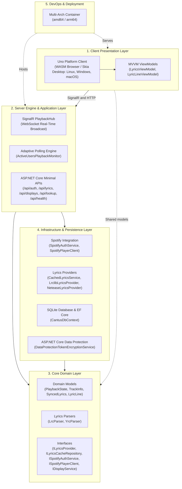

# System Architecture Overview

Cantus is built following **Clean Architecture** principles to separate concerns, ensure testability, and isolate external third-party dependencies (such as the Spotify Web API, LRCLIB and NetEase) from core domain business logic.

---

## 5-Layer Architectural Design

The system is organized into five distinct layers:

---

## Architectural Layers Explained

### 1. Client Presentation (Uno Platform)
- **Technology**: Uno Platform (C# / XAML), Skia desktop (Linux, Windows, macOS), WebAssembly. The client references `Cantus.Core` directly for shared models and parsers.
- **Responsibilities**: Renders scrolling lyrics at about 60 FPS, extracts dynamic color palettes from album artwork, interpolates the playback position from the NTP-corrected clock, and dispatches UI events.

### 2. Server Engine & Real-Time Hub (ASP.NET Core)
- **Technology**: ASP.NET Core 10 Minimal APIs, Microsoft SignalR.
- **Responsibilities**: Tracks each owner's connected Session and Display connections, manages the background adaptive polling engine (featuring end-of-track acceleration, graduated backoff, client tab visibility throttling, and on-demand refresh), orchestrates Spotify token renewal, and handles 4-timestamp NTP clock sync pings.

### 3. Core Domain Models & Contracts
- **Technology**: `net10.0` class library. Its only package references are `Microsoft.Extensions.DependencyInjection.Abstractions` and `Microsoft.Extensions.Logging.Abstractions`.
- **Responsibilities**: Contains domain models (`PlaybackState`, `TrackInfo`, `SyncedLyrics`, `LyricLine`, `UserSession`, `DisplayInfo`, `LyricsOverride`), lyrics parsers (`LrcParser`, `YrcParser`), the song lookup scorer (`Cantus.Core/Search`), logging attributes (`[TraceLog]`, `[Redact]`), and provider and repository contracts.

### 4. Infrastructure & External Services
- **Technology**: Entity Framework Core with SQLite, ASP.NET Core Data Protection, `HttpClient`.
- **Responsibilities**: Implements Spotify OAuth PKCE exchanges and token renewal, queries LRCLIB (exact lookup, then search) with NetEase as a fallback, manages the SQLite lyrics cache with 30-day negative caching for tracks no provider has, looks up covers in MusicBrainz and the Cover Art Archive for Local Session tracks that arrive without one, stores owner overrides and Displays, and encrypts OAuth tokens at rest.

### 5. DevOps & Containerization
- **Technology**: Multi-stage Docker build, Docker Compose, GitHub Actions.
- **Responsibilities**: Compiles the Uno WebAssembly static bundle and ASP.NET Core backend into a single unified container for effortless self-hosting.

### Source Generator
A fifth project, `Cantus.Generators`, is a Roslyn source generator (`TraceLogDecoratorGenerator`) that the other four reference as an analyzer. For each interface marked `[TraceLog]` it emits a decorator that logs calls and timings at the trace log level, masking parameters marked `[Redact]`.

---

## Core Conceptual Deep Dives

To explore specific subsystems in depth:

- [**NTP Clock Synchronization**](ntp-clock-sync.md): How Cantus estimates the offset between client and server clocks.
- [**Adaptive Polling Engine**](adaptive-polling.md): How Cantus tracks Spotify playback efficiently without exceeding API rate limits.
- [**Multi-Tier Lyrics Caching**](lyrics-caching.md): How lyrics are resolved, cached, and validated.
- [**Cover Art Lookup for Local Sessions**](cover-art.md): How a track with no cover gets one from an open catalogue without delaying playback.
- [**Uno Platform Client Architecture**](client-uno.md): How the MVVM pattern and cross-platform UI rendering work under the hood.
