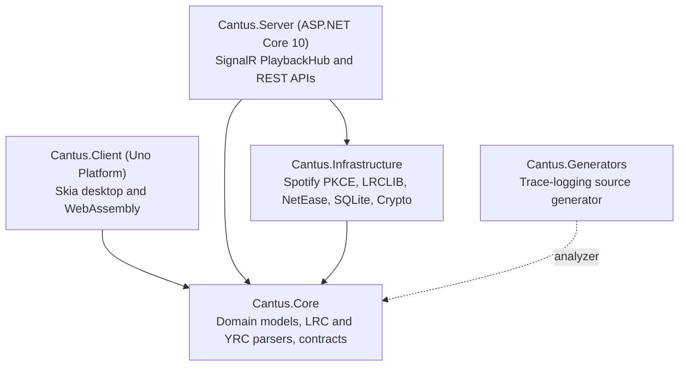

# Contributing to Cantus

Thank you for your interest in contributing to Cantus! We welcome contributions of all kinds, from reporting bugs and improving documentation to submitting bug fixes and proposing new features.

---

## Code of Conduct

Cantus is an open-source project that thrives on respectful, constructive collaboration. Please ensure that all interactions across discussions, issues, and pull requests remain professional and welcoming to developers of all backgrounds.

---

## Ways to Contribute

You can contribute to Cantus in several ways:

- **Bug Reports**: Open an issue if you discover a timing bug, rendering defect, or crash.
- **Feature Requests**: Share ideas for new UI visualizers, additional lyrics providers, or platform targets.
- **Code Contributions**: Submit pull requests for bug fixes, performance optimizations, or new capabilities.
- **Documentation**: Help improve guides, clarify setup steps, or fix typos.

---

## Development Setup & Prerequisites

### Prerequisites

To build and run Cantus locally, ensure you have the following installed:

1. **.NET 10 SDK** (`10.0.100` or a later feature band, as pinned in `global.json`, which also pins `Uno.Sdk` `6.5.36`):
   ```bash
   dotnet --version
   ```
2. **Uno Platform WebAssembly Workload** (if developing for the Web client):
   ```bash
   dotnet workload install wasm-tools
   ```
3. **Spotify Developer Account** (Free):
   - Create a free developer application at [developer.spotify.com/dashboard](https://developer.spotify.com/dashboard) to obtain a **Client ID**.
   - Add `http://127.0.0.1:5000/api/auth/spotify/callback` to your Spotify App's **Redirect URIs**. Spotify rejects `http://localhost`, so open Cantus at `http://127.0.0.1:5000` when testing sign-in.
4. **Docker** (Optional): For running containerized tests or smoke tests.

### Getting the Code

1. Fork the [Cantus repository](https://github.com/jav76/Cantus) on GitHub.
2. Clone your fork locally:
   ```bash
   git clone https://github.com/<your-username>/Cantus.git
   cd Cantus
   ```
3. Create a descriptive feature branch:
   ```bash
   git checkout -b feature/my-new-feature
   ```

### Local Environment Configuration

For Docker Compose, copy the example environment file and add your Spotify Client ID:

```bash
cp .env.example .env
```

```ini
Spotify__ClientId=your_32_character_client_id
CANTUS_HOST_URL=http://127.0.0.1:5000
```

`dotnet run` does not read `.env`. For a local server run, export the same variables in your shell first. `ASPNETCORE_ENVIRONMENT=Development` keeps the database (`cantus.db`) in the working directory; without it the server runs as Production and uses `/app/data/cantus.db`:

```bash
export Spotify__ClientId=your_32_character_client_id
export CANTUS_HOST_URL=http://127.0.0.1:5000
export ASPNETCORE_ENVIRONMENT=Development
```

---

## Solution Structure & Architecture

Cantus follows **Clean Architecture**. `Cantus.slnx` holds five `src/` projects and four test projects:



- **`src/Cantus.Core`**: Domain models (`PlaybackState`, `SyncedLyrics`, `LyricLine`), `LrcParser` and `YrcParser`, and interface definitions. Depends only on the `Microsoft.Extensions` DI and logging abstractions.
- **`src/Cantus.Generators`**: Roslyn source generator for the `[TraceLog]` decorators (`TraceLogDecoratorGenerator`), referenced as an analyzer.
- **`src/Cantus.Infrastructure`**: Spotify Web API client, LRCLIB and NetEase lyrics providers, SQLite persistence (`CantusDbContext`), and Data Protection encryption.
- **`src/Cantus.Server`**: ASP.NET Core application hosting the SignalR `PlaybackHub`, background `ActiveUsersPlaybackMonitor`, and Minimal API endpoints.
- **`src/Cantus.Client`**: Cross-platform MVVM client targeting the Skia desktop head (`net10.0-desktop`: Linux, Windows, macOS) and WebAssembly (`net10.0-browserwasm`). On Windows hosts it also has a WinUI target (`net10.0-windows10.0.26100`).

---

## Building and Running Locally

### 1. Build the Entire Solution

```bash
dotnet build Cantus.slnx
```

### 2. Run the ASP.NET Core Server

Start the backend server on `http://localhost:5000`:

```bash
dotnet run --project src/Cantus.Server
```

To enable detailed logs, pass `--log-configuration` (`-l`) with `none`, `debug` or `trace`, or set `CANTUS_LOG_CONFIGURATION`:

```bash
dotnet run --project src/Cantus.Server -- --log-configuration debug
```

### 3. Run the Desktop Client

Launch the Uno Platform Skia desktop window:

```bash
dotnet run --project src/Cantus.Client/Cantus.Client/Cantus.Client.csproj -f net10.0-desktop
```

### 4. Run the WebAssembly Client

To build and serve the WebAssembly client through the ASP.NET Core server:

```bash
# Publish WASM assets, then copy the publish output's wwwroot into the server's web root
dotnet publish src/Cantus.Client/Cantus.Client/Cantus.Client.csproj -f net10.0-browserwasm -c Release -o ./wasm_dist
mkdir -p src/Cantus.Server/wwwroot
cp -r ./wasm_dist/wwwroot/* src/Cantus.Server/wwwroot/

# Start server and navigate to http://127.0.0.1:5000
dotnet run --project src/Cantus.Server
```

---

## Running Automated Tests

Before opening a pull request, ensure all unit and integration test suites pass:

```bash
# Run all tests
dotnet test Cantus.slnx

# Run tests with detailed console logger
dotnet test Cantus.slnx --logger "console;verbosity=normal"
```

CI runs the same suite in Release: `dotnet build Cantus.slnx --configuration Release`, then `dotnet test Cantus.slnx --configuration Release --no-build`.

Unit and integration tests reside in `tests/`:
- `tests/Cantus.Core.Tests`: LRC and YRC parsers, domain models, the trace-log source generator.
- `tests/Cantus.Infrastructure.Tests`: Lyrics providers and caching, overrides, Spotify clients, token encryption, SQLite persistence, logging.
- `tests/Cantus.Client.Tests`: View models, SignalR client and jitter filter, theme manager, color quantizer, responsive layout, local settings.
- `tests/Cantus.Server.Tests`: SignalR hub, REST API endpoints, Display pairing and credentials, adaptive poller.

### Previewing the Docs

The docs site is MkDocs Material. Serve it locally on `http://localhost:8000`:

```bash
docker compose -f docker-compose.docs.yml up
```

---

## Coding Standards & Style Conventions

Cantus follows strict C# code quality guidelines. Please keep the following rules in mind:

### 1. Explicit Types over `var`
Do not use `var` for local variable declarations. Always use the explicit type:
```csharp
// Correct
string trackTitle = "Never Gonna Give You Up";
int durationMs = 213000;
List<LyricLine> lines = new();

// Avoid
var trackTitle = "Never Gonna Give You Up";
```

### 2. Target-Typed `new()`
When the explicit type is declared on the left-hand side, use target-typed `new()`:
```csharp
// Correct
Dictionary<string, CachedTrack> cache = new();
PlaybackState state = new(trackId, progressMs);

// Avoid
Dictionary<string, CachedTrack> cache = new Dictionary<string, CachedTrack>();
```

### 3. File-Scoped Namespaces
Always use file-scoped namespace declarations:
```csharp
namespace Cantus.Core.Models;
```

### 4. Allman Bracing Style
Place opening braces `{` on their own line:
```csharp
public void UpdateProgress(long progressMs)
{
    if (progressMs < 0)
    {
        return;
    }
}
```

### 5. Structured Logging
Never use string interpolation inside `ILogger` calls. Use semantic message templates:
```csharp
// Correct
_logger.LogInformation("Display {DisplayId} paired to connection {ConnectionId}", displayId, connectionId);

// Avoid
_logger.LogInformation($"Display {displayId} paired to connection {connectionId}");
```

### 6. Code Formatting
Format your code before committing using `dotnet format`:
```bash
dotnet format Cantus.slnx
```

---

## Submitting a Pull Request (PR)

### PR Checklist

Before submitting your pull request, verify that:

- [ ] Code builds without errors or warnings (`dotnet build Cantus.slnx --configuration Release`).
- [ ] All unit and integration tests pass (`dotnet test Cantus.slnx`).
- [ ] Code conforms to repository formatting standards (`dotnet format`).
- [ ] New functionality or bug fixes include corresponding unit or integration tests.
- [ ] Commit messages and PR titles are clear, descriptive, and follow conventional commit formats (e.g. `feat: ...`, `fix: ...`, `docs: ...`).

### Opening the PR

1. Push your branch to your GitHub fork:
   ```bash
   git push origin feature/my-new-feature
   ```
2. Navigate to [github.com/jav76/Cantus](https://github.com/jav76/Cantus) and click **Compare & pull request**.
3. Fill out the PR template with a clear explanation of what changed, why, and how it was tested.
4. If your PR resolves an existing issue, link it in the description (e.g. `Closes #12`).
5. CI builds and tests the solution, runs a Docker build smoke test, and reports formatting (`dotnet format --verify-no-changes`) as a non-blocking advisory.

---

## Reporting Issues

If you find a bug or experience unexpected behavior:

1. Check existing [GitHub Issues](https://github.com/jav76/Cantus/issues) to see if the issue has already been reported.
2. Open a new issue with:
   - A clear, descriptive title.
   - Exact steps to reproduce the behavior.
   - Expected vs. actual behavior.
   - Relevant environment details (OS, browser/client type, Docker setup).
   - Server or client logs (use `--log-configuration debug`, or open the Diagnostics HUD from its button in the client's header bar).
