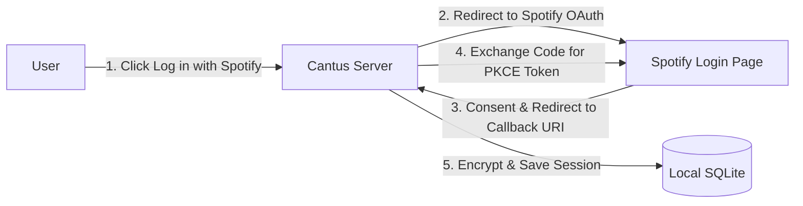

# Spotify Developer App Setup

To allow Cantus to securely communicate with the Spotify Web API and track playback on behalf of users, you must register a free application in the Spotify Developer Dashboard.

---

## 1. Create a Spotify Developer Application

1. Open the [Spotify Developer Dashboard](https://developer.spotify.com/dashboard) and log in with your Spotify account.
2. Click **Create App** (top right).
3. Fill in the application details:
   - **App Name**: `Cantus Lyrics Display` (or your preferred name)
   - **App Description**: `Self-hosted synchronized lyrics display platform`
   - **Redirect URIs**: (See section below)
   - **Which APIs/SDKs are you planning to use?**: Select **Web API**.
4. Check the terms of service checkbox and click **Save**.

---

## 2. Configure Redirect URIs

Cantus uses OAuth 2.0 Authorization Code Flow with **PKCE** (Proof Key for Code Exchange). Spotify requires exact URI matching for callback redirects.

Add your callback URLs to the **Redirect URIs** list in your app settings. Cantus always sends `<base URL>/api/auth/spotify/callback`, where the base URL is the browser's address when you open Cantus on `localhost` or `127.0.0.1`, otherwise `CANTUS_HOST_URL`, otherwise the address the request arrived at:

| Environment | Redirect URI |
| :--- | :--- |
| **Same machine (loopback)** | `http://127.0.0.1:5000/api/auth/spotify/callback` |
| **Production Domain (HTTPS)** | `https://cantus.yourdomain.com/api/auth/spotify/callback` |

Spotify only accepts `http://` on loopback IPs (`127.0.0.1` or `[::1]`). It rejects `http://localhost` and plain `http://` LAN addresses such as `http://192.168.1.100:5000`, so open Cantus at `http://127.0.0.1:5000` locally and put LAN or internet access behind HTTPS ([Reverse Proxy](reverse-proxy.md)).



!!! warning "Strict Redirect URI Matching"
    The redirect URI in your Spotify Developer Dashboard must **exactly match** `${CANTUS_HOST_URL}/api/auth/spotify/callback`, including protocol (`http://` vs `https://`) and port. A trailing slash on `CANTUS_HOST_URL` is removed. You can add several redirect URIs in the dashboard (e.g. both `http://127.0.0.1:5000/api/auth/spotify/callback` and your HTTPS domain). `Spotify__RedirectUri` overrides the callback only when `CANTUS_HOST_URL` is unset (see [Configuration](../reference/configuration.md#spotify-authentication)).

---

## 3. Retrieve Your Client ID

1. In your Spotify Developer App dashboard, click **Settings**.
2. Locate the **Client ID** (a 32-character hexadecimal string).
3. Set it as `Spotify__ClientId`, either in the compose `environment:` list or in a `.env` file next to the repository's `docker-compose.yml`:
   ```ini
   Spotify__ClientId=abcdef0123456789abcdef0123456789
   ```

!!! note "PKCE Flow Security"
    Because Cantus uses the **PKCE** extension, a Client Secret is **not** required or used. `Spotify__ClientSecret` is accepted but ignored.

---

## 4. User Quotas & Spotify Development Mode

New Spotify apps run in **Development Mode**, and Spotify's rules for it (since February 2026) are:

- **Up to 5 users** per app. Each must be added by name and Spotify email under **User Management** in the app's settings. Anyone else can open the Spotify consent screen, but the sign-in then fails with "Your account is not on this app's user list".
- **The app owner needs Spotify Premium**, or the app stops working for everyone.
- **Extended Quota Mode** (more users) is only open to registered organisations with at least 250,000 monthly active users, so a self-hosted server cannot get it.

To serve more than 5 people, let them sign in with their own Spotify app (next section).

---

## 5. Users' Own Spotify Apps

A user can sign in with a Spotify app they create themselves, by pasting its Client ID into the **Connect Spotify** screen. That user then counts against their own app's limit, not yours. PKCE means a Client ID is not a secret, so Cantus stores it in plain text with their Session and on their device.

`Spotify__AllowUserClientIds` controls it:

| `Spotify__ClientId` | `Spotify__AllowUserClientIds` | Own apps |
| :--- | :--- | :--- |
| unset | unset | **Allowed** (the only way to sign in) |
| set | unset | Off: only your allowlisted users can sign in |
| either | `true` | Allowed |
| either | `false` | Off |

!!! warning "Who can sign in"
    With own apps allowed, Spotify's allowlist no longer limits who can sign in to your server: anyone who can reach it and has a Spotify app can. Each signed-in user adds Spotify polling and lyrics lookups. On a server reachable from the internet, keep own apps off unless you want open sign-up.

Every user's own app needs the same redirect URI as yours, `<base URL>/api/auth/spotify/callback`. The Connect Spotify screen shows it with a copy button and warns when Spotify will refuse it (plain `http://` on anything but `127.0.0.1`). The user steps are in [Connect Spotify](../user-guide/connect-spotify.md).
