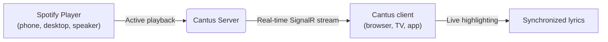

# User Guide Overview

Welcome to the Cantus user guide. Cantus turns any screen (your desktop monitor, tablet, living room smart TV, or home entertainment center) into a real-time synchronized lyrics display for your Spotify playback.

---

## What is Cantus?

Cantus connects to your Spotify account using Spotify's OAuth 2.0 PKCE sign-in. Once signed in, Cantus monitors your active playback and shows synchronized lyrics that scroll in time with the music, with word-by-word karaoke fill when the lyrics carry word timing.

---

## Key User Features

- **Multiple Screens & Paired Displays**: Any number of screens can follow your Spotify playback at once. Sign in on your own devices, and pair shared screens such as a family TV as view-only [Displays](displays.md) that never hold your Spotify sign-in.
- **Smooth Karaoke Scrolling**: Lyrics scroll to keep the active line centered, and fill word by word when word timing is available.
- **Audio Delay Calibration**: Set a per-device latency compensation for Bluetooth or AirPlay speakers, and a per-track offset for lyrics that are timed early or late.
- **Dynamic Artwork Palette Theming**: The ambient backdrop and accent colors adapt to the album artwork of the current track.
- **Find a Song by Lyrics**: Type a half-remembered line to find the song, then play or queue it.
- **Instrumental Break Detection**: Shows an instrumental countdown during long gaps between lines.
- **Privacy First**: Your Spotify tokens are stored encrypted on your own server, and Cantus sends no telemetry. Track title, artist, album and duration are sent to the lyrics providers (LRCLIB, and NetEase when enabled) to look up lyrics.

---

## User Guide Topics

Explore the sections below to get the most out of your Cantus setup:

1. [**Playback & Display Modes**](playback-and-display.md): Fullscreen mode, TV/kiosk setup, responsive layouts, and keyboard shortcuts.
2. [**Pairing & Managing Displays**](displays.md): Pair a TV or other shared screen from your phone, then rename or remove it.
3. [**Timing & Latency Calibration**](timing-and-calibration.md): Fine-tuning millisecond offsets for Bluetooth, AirPlay, and soundbars.
4. [**Dynamic Theming & Visuals**](theming.md): Theme modes, album palette generation, and lyric animation states.
5. [**Find a Song by Lyrics**](song-lookup.md): Look up a song from a line you remember, then play or queue it on Spotify.
