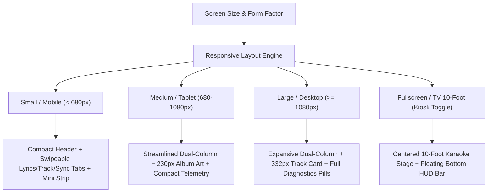

# Playback & Display Modes

Cantus is engineered to deliver a seamless, distraction-free lyrics display across any screen format, from a secondary desktop monitor to a dedicated living room TV kiosk.

---

## Responsive Multi-Form-Factor Layouts

Cantus features a dynamic responsive layout engine that automatically and fluidly adapts to any screen size and aspect ratio:



### Form Factor Specifications

| Form Factor | Breakpoint | Header Mode | Track Card | Lyrics Stage | Navigation |
| :--- | :--- | :--- | :--- | :--- | :--- |
| **Small (Mobile)** | `< 680px` | Minimal + Overflow Flyout | Compact 56px thumbnail strip or dedicated tab | Touch-focused, 24px active line | 3-Tab Bottom Bar (Lyrics / Track / Sync & Info) |
| **Medium (Tablet)** | `680px - 1079px` | Compact status + quick action icons | Side-by-side 290px rail with 230px artwork, in landscape and portrait | Balanced 32px active line | Dual-pane workspace |
| **Large (Desktop)** | `>= 1080px` | Full telemetry pills + actions | Expansive 380px card with 332px artwork | Grand 38px active line with smooth auto-scroll | Dual-column workspace |
| **Fullscreen (TV)** | Kiosk toggle (<kbd>K</kbd> / <kbd>F11</kbd>) | Hidden | Floating minimal 10-foot HUD | Centered 50px high-contrast karaoke lyrics | Keyboard / remote navigation |

### Narrow Windows

Inside each layout, controls shrink before they overflow:

- **Large header:** the telemetry pills (connection, RTT, skew, poller) are hidden from the right when they do not fit, so the connection pill goes last. Below 1200px the **Find Song** and **Theme** buttons become icon-only and the brand subtitle is hidden. A long account name on the Spotify button is trimmed; hover it for the full name.
- **Track card:** the album art shrinks to fit the card. A long device name is trimmed; hover it for the full name.
- **Lyrics stage:** when the stage is narrower than 420px, the Karaoke, Autoscroll and Static/Live buttons become icon-only (hover for the tooltip). The theme toast shows at the top of the lyrics, not beside these buttons.
- **Phones under 380px:** the mobile tab bar stacks each icon above its label, and the now-playing strip drops its timestamp and offset column.
- **Kiosk mini bar:** long titles are trimmed. Below 700px the timestamp is hidden and **Exit Kiosk** becomes an icon, so it always stays on screen. Kiosk padding also shrinks on phone widths.
- **Diagnostics HUD:** drops its 420px minimum width on small screens.
- **Desktop app:** the window cannot be made smaller than 360 x 560.

On small layouts the header keeps only the brand, the connection dot, the Spotify button (owners only) and an overflow menu (**≡**). The overflow menu holds **Find Song by Lyrics** (owners only), **Theme** (a submenu with every theme and the **Post-processing effects** toggle), **Diagnostics HUD**, **Fullscreen Kiosk**, **Switch Mobile View** and **Log Out** (owners only).

---

## Auto-Scrolling & Interactive Controls

Cantus combines automated karaoke-style tracking with full manual freedom:

### 1. Dynamic Auto-Centering
During playback, the lyrics stage dynamically scrolls to maintain the active singing line in the optical center of the display. Padding at the top and bottom of the container dynamically adjusts based on viewport height so the first and last lines can be centered comfortably.

### 2. Manual Scroll Detection & Free Browsing
If you want to read ahead or check previous lyrics:
- Simply scroll using your mouse wheel, trackpad gesture, or touchscreen drag.
- Cantus immediately detects user intervention and sets auto-scroll to **Paused**.
- The active line continues to highlight in time with the music, but the scroll position will not jump or fight against your scrolling.

### 3. Floating Resume Button & 3-Second Auto-Resume
When manual scrolling pauses the display:
- A floating **Resume Autoscroll** pill button appears at the bottom-center of the stage.
- If no scrolling interaction occurs for **3 seconds**, Cantus automatically resumes auto-scrolling with a smooth transition back to the currently active line.
- You can also tap the floating **Resume** button at any time to re-center immediately.

### 4. Karaoke Underline
With the **Karaoke** toggle on, an underline fills beneath the active line:
- **Word-timed lyrics**: the underline follows each word as it is sung, pauses during rests inside the line, and moves slowly through held notes.
- **Line-timed lyrics**: the underline fills evenly over the line's duration. It does not track individual words.

### 5. Fixing Wrong Lyrics
If a track shows the wrong lyrics, or none:
- Tap **Wrong lyrics?** on the track card. On a phone it is on the **Sync & Info** tab.
- Cantus lists the lyrics each provider has for the track, with the provider, title, artist, length, whether the lyrics are synced or plain, and their first lines. Tap one to use it.
- **Re-fetch automatically** looks the track up again. **No lyrics** shows an empty lyrics view for the track.
- If you already picked lyrics for the track, the picker says so and offers **Use automatic lyrics** to undo it.
- Your choice applies to every screen showing the track, without a reload, and is kept until you change it.
- The button appears only while you are signed in and a track is playing. A [paired Display](displays.md) never shows it.

---

## Display Environments

### 1. Smart TV & Kiosk Display

To use Cantus as an ambient music visualizer on a TV or dedicated Raspberry Pi display:

1. Open your browser on the smart TV (or launch a Chromium kiosk on Raspberry Pi) to your Cantus URL: `http://<your-server-ip>:5000`.
2. Sign in with Spotify, or [pair the screen as a Display](displays.md) so it never holds your account.
3. Enter fullscreen mode (press <kbd>F11</kbd> or use the TV browser's fullscreen button).
4. Press <kbd>K</kbd> (or <kbd>F11</kbd> in the app) to switch into the 10-foot kiosk lyrics stage. Kiosk mode is an explicit toggle, so large monitors keep the full desktop controls unless you opt in; press <kbd>Esc</kbd> to exit.

!!! tip "Raspberry Pi & Kiosk Launch"
    If using a Raspberry Pi or wall tablet, launch Chromium in kiosk mode:
    ```bash
    chromium-browser --kiosk --noerrdialogs --disable-infobars http://cantus.local:5000
    ```

---

### 2. Pairing a Screen as a Display

A **Display** is a screen that shows your lyrics and playback without signing in to Spotify on it. It holds its own view-only Display token, so a shared TV never gets your account's full rights. Choose **Pair as display** on the screen and approve its code from a signed-in phone or computer.

See [Pairing & Managing Displays](displays.md) for the full steps, what a Display can and cannot do, and how to rename or remove one.

---

## Keyboard Shortcuts

When the Cantus window is focused, and focus is not in a text field, these keys work:

| Key | Action | Description |
| :--- | :--- | :--- |
| <kbd>K</kbd> / <kbd>F11</kbd> | **Toggle Kiosk Mode** | Switches between the normal layout and the 10-foot kiosk lyrics stage. It does not change browser fullscreen. |
| <kbd>Esc</kbd> | **Exit Kiosk Mode** | Leaves the kiosk stage. |
| <kbd>[</kbd> | **Lyrics Earlier (-50ms)** | Lowers this device's latency compensation, so lyrics render earlier. Use it when lyrics trail the audio. |
| <kbd>]</kbd> | **Lyrics Later (+50ms)** | Raises this device's latency compensation, so lyrics render later. Use it when lyrics run ahead of the audio. |
| <kbd>T</kbd> | **Cycle Theme** | Switches to the next theme. To pick one directly, use the **Theme** menu in the header. See [Theming](theming.md). |
| <kbd>M</kbd> | **Cycle Mobile Tab** | On small layouts only: moves between the Lyrics, Track and Sync & Info tabs. |

The <kbd>[</kbd> and <kbd>]</kbd> keys change the device-wide latency compensation (`0` to `1000ms`, default `200ms`), not the per-track `SYNC OFFSET`. They also work on a [paired Display](displays.md). See [Timing & Latency Offset Adjustment](timing-and-calibration.md) for how the two adjustments combine. There is no keyboard shortcut to reset either value: use the `SYNC OFFSET` **Reset** button for the track offset.

---

## Diagnostics HUD

Choose the **Diagnostics HUD** button in the header bar (on small layouts, the overflow menu) to open the diagnostics overlay. It shows live metrics useful for debugging latency and connection quality:

- **Status** and **Transport**: the SignalR connection state (`Connected`, `Reconnecting`, `Disconnected`) and transport.
- **RTT / NTP Skew**: the round-trip time and estimated clock offset relative to the server.
- **Latency Compensation**: this device's current compensation, as set with <kbd>[</kbd> and <kbd>]</kbd>.
- **Poller Cadence**: the server-side poll state and interval for the active account.
- **Connected Clients** and **Authorized Accounts**.
- **Active User**, **Device** and **Volume**: the Spotify account and device being followed.
- **App Version** and **Commit SHA**: the build you are running.
