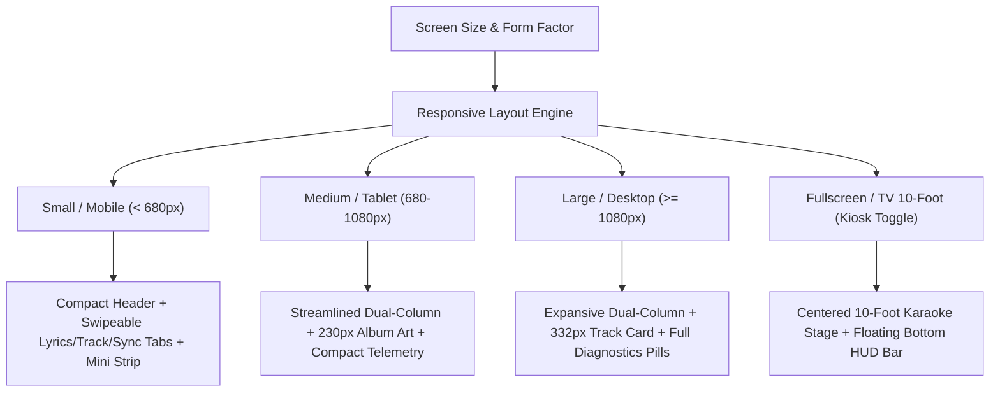

# Playback & Display Modes

Cantus is engineered to deliver a seamless, distraction-free lyrics display across any screen format—from a secondary desktop monitor to a dedicated living room TV kiosk.

---

## Responsive Multi-Form-Factor Layouts

Cantus features a dynamic responsive layout engine that automatically and fluidly adapts to any screen size and aspect ratio:



### Form Factor Specifications

| Form Factor | Breakpoint | Header Mode | Track Card | Lyrics Stage | Navigation |
| :--- | :--- | :--- | :--- | :--- | :--- |
| **Small (Mobile)** | `< 680px` | Minimal + Overflow Flyout | Compact 56px thumbnail strip or dedicated tab | Touch-focused, 24px active line | 3-Tab Bottom Bar (Lyrics / Track / Sync & Info) |
| **Medium (Tablet)** | `680px - 1079px` | Compact status + quick action icons | Side-by-side 290px rail with 230px artwork | Balanced 32px active line | Direct dual-pane or adaptive portrait flow |
| **Large (Desktop)** | `>= 1080px` | Full telemetry pills + actions | Expansive 380px card with 332px artwork | Grand 38px active line with smooth auto-scroll | Dual-column workspace |
| **Fullscreen (TV)** | Kiosk toggle (<kbd>K</kbd> / <kbd>F11</kbd>) | Hidden | Floating minimal 10-foot HUD | Centered 50px high-contrast karaoke lyrics | Keyboard / remote navigation |

---

## Auto-Scrolling & Interactive Controls

Cantus combines automated karaoke-style tracking with full manual freedom:

### 1. Dynamic Auto-Centering
During playback, the lyrics stage dynamically scrolls to maintain the active singing line in the optical center of the display. Padding at the top and bottom of the container dynamically adjusts based on viewport height so the first and last lines can be centered comfortably.

### 2. Manual Scroll Detection & Free Browsing
If you want to read ahead or check previous lyrics:
- Simply scroll using your mouse wheel, trackpad gesture, or touchscreen drag.
- Cantus immediately detects user intervention and sets auto-scroll to **Paused**.
- The active line continues to highlight in time with the music, but the scroll position will not jump or fight against your scrolling.

### 3. Floating Resume Button & 3-Second Auto-Resume
When manual scrolling pauses the display:
- A floating **"Resume Auto-Scroll"** pill button appears at the bottom-center of the stage.
- If no scrolling interaction occurs for **3 seconds**, Cantus automatically resumes auto-scrolling with a smooth transition back to the currently active line.
- You can also tap the floating **Resume** button at any time to re-center immediately.

---

## Display Environments

### 1. Smart TV & Kiosk Display

To use Cantus as an ambient music visualizer on a TV or dedicated Raspberry Pi display:

1. Open your browser on the smart TV (or launch a Chromium kiosk on Raspberry Pi) to your Cantus URL: `http://<your-server-ip>:5000`.
2. Sign in with Spotify, or pair the screen as a Display (see below) so it never holds your account.
3. Enter fullscreen mode (press <kbd>F11</kbd> or use the TV browser's fullscreen button).
4. Press <kbd>K</kbd> (or <kbd>F11</kbd> in the app) to switch into the 10-foot kiosk lyrics stage. Kiosk mode is an explicit toggle, so large monitors keep the full desktop controls unless you opt in; press <kbd>Esc</kbd> to exit.
5. The cursor will auto-hide after 3 seconds of inactivity to keep the display clean.

!!! tip "Raspberry Pi & Kiosk Launch"
    If using a Raspberry Pi or wall tablet, launch Chromium in kiosk mode:
    ```bash
    chromium-browser --kiosk --noerrdialogs --disable-infobars http://cantus.local:5000
    ```

---

### 2. Pairing a Screen as a Display

A **Display** is a screen that shows your lyrics and playback without signing in to Spotify on it. It holds its own view-only Display token, so a shared TV never gets your account's full rights.

1. On the screen, open Cantus and choose **Pair as display** in the Spotify account card (on mobile layouts it is under the **Sync & Info** tab).
2. The screen shows a short code in large type and a QR code. The QR opens `http://<your-server>/?pair=<CODE>` on this Cantus server.
3. On a phone or computer signed in to Cantus, scan the QR, or choose **Add display** in the **Displays** card and type the code. Give the screen a name (1 to 64 characters, such as "Living room TV") and choose **Approve**. The Displays card is under the Spotify account card, and under the **Sync & Info** tab on mobile layouts.
4. The screen switches to the lyrics view by itself. It stores its token on the device (browser storage on the web app, local settings on the desktop app), so it reconnects as the same Display after a restart.

Codes expire after 5 minutes by default. The screen requests a new one when the code expires or its connection to the server drops, so a waiting screen always shows a code that works.

A paired Display is view only. It hides the transport controls, seeking, sync offset steppers and account actions, and it shows which Display it is instead. Device latency is a setting of the screen itself, so a Display keeps the **Device Latency** controls and the <kbd>[</kbd> and <kbd>]</kbd> shortcuts to correct a TV's own lag.

If the QR opens Cantus in a browser that is not signed in, the prompt asks you to sign in first. Signing in leaves the page, so once you are back, choose **Add display** and type the code shown on the screen.

#### Managing your Displays

The **Displays** card lists every screen paired to your account with when it last connected. Use the pencil button to rename a Display and the trash button to remove it. Removing a Display disconnects it right away and leaves your own sign-in and your other Displays alone; the screen has to be paired again.

The list refreshes after each change you make, when you sign in, and when you open the **Sync & Info** tab on mobile. Changes made on another device appear after that, or when you press the refresh button.

If the owner revokes the Display, the screen discards its token at once and returns to the pairing screen with a message saying why. If the server stops accepting the token, the screen keeps it through a few retries (a server restart can refuse it briefly) and then does the same. Pair it again to keep showing lyrics.

!!! note "Desktop app as a Display"
    The QR and the address under the code use the server address the desktop app connects to. Start it with `--server-url http://<your-server-ip>:5000` (or `CANTUS_SERVER_URL`) so a phone can reach that address; the default `127.0.0.1` only works on the same machine.

---

## Keyboard Shortcuts

When the Cantus display window is focused, you can use keyboard shortcuts for quick control:

| Key | Action | Description |
| :--- | :--- | :--- |
| <kbd>F11</kbd> / <kbd>F</kbd> | **Toggle Fullscreen** | Expands viewport to fill the entire monitor. |
| <kbd>[</kbd> | **Delay Lyrics (-50ms)** | Decreases timing offset if lyrics are appearing too early. |
| <kbd>]</kbd> | **Advance Lyrics (+50ms)** | Increases timing offset if lyrics are appearing too late. |
| <kbd>0</kbd> | **Reset Calibration** | Resets custom latency offset for the current track to `0ms`. |
| <kbd>D</kbd> | **Toggle Diagnostics HUD** | Shows real-time NTP roundtrip, clock skew, and SignalR latency. |
| <kbd>T</kbd> | **Toggle Theme Mode** | Cycles between Dynamic Cover Art, Dark Slate, and Light themes. |

---

## Diagnostics HUD

Pressing <kbd>D</kbd> opens the built-in Diagnostics HUD overlay. This displays live performance metrics useful for debugging latency and connection quality:

- **SignalR State**: Connection status (`Connected`, `Reconnecting`, `Disconnected`).
- **NTP Clock Offset**: Current estimated clock skew relative to the server (typically `< 2ms`).
- **Round-Trip Delay (RTT)**: WebSocket ping latency.
- **Active Polling Cadence**: Current server-side poll interval for your Spotify account (e.g. `500ms`).
- **Lyrics Source**: LRCLIB query result status (`Direct Hit`, `Fuzzy Match`, `Cache Hit`, `Instrumental`).
