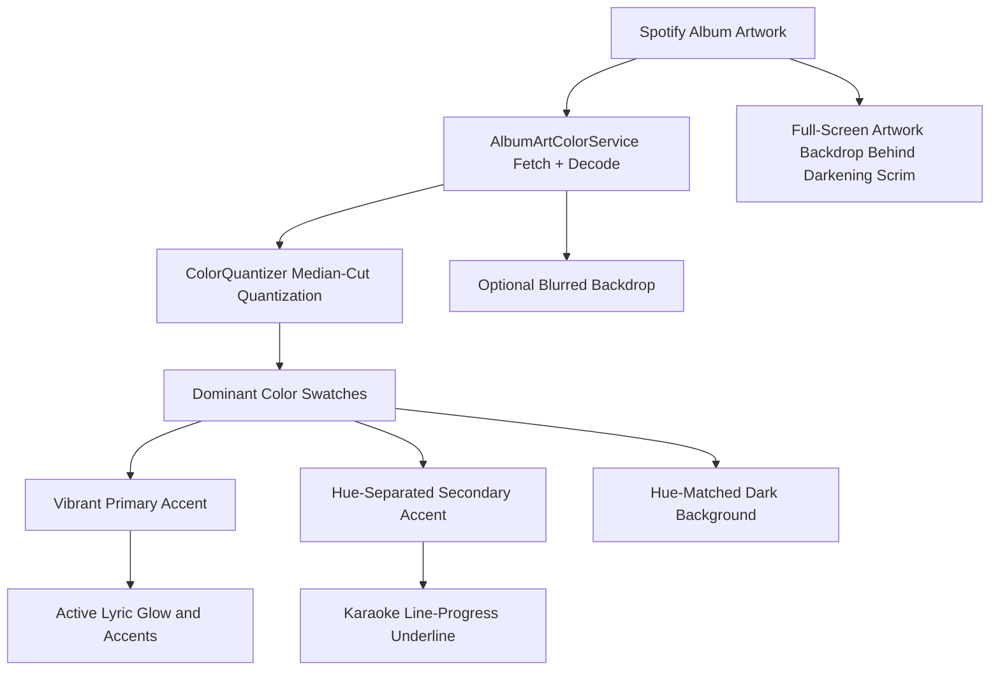
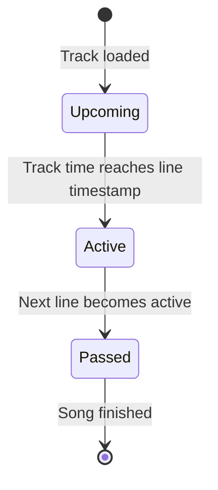

# Dynamic Theming & Visuals

Cantus features a dynamic theming engine that bridges the visual mood of your music with the lyric display.

---

## Dynamic Album Art Palette Extraction

When a new track starts playing with the **Dynamic Palette** theme, Cantus downloads the album artwork directly in the client and extracts a harmonized color palette from its pixels:

### Color Extraction Principles

1. **Median-Cut Quantization**: The artwork is downsampled and quantized into up to eight dominant color swatches. Near-black, near-white, and transparent pixels are excluded so letterboxing and vignettes do not skew the palette.
2. **Vibrancy-Weighted Accent Selection**: The primary accent is the swatch with the best combination of saturation, population, and mid-range lightness. The secondary accent prefers a swatch at least 30 degrees away in hue; grayscale artwork keeps its neutral character instead of being forced into artificial color.
3. **Legibility Clamping**: Accent saturation and lightness are clamped into ranges that keep lyrics crisp against the hue-matched dark background, regardless of how dark or washed out the artwork is.
4. **Ambient Artwork Backdrop**: The full-resolution album cover fills the entire viewport behind a darkening scrim (center-cropped to fit), so different albums produce visibly different backdrops. The lyrics sit straight on this backdrop with no panel behind them, so the scrim is dark enough to keep them readable even on a bright cover. With **Blur album background** on, a softly blurred copy replaces the sharp cover (see [Post-Processing Effects](#post-processing-effects)).
5. **Instant Fallback**: A metadata-derived placeholder palette is applied immediately while extraction runs, and remains active if the artwork cannot be fetched (for example, when offline). The palettes of the last 16 artworks are cached in memory, so revisiting a recent track re-themes instantly.

---

## Available Theme Modes

Pick a theme from either dropdown:

- **Header bar:** the **Theme** button (a palette icon with a small arrow on tablet layouts) opens a menu that lists every theme, with a check next to the active one. On small screens the same list is under **Theme** in the overflow menu.
- **Sync & Info tab (mobile):** the **Color theme** section has a dropdown of all themes.

<kbd>T</kbd> still moves to the next theme in list order: Dynamic Palette, Midnight Violet, Emerald Synth, Cyberpunk Sunset, Nordic Slate, OLED Monochrome, Solarized Dark, then back to Dynamic Palette. Every change shows a short toast with the theme name. The theme choice is not saved: each launch starts on Midnight Violet.

| Theme Mode | Description | Ideal Use Case |
| :--- | :--- | :--- |
| **Dynamic Palette** | Adapts colors, glow, and text highlights to match the current album artwork. | Daily listening, TV living room display, visualizers. |
| **Midnight Violet (Default)** | Deep indigo background with violet accents. | General use, low-light viewing. |
| **Emerald Synth** | Dark slate background with emerald green accents. | Night viewing, low eye strain. |
| **Cyberpunk Sunset** | Dark purple-tinted background with neon rose and amber accents. | High-energy visuals. |
| **Nordic Slate** | Deep slate-navy background with cyan and sky-blue accents. | Subtle, understated displays. |
| **OLED Monochrome** | True-black background with white accents. | OLED displays, burn-in avoidance. |
| **Solarized Dark** | Classic Solarized base tones with blue accents. | Long reading sessions. |

Every theme is dark, and the whole interface follows it: text boxes, menus, dropdowns, checkboxes, progress rings and dialogs (Find a song, Wrong lyrics?, Diagnostics) all switch colours with the theme, without a restart. Labels on accent-coloured buttons and the selected mobile tab turn dark when the accent is light (for example the white accent of OLED Monochrome). With Dynamic Palette, they use whichever of dark or white contrasts more with the album accent, so amber, orange and lime accents get dark labels.

---

## Post-Processing Effects

Optional effects you can combine freely. Each one is off by default.

| Effect | What it does | Applies to |
| :--- | :--- | :--- |
| **Film grain** | Faint animated noise, like old film. | Every theme and kiosk mode |
| **Vignette** | Darkens the window edges and leaves the centre clear. | Every theme and kiosk mode |
| **Scanlines** | Thin, static horizontal lines, like a CRT screen. | Every theme and kiosk mode |
| **Blur album background** | Shows a soft, blurred version of the album cover behind the lyrics instead of the sharp one, with a slightly lighter scrim. | The **Dynamic Palette** theme only |

- Toggle them in the theme menu, below the list of themes (on small screens: overflow menu, **Theme**), or with the checkboxes under **Effects** in the **Color theme** section on the mobile **Sync & Info** tab.
- Each effect is saved per device (browser or desktop install), like the Karaoke toggle, and is not synced to other devices.
- **Blur album background** (labelled **Blur album background (Dynamic theme)** in the theme menu) can be switched on in any theme, but it only changes something in Dynamic Palette, the one theme with an album art backdrop. The sharp cover shows first and the blurred one replaces it a moment later. If the blur fails, the sharp cover stays.
- All effects are subtle, so lyrics stay readable. The grain animation stops while film grain is off.

---

## Lyric Animation States

Each line of synchronized lyrics is in one of three visual states:

- **Upcoming Lines**: 75% opacity, regular weight, in the theme's upcoming-lyric color.
- **Active Line**: 100% opacity, semibold, larger font, in the theme's active-lyric color, centered vertically in the viewport.
- **Passed Lines**: 45% opacity, regular weight, smaller font, scrolled up out of the center.

### Instrumental Breaks

When the gap from the active line to the next one is 8 seconds or more (or before the first line), and at least 3 seconds remain, Cantus shows a countdown such as `♪ Instrumental Interlude (12s) ♪` on the lyrics stage and the track card. It is hidden in static lyrics mode.
